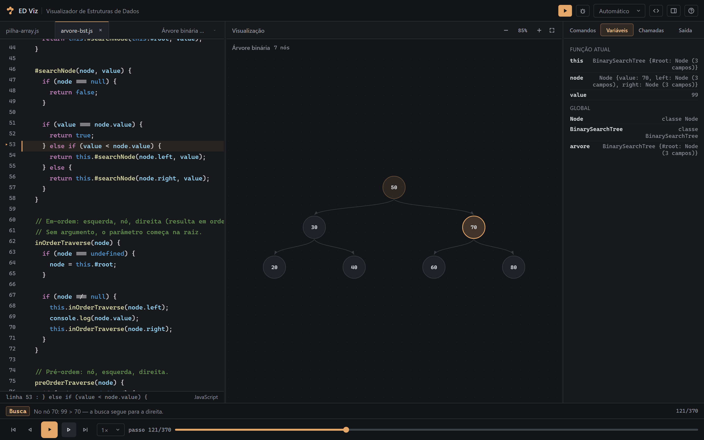
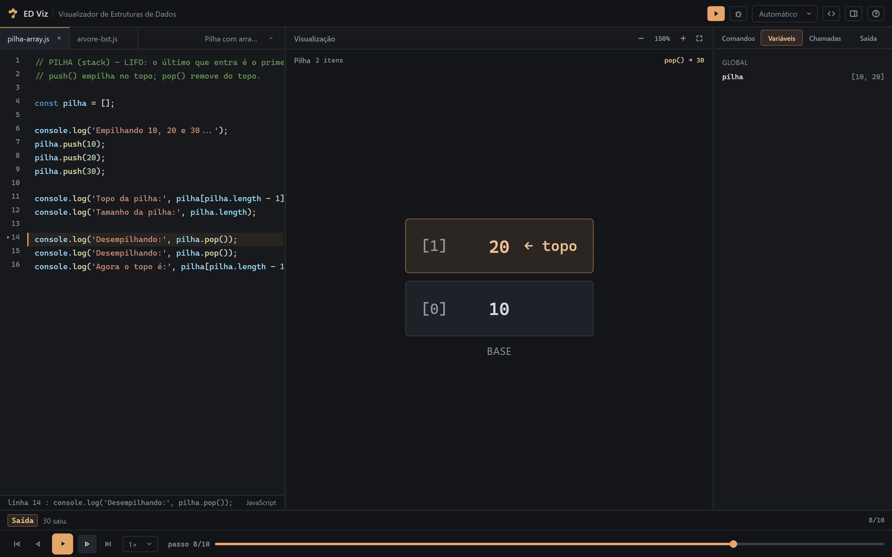
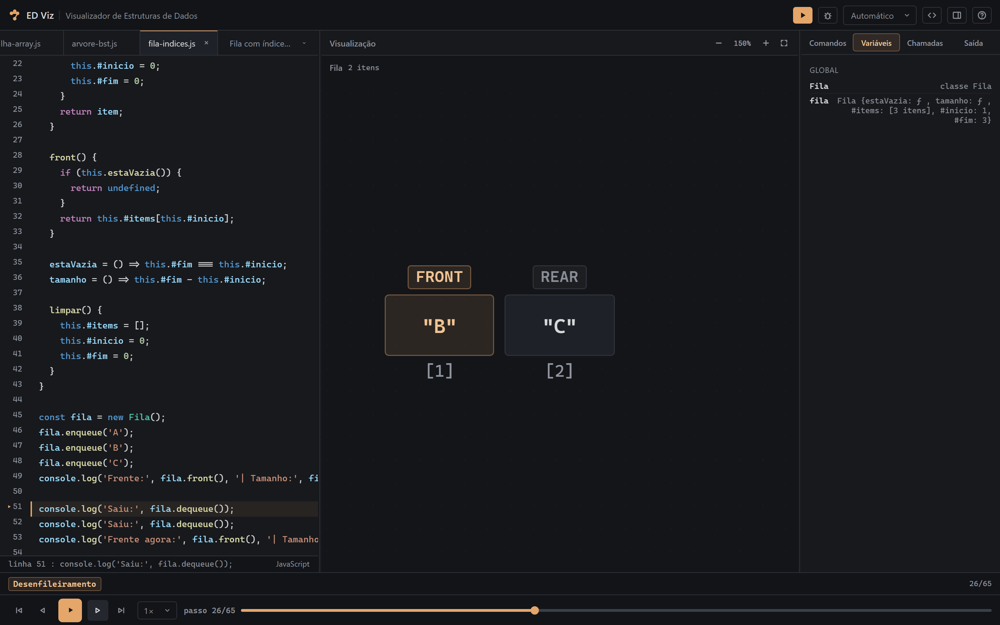
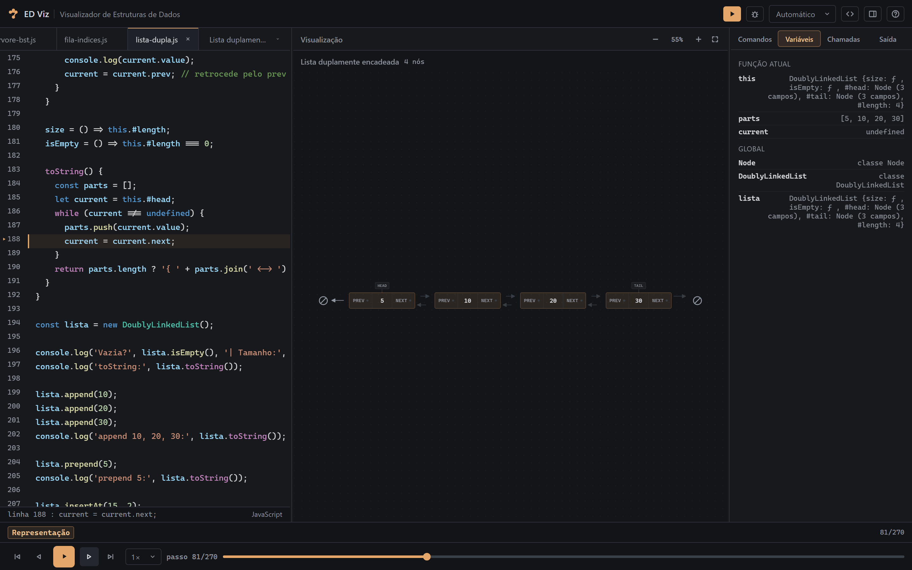

# ED Viz — Visualizador de Estruturas de Dados

> **Escreva (ou escolha) um código JavaScript e veja a estrutura de dados rodar passo a passo** — com a linha em execução destacada, ponteiros, variáveis, pilha de chamadas e a saída do `console`.

[](https://edviz-rouge.vercel.app)
[](LICENSE)


**[▶ Abrir o ED Viz](https://edviz-rouge.vercel.app)** · **[Rodar localmente](#rodando-localmente)** · **[Como foi feito (guia interno)](docs/COMO-FOI-FEITO.md)**



O ED Viz é uma aplicação **estática (HTML/CSS/JS puro)** para aprender estrutura de dados
**vendo o próprio código executar**: você escreve `pilha.push(10)` ou uma classe de árvore e o
portal desenha a estrutura a cada passo, sincronizada com o editor e com os painéis de depuração.

Não precisa instalar nada para usar — nem build, nem backend, nem banco.

## O que você vê

- **A estrutura desenhada e animada** — pilha, fila, lista simples/duplamente encadeada, árvore
  binária ou array (por índice ou com tamanho manual). Elementos deslizam, entram e saem com
  animação (FLIP) para mostrar *o que* mudou.
- **A linha que está executando**, destacada no editor com um `▶` na margem.
- **Os ponteiros** (`atual`, `no`, `raiz`, `inicio`…) etiquetados sobre os nós; na árvore o
  ponteiro ativo é indicado pela **cor do nó**, sem texto.
- **A pilha de chamadas** — essencial para enxergar a recursão de percursos e buscas.
- **O valor de uma variável sob o mouse** — segure sobre `node.value`, `node.left.value` ou
  `this.#root` e veja o valor real daquele objeto no passo atual.
- **A saída do `console.log` vinculada ao passo** em que foi impressa (clique para pular até ele).
- **Explicação em linguagem natural** do passo atual: *"A busca por níveis encontrou a primeira
  posição disponível: o filho direito do nó A."*
- **Playback completo**: play/pause, velocidade (0,5×–4×), passo a passo, barra de progresso e
  teclado.
- **Modo debug** (`F10`): o código espera uma tecla por linha, como um debugger.
- **Pan e zoom** no desenho, com enquadramento automático, e layout responsivo.

## Estruturas suportadas

| Estrutura | Como é desenhada |
|---|---|
| **Pilha** | Caixas empilhadas com índice, topo e base; `push`/`pop` animados |
| **Fila** | Nós na horizontal com indicadores **FRONT**/**REAR**; fila com índices mostra só a janela viva `[#inicio, #fim)` |
| **Lista encadeada** | Nó dividido em **VALUE** e **NEXT**, etiqueta **HEAD** e terminador **∅** |
| **Lista duplamente encadeada** | Nó **PREV \| VALUE \| NEXT**, **HEAD**/**TAIL** e setas de ida e volta em pistas separadas |
| **Árvore binária** | Nós circulares, conexões em curva S e destaque do nó da operação e dos já visitados; funciona para BST e árvore simples |
| **Array com tamanho manual** | Células com índice fixo; `#items` e `#tamanho` como coisas distintas, buracos do `delete` e deslocamentos manuais |
| **Array por índice** | Array comum usado por posição (`v[0] = 9`), com a célula escrita em destaque |

<p align="center">
  
  
  
</p>

A detecção é automática: arrays com `push/pop`, classes `Pilha`/`Stack`, nós com
`proximo`/`next`, raízes em `raiz`/`#root`, wrappers como `MeuArray`… Se o palpite não for ideal,
o seletor **Visualização** permite trocar a estrutura exibida.

## Rodando localmente

Pré-requisitos: **nenhum** para usar. Node.js é necessário apenas para o servidor opcional e os testes.

**Opção 1 — abrir direto:** dê um duplo clique em `index.html` (funciona inclusive via `file://`).

**Opção 2 — servidor local (porta 8787):** dê um duplo clique em `iniciar.cmd` ou rode:

```bash
npm start                # http://localhost:8787
node servidor.js         # idem
node servidor.js 9000    # trocar a porta
```

O servidor é um arquivo único, sem dependências — ele só serve os estáticos localmente.

## Como usar

1. Escolha um **exemplo** no seletor (cada um vira uma aba) ou escreva seu código no editor.
2. Clique em **Executar ▶** (ou `Ctrl+Enter`). A execução começa a tocar do primeiro passo.
3. Navegue pelos passos; a estrutura, as variáveis, as chamadas e o console acompanham.
4. Segure o mouse sobre uma variável para ver o valor dela naquele passo.
5. Arraste para mover o desenho e use a roda para dar zoom (ou os controles `−`, `100%`, `+`,
   ajustar à tela).

| Atalho | Ação |
|---|---|
| `Ctrl+Enter` | Executar |
| `Espaço` | Play / pause |
| `←` / `→` | Passo anterior / próximo |
| `Home` / `End` | Primeiro / último passo |
| `F10` | Entrar no modo debug (passo por tecla) |
| `Esc` | Sair do debug e liberar o editor |

## Testes

```bash
npm test          # núcleo (parser/interpretador/exemplos/animação) + UI com DOM simulado
npm run test:e2e  # navegador real (Playwright, Chromium + Firefox)
npm run test:all  # tudo
```

Na primeira vez com os testes de navegador:

```bash
npm install
npx playwright install chromium firefox
```

Os testes cobrem precedência de operadores, classes e campos privados, recursão, limites de
laço/recursão e erros com a linha correta; as quatro variantes de árvore (BST, remoção, árvore
simples e promoção), as duas listas (invariantes de `head`/`tail`, setas nos dois sentidos,
percurso reverso) e o `MeuArray` (`#items` × `#tamanho`, buracos do `delete`, deslocamentos);
a dica de variável no hover, a lista de comandos, o enquadramento e os 16 exemplos. No navegador:
layout real, foco e teclado, persistência por aba, `file://`, janela estreita,
`prefers-reduced-motion` e acessibilidade (axe).

## Subconjunto de JavaScript

O ED Viz tem um **interpretador didático próprio** — não é o motor do navegador. Ele suporta o
que aparece em código de estrutura de dados na faculdade:

- `let`/`const`/`var`, operadores, `if`/`else`, `while`, `do/while`, `for` clássico e `for...of`;
- `function`, recursão, arrow functions, `return`, `break`, `continue`;
- `class` com `constructor`, métodos, campos de instância (inclusive `#privados`) e `this`, `new`;
- `delete`, arrays, objetos e os principais métodos de array/string;
- `console.*`, `Math.*`, `JSON`, `Object.*`, `Array.*`, `Number`, `String`, `Boolean`,
  `parseInt`/`parseFloat`, `isNaN`, `typeof`.

**Não suportado:** `extends`, `static`/`get`/`set`/`async`, parâmetros com valor padrão,
`try/catch`, `async/await`, regex, generators, `switch`, `for...in`, desestruturação, `**`, `??`,
`?.`, spread/rest, `Map`/`Set`, módulos e `new Array(...)`. Esses casos falham com uma mensagem
explícita de "não é suportado" — o portal avisa o que não faz em vez de acusar uma variável
inexistente.

> **Proteções:** limite de 20.000 passos e 500 chamadas aninhadas. Se estourar, provavelmente há
> laço ou recursão sem fim.

<details>
<summary><b>Lista completa de métodos e funções suportados</b></summary>

**Arrays:** `push, pop, shift, unshift, splice, slice, concat, join, indexOf, lastIndexOf,
includes, reverse, sort, forEach, map, filter, find, findIndex, reduce, some, every, fill`.

**Strings:** `charAt, indexOf, includes, startsWith, endsWith, slice, substring, split,
toUpperCase, toLowerCase, trim, repeat, padStart, padEnd, replace`.

**Globais:** `console.log/warn/error/info`, `Math.*`, `JSON.stringify/parse`,
`Object.keys/values/entries`, `Array.isArray/from`,
`Number.isNaN/isInteger/isFinite/parseInt/parseFloat`, `String`, `Boolean`,
`parseInt`, `parseFloat`, `isNaN`, `typeof`.

</details>

## Exemplos incluídos

São **16 exemplos prontos**, na ordem da disciplina:

| Exemplo | O que demonstra |
|---|---|
| Array com tamanho manual (MeuArray) | `adicionar`/`editar`/`remover`/`obterElemento`/`inserirEm`/`removerPorIndice`…, `#items` × `#tamanho`, deslocamentos e buracos |
| Pilha com array | LIFO, topo e eventos de `push`/`pop` |
| Pilha com classe | encapsulamento em `this.itens` |
| Fila com array | FIFO com `push`/`shift`, indicadores FRONT/REAR |
| Fila com classe | `enfileirar`/`desenfileirar`/`frente`/`estaVazia`/`tamanho` |
| Fila com campos privados | `#itens` encapsulado de verdade |
| Fila com índices | fila sem `shift`, janela viva `[#inicio, #fim)` |
| Lista encadeada | nós com `proximo`, ponteiro `atual` percorrendo |
| Lista simplesmente encadeada | `insertAtBeginning`/`insertAtEnd`/`removeByValue`/`find`…, VALUE/NEXT e HEAD |
| Lista duplamente encadeada | `append`/`prepend`/`insertAt`/`removeAt`/`transverseReverse`…, PREV/VALUE/NEXT |
| Árvore binária — percurso em-ordem | recursão, pilha de chamadas e ordem de visita |
| Árvore binária — busca iterativa | ponteiro `atual` descendo pela árvore |
| BST — inserção, busca e percursos | regra menor→esquerda, `#root` privada e percursos em/pré/pós |
| BST — remoção | folha, um filho, dois filhos (sucessor = menor da direita), raiz e duplicados |
| Árvore binária simples — inserção por nível | BFS preenchendo da esquerda para a direita |
| Árvore binária simples — remoção com promoção | folha, um filho, dois filhos e raiz |

> **Árvore simples × de busca:** os exemplos "simples" não ordenam por valor — a inserção procura
> a primeira vaga em ordem de nível e a remoção promove os filhos pela regra do código. Os demais
> são árvores binárias de busca, o que permite comparar as duas.

## Interface

- Tema escuro com tokens centralizados em `css/styles.css` (`--bg-primary`, `--border`,
  `--accent`…), superfícies planas separadas por divisórias de 1px e **âmbar** (`#e5a66a`) como
  cor de destaque — usada só no botão de execução, na linha atual, no elemento afetado e na timeline.
- Editor com **abas de arquivo** (feche pelo `×` ou com o clique do meio), syntax highlighting
  do VS Code Dark+, números de linha e a linha em execução destacada.
- Área de visualização quase preta com grid pontilhado, **pan/zoom** e enquadramento automático
  ao executar ou redimensionar.
- Painel direito com **Comandos**, **Variáveis**, **Chamadas** e **Saída** em abas; os botões
  **Código** e **Painéis** recolhem as laterais para dar espaço ao desenho.
- Faixa de explicação acima dos controles com a operação atual (Inserção, Busca, Percurso…) e o
  passo.

<details>
<summary><b>Detalhes do desenho de cada estrutura</b></summary>

**Pilha, fila e array** compartilham a mesma linguagem visual: superfícies escuras, borda de 1px,
tipografia monoespaçada e destaque âmbar no elemento ativo. Na fila, **FRONT** é o primeiro a
sair e **REAR** o último a entrar; com um único elemento os dois apontam para o mesmo nó, e com
a fila vazia nenhum indicador aparece. Na variante com índices, o desenho mostra só a janela viva:
FRONT é `#inicio`, REAR é `#fim - 1` e os buracos do `delete` ficam fora.

**Árvore binária:** nós circulares, conexões finas e hierarquia raiz→filhos, sem rótulos
permanentes de "esquerda/direita" nem etiquetas de texto sobre os nós. O tamanho dos nós e o
espaçamento entre níveis se adaptam ao tamanho da árvore (pequenas ganham nós maiores; grandes
são navegadas por zoom/pan). O nó da operação recebe âmbar forte, os já visitados na mesma
operação ficam em âmbar suave, a vaga da próxima inserção aparece pontilhada e a conexão
criada/alterada é revelada progressivamente. Uma seta contextual mostra a transição real do
ponteiro entre as etapas (varredura da BFS, descida da busca, recursão dos percursos).

**Lista simplesmente encadeada:** cada nó é uma caixa **VALUE** (com mais destaque) e **NEXT**
(a referência); a seta parte da região NEXT e nunca é desenhada dentro dela. **HEAD** é uma
etiqueta ligada ao primeiro nó por uma linha-guia fina, e o fim da corrente é o indicador
compacto **∅** — que não vira nó, não conta no tamanho e preserva a referência real
(`undefined`/`null`) no título. Na lista vazia, o diagrama mostra `HEAD → ∅`. Um nó recém-criado
que ainda não foi ligado aparece tracejado, "fora da lista", até a ligação acontecer.

**Lista duplamente encadeada:** cada nó tem **PREV | VALUE | NEXT** e, entre cada par, duas
pistas de setas — a de cima é a ida (`next` de A para B) e a de baixo é a volta (`prev` de B para
A), em linhas paralelas alinhadas no mesmo eixo. **HEAD** e **TAIL** marcam as extremidades, e
as pontas nulas viram o indicador **∅** (no início para `head.prev`, no fim para `tail.next`); na
lista vazia, `HEAD → ∅ ← TAIL`. O percurso reverso acende a seta de volta conforme `current` desce
pelo `prev`.

**Array com tamanho manual (MeuArray):** cada posição é uma célula com o **índice** numa faixa
própria acima (o índice nunca desliza) e o valor dentro. O array interno (`#items`) e o tamanho
lógico (`#tamanho`) são desenhados como coisas distintas — a legenda mostra `tamanho = N` e,
quando o array interno tem mais posições, `#items.length = M`, com as posições fora do tamanho em
células tracejadas. O `delete` vira uma célula vazia (buraco), nunca confundida com um `undefined`
armazenado. Nos deslocamentos, o valor **desliza** de uma célula para a vizinha (FLIP) com uma
etiqueta discreta `← valor de [i]`; na busca, as posições examinadas ficam em âmbar suave e a
encontrada em âmbar forte.

</details>

## Detecção automática

| Estrutura | Como é reconhecida |
|---|---|
| **Pilha** | variável/classe `pilha`/`stack`, ou array com `push`/`pop` |
| **Fila** | nome `fila`/`queue`, array com `push`/`shift` (ou `unshift`/`pop`) ou classe com array interno e índices `#inicio`/`#fim` |
| **Lista encadeada** | nós com `proximo`/`next`; início em `inicio`/`head` (inclusive `#head`). Com `prev`/`anterior` nos nós (ou `#tail` no wrapper), é desenhada como dupla |
| **Árvore binária** | nós com `esquerda`/`direita` (ou `left`/`right`); raiz em `raiz`/`root` (inclusive `#root`, ou classe `Arvore*`/`Tree*`) |
| **Array com tamanho manual** | objeto com array interno (`#items`, `items`, `itens`…) e tamanho numérico (`#tamanho`, `size`…), como `MeuArray`; o wrapper sobrevive ao `limpar()` |
| **Array por índice** | array global comum usado por posição, como `const v = [1, 2, 3]; v[0] = 9` |

O trace é gravado na ordem real de conclusão dos comandos, então o passo a passo acompanha a
execução sem "pulos para trás". Nós visitados por `atual`/`no`/`current` ficam destacados em
âmbar; as visitas somem ao trocar de operação.

## Estrutura do projeto

```
index.html              página do portal
css/styles.css          tema escuro e layout
js/util.js              utilitários e formatação de valores
js/tokenizer.js         tokenizador do subconjunto de JS
js/parser.js            parser (AST com número de linha em cada nó)
js/interpreter.js       interpretador + trace (passos, eventos, ponteiros)
js/examples.js          os 16 exemplos prontos
js/anim.js              animação FLIP (movimentos, entradas e saídas)
js/views.js             detecção de estruturas + renderização (SVG/HTML animado)
js/app.js               editor, playback e painéis
js/rough.js             traço "à mão" determinístico (reservado, não usado na interface)
servidor.js             servidor local sem dependências (porta 8787)
iniciar.cmd             atalho Windows: sobe o servidor e abre o navegador
docs/COMO-FOI-FEITO.md  guia de estudo: como tudo funciona por dentro e como reconstruir
docs/img/               capturas de tela usadas neste README
tests/                  testes do núcleo, UI simulada e e2e (Playwright)
playwright.config.js    configuração dos testes e2e (Chromium + Firefox)
vercel.json             cabeçalhos de segurança/cache do deploy estático
.vercelignore           o que não vai para o site publicado
```

### Aprenda por dentro

O [`docs/COMO-FOI-FEITO.md`](docs/COMO-FOI-FEITO.md) explica cada mecanismo — tokenizer, parser,
interpretador, trace, detecção de estruturas, animações — e traz um **roteiro de reconstrução em
fases** para quem quiser reimplementar o projeto do zero.

## Publicação (Vercel)

O ED Viz é um site **estático**: publicar é entregar `index.html`, `css/`, `js/` e os favicons.
Não há build, backend, variáveis de ambiente nem banco. O `servidor.js` é só conveniência local.

- **Via Git:** importe o repositório na Vercel (framework *Other*, sem build). O `.vercelignore`
  deixa `tests/`, `servidor.js`, `iniciar.cmd` e arquivos locais fora do deploy.
- **Via CLI:** `npx vercel` (preview) e `npx vercel --prod`.
- **Cabeçalhos:** o `vercel.json` define `Content-Security-Policy`, `X-Content-Type-Options`,
  `Referrer-Policy` e cache de 1h com revalidação para `css/` e `js/`.
- **Rollback:** publique de novo um commit anterior — o site não guarda estado no servidor.
- **Rascunhos:** o código do usuário fica no `localStorage` do navegador, por aba.

## Ideias de evolução

- Novos visualizadores: grafo, tabela hash, `Map`/`Set`.
- Exportar o trace em JSON e compartilhar um link com exemplo + passo.
- Modo "exercício": o portal propõe um objetivo e verifica a estrutura final.

## Licença

Distribuído sob a licença **MIT** — veja [`LICENSE`](LICENSE).

## Recado

> O portal existe para **entender**, não para substituir a implementação. Escreva o código,
> errôneo mesmo, rode, veja o passo a passo — e depois reimplemente do zero sem ele.
