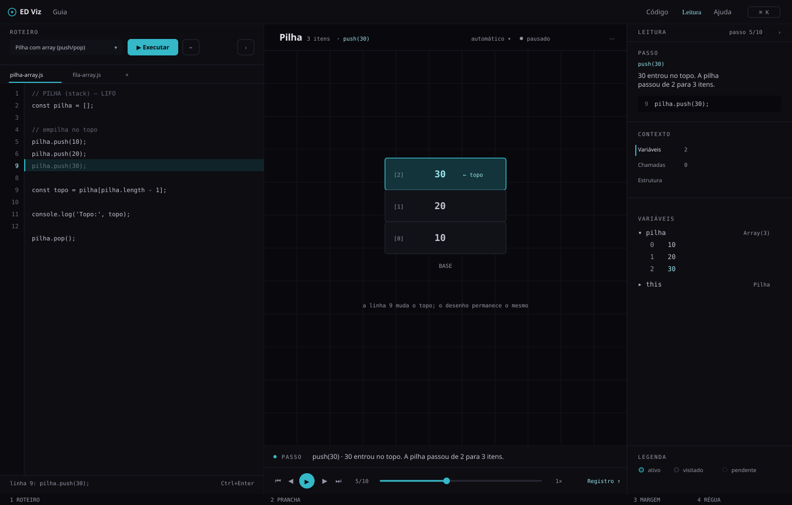
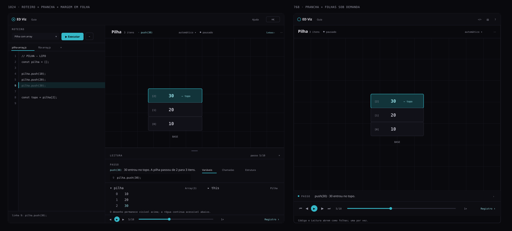
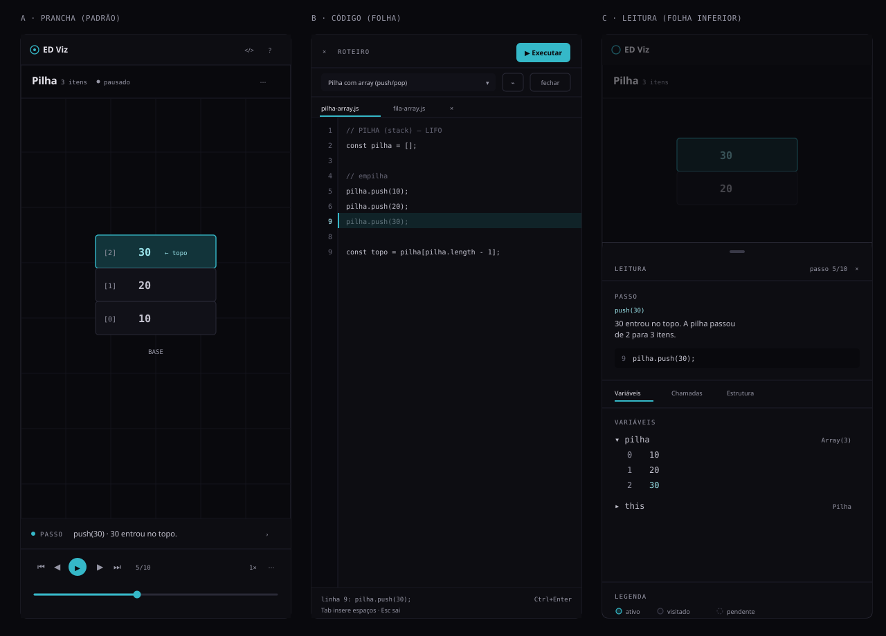

# ED Viz — Etapa 4A
## Diagnóstico e Arquitetura do Novo Visualizador

**Data:** 10/11/2026  
**Branch:** `redesign/etapa-1-baseline`  
**HEAD:** `b97545f`  
**Escopo:** diagnóstico técnico e proposta visual do Visualizador  
**Status:** concluída a análise; **nenhuma alteração de produção foi feita**

> **Este documento não implementa a nova interface.** Ele mapeia o que existe, separa o que deve ser preservado do que será substituído e propõe a arquitetura visual, os wireframes e a estratégia de implementação. A implementação depende de aprovação.

---

## 1. Sumário executivo

O Visualizador atual é funcionalmente maduro, mas visualmente pertence a outra etapa do produto. Ele já nasceu “canvas-first”: o desenho ocupa o palco, o código e o inspetor são gavetas, e o rodapé concentra explicação, transporte e histórico. Essa arquitetura resolveu o problema de espaço, porém criou cinco superfícies diferentes para a mesma execução (Executar, Depurar, play, controles de passo e chip de estado), escondeu o código que causa o desenho e transformou a explicação didática em uma faixa periférica.

A proposta desta etapa é **substituir a organização, não o motor**. O Visualizador passa a ser um **Caderno de Execução**:

- **Roteiro** — o código e as ações que o produzem, em uma coluna estável à esquerda.
- **Prancha** — a estrutura desenhada, dominante, com identificação, estado e câmera no próprio plano.
- **Margem** — a leitura do passo: operação, explicação, variáveis, chamadas e metadados.
- **Régua** — o tempo: reprodução, progresso e histórico, na base da prancha.

No desktop largo, as três primeiras zonas coexistem. Em 1024px, o Roteiro e a Prancha permanecem; a Margem vira folha inferior dentro da Prancha. Em 768px e 390px, a Prancha fica sozinha e Código/Leitura/Registro abrem sob demanda, uma folha por vez. A prioridade é sempre o desenho e o passo atual; o resto é contexto.

O que **não** muda: interpretador, parser, tokenizer, exemplos, detecção de estruturas, renderizadores, geometria, SVG, FLIP, zoom/pan, playback, debug, persistência e deep links. O que **muda**: o shell HTML, o CSS de layout, a organização dos painéis, a hierarquia dos controles, os estados de erro/edição, a tipografia e as cores — agora Ocean + Geist, sem âmbar.

O maior risco técnico não é o desenho: é o **contrato de DOM e métricas** que o `app.js` mantém com o HTML atual. São cerca de 85 consultas por `id`, 68 listeners, medidas fixas do editor (`22 / 10 / 12 / 44`) e seletores que a câmera usa para enquadrar listas e árvores. A estratégia recomendada é preservar os IDs e o markup dos renderizadores, trocar a “pele” ao redor e atualizar apenas os testes que afirmam o layout antigo.

### Decisões que precisam de aprovação

1. Adotar o **Caderno de Execução** (Roteiro + Prancha + Margem + Régua) como arquitetura oficial.
2. No desktop largo, abrir as três zonas por padrão, com a Prancha ainda como maior área.
3. Mover **Executar/Depurar** para o Roteiro e o **seletor de estrutura** para a legenda da Prancha.
4. Transformar o histórico em **Régua expansível** dentro da Prancha, não em rodapé global.
5. Na Margem, manter **Passo fixo** e um índice vertical de contexto (Variáveis, Chamadas, Estrutura), removendo a aba “Estado” duplicada.
6. Usar **480px** de Roteiro em 1440 (`clamp(420px, 33.3vw, 520px)`), com folha “expandir código” para linhas longas.
7. Atualizar os testes de layout/defaults que afirmam a composição antiga, preservando IDs e testes de comportamento.

---

## 2. Estado do Git e método

### 2.1 Estado registrado antes da etapa

O estado completo está em [`git-state-before.txt`](git-state-before.txt).

```text
Branch: redesign/etapa-1-baseline
HEAD:   b97545f
Working tree: 29 arquivos modificados + 11 não rastreados = 40 entradas
```

Nada foi descartado, sobrescrito, resetado, “stashado” ou commitado. As modificações existentes — incluindo as etapas 1, 2 e 3, o UI Kit, as fontes Geist e os relatórios anteriores — permanecem intactas.

### 2.2 O que esta etapa fez

- Leu o HTML, CSS, JavaScript, testes e relatórios anteriores.
- Mediu as métricas de Geist Mono e das fontes mono fallback em Chromium, com as fontes locais carregadas.
- Comparou os estados visuais do baseline em `docs/baseline/`.
- Produziu este relatório e três wireframes SVG em `docs/etapa-4/`.
- Não executou build, não alterou `dist/`, não instalou dependências e não tocou em arquivos de produção.

### 2.3 Limites

- Não houve alteração funcional para validar; a análise de comportamento se apoia no código, nos testes existentes e nos relatórios das etapas 1–3.
- A suíte automatizada não foi reexecutada nesta etapa. Os números citados são os últimos registros do projeto (`docs/baseline/RELATORIO.md`, `docs/etapa-2/RELATORIO.md`, `docs/etapa-3/RELATORIO.md`).
- Métricas de fonte foram medidas em Chromium/Windows com os WOFF2 locais; outros sistemas podem variar na rasterização, mas não na largura avançada da mono.

---

## 3. Diagnóstico da arquitetura atual

### 3.1 Stack e modelo

O ED Viz é uma aplicação **MPA estática** construída com Vite, sem framework de UI e sem dependências de runtime. Cada página carrega `tokens.css` e uma folha própria:

| Superfície | Entrada | CSS | Papel |
|---|---|---|---|
| Landing | `index.html` | `css/landing.css` | Persuadir e apresentar o produto |
| Guia | `guia/*.html` | `css/conteudo.css` | Leitura didática |
| Visualizador | `visualizador.html` | `css/styles.css` | Operar a ferramenta |
| UI Kit | `uikit.html` | `css/uikit.css` | Referência interna de componentes |

O JavaScript é organizado em **IIFEs** que publicam um namespace global `window.DSV`. O `js/main.js` importa os módulos na ordem de dependência:

```js
import './util.js';
import './tokenizer.js';
import './parser.js';
import './interpreter.js';
import './examples.js';
import './anim.js';
import './rough.js';
import './views.js';
import './app.js';
```

Não há reatividade, store, componentes ou roteador. O `app.js` é o controlador imperativo: consulta o DOM por `id`, mantém o estado da execução, chama o interpretador, pede a renderização ao `views.js` e atualiza os painéis manualmente.

### 3.2 Mapa de arquivos e responsabilidades

| Arquivo | Linhas aprox. | Responsabilidade | Acoplamento principal |
|---|---:|---|---|
| `visualizador.html` | 330 | Shell, topbar, editor, palco, inspetor, dock, sprite, diálogo de ajuda | IDs e classes consumidos por `app.js`/`styles.css` |
| `css/tokens.css` | 279 | Tokens legados (`--viz-*`, `--accent`, `--font-*`) e Design System Ocean (`--ds-*`) | Duas camadas convivendo |
| `css/styles.css` | 3.063 | Todo o visual do Visualizador: layout, editor, canvas, painéis, transporte, ajuda, responsivo | Tokens legados, classes dos renderizadores |
| `js/main.js` | 15 | Ordem de importação | Ordem rígida: `views` antes de `app` |
| `js/app.js` | 2.746 | Controlador da interface: editor, execução, playback, layout, câmera, painéis, eventos | ~85 `getElementById`, 68 `addEventListener` |
| `js/views.js` | 3.752 | Detecção, seleção, explicações, renderizadores, geometria da árvore, FLIP | Classes CSS, `data-*`, `ctx.onMeta`, DOM do canvas |
| `js/interpreter.js` | 1.699 | Runtime, passos, eventos, serialização, limites | Contrato `trace.steps`, `trace.output`, `trace.error` |
| `js/parser.js` | 697 | Parser do subconjunto de JavaScript | AST consumida pelo interpretador |
| `js/tokenizer.js` | 228 | Tokenização | Parser |
| `js/examples.js` | 1.718 | 16 exemplos e ordem do menu | `DSV.EXAMPLES`, `DEFAULT_EXAMPLE`, `EXAMPLE_MENU_ORDER` |
| `js/anim.js` | 155 | FLIP e utilidades de animação | `[data-k]`, `--canvas-zoom`, `Element.animate` |
| `js/rough.js` | 112 | Traço “à mão” determinístico | Importado, mas **sem uso atual** no produto |
| `js/util.js` | 180 | Escape, formato, expressão sob o cursor, resolução de variável | Usado por `app` e `views` |
| `css/fonts.css` | 26 | `@font-face` de Geist/Geist Mono | **Não carregado** pelo Visualizador hoje |
| `css/uikit.css` | 3.951 | UI Kit interno, incluindo Visualizer Kit | Referência de componentes, não usado pelo produto |

### 3.3 O que o `app.js` faz

O arquivo é um monólito de interface, mas com seções reconhecíveis:

| Faixa | Responsabilidade |
|---|---|
| 1–156 | Cache de elementos (`els`), constantes, estado global |
| 157–241 | Preferências do workspace em `localStorage` (versão 2) |
| 243–613 | Editor: highlight, gutter, scroll, linha atual, overflow, hover de variável |
| 615–724 | Execução: interpretar, candidatos, erro, prévia, banner |
| 726–868 | Exemplos, abas, buffers, deep link |
| 870–1.210 | Canvas: pan/zoom, fit, auto-fit, foco, insets |
| 1.212–1.551 | Workspace: grid, gavetas, splitter, `codeFit`, câmera após layout |
| 1.553–1.616 | Modo debug |
| 1.618–1.769 | Playback: play/pause, timer, velocidade, `goto` |
| 1.771–1.811 | Seleção da estrutura e renderização |
| 1.813–1.877 | Faixa de explicação do passo |
| 1.879–1.968 | Dock: comandos, eventos, saída |
| 1.970–2.077 | Inspetor: abas, metadados, chamadas, estado |
| 2.079–2.297 | Variáveis: árvore expansível, persistência de expansão |
| 2.299–2.420 | Console, comandos e eventos |
| 2.422–2.663 | Eventos de UI, atalhos globais, resize |
| 2.665–2.746 | Inicialização, exemplos, workspace, deep link, prévia |

#### Estado global

O objeto `state` guarda o trace e a execução:

```js
trace, traceCode, index, playing, timer, speed, debug, stale, preview,
forced, sticky, candidates, opsMap, commands, visit, errorLine,
tabs, activeTab, buffers, events
```

Além dele, há estado de módulo não encapsulado:

- `workspace` — preferências persistidas.
- `collapsed` — gavetas abertas/fechadas.
- `canvasView`, `canvasInset*`, `canvasFitKey` — câmera.
- `codeFit`, `codeUserResized` — largura do editor.
- `varExpanded`, `varValueMap` — expansão de variáveis.
- `codeCharW`, `codeMeasure` — métrica de caractere.
- `varTip`, `tabMovesFocus`, `codeScrollX`, `codeScrollHold`.
- `canvasDrag`, `pendingCanvasFit`, `lastVizWidth`.

Não há um “estado de UI” separado do estado de execução. `goto(i)` é o **hub de renderização**: ele atualiza linha, slider, estrutura, câmera, explicação, chamadas, variáveis, console, comandos, eventos, metadados e botões. Qualquer mudança de layout precisa respeitar essa ordem.

#### Grupos de eventos e listeners

| Grupo | Eventos principais | Onde |
|---|---|---|
| Editor | `input`, `scroll`, `focus`, `blur`, `keydown`, `pointerdown`, `wheel`, `mousemove`, `mouseleave`, `mousedown` | `#code`, `#codeViewport` |
| Execução | `click` em Executar, Depurar, play, first/prev/next/last, zoom, grid, center | topbar, canvas, transporte |
| Abas | `click`, `mousedown` (botão do meio), `auxclick`, `keydown` (setas) | `#tabs` |
| Canvas | `pointerdown/move/up/cancel`, `wheel`; botões de zoom/fit/center | `#structure`, `#btnZoom*` |
| Layout | `pointerdown/move/up/cancel`, `dblclick`, `keydown` no splitter; toggles de gaveta | `#splitLeft`, `#btnToggle*`, `#btnCollapse*`, rails |
| Dock | `click` em abrir/fechar e abas; `keydown` (setas/Home/End) | `#btnDock*`, `#tabCommands/Events/Console` |
| Inspetor | `click` e `keydown` nas abas; `click`/`keydown` nas variáveis | `#inspTab*`, `#vars` |
| Logs | `click` delegado em comandos/eventos/console | `#commands`, `#events`, `#console` |
| Global | `keydown` (atalhos), `resize` (câmera/insets) | `document`, `window` |

São 68 chamadas `addEventListener` no `app.js`. A nova shell precisa religar os mesmos controles ou preservar seus nós; não há delegação global que sobreviva a uma troca de IDs sem ajuste.

### 3.4 Fluxo de dados e renderização

```text
┌────────────────────────────┐
│ <textarea id="code">       │
│ edição / exemplo / deep link│
└─────────────┬──────────────┘
              │ onEdit
              ▼
┌────────────────────────────┐
│ highlight / gutter / scroll │
│ lineHilite / stale / status │
└─────────────┬──────────────┘
              │ Executar / Ctrl+Enter
              ▼
┌────────────────────────────┐
│ DSV.interpret(code)        │
│ trace = { steps, output,   │
│           error }           │
└─────────────┬──────────────┘
              │
              ▼
┌──────────────────────────────────────────────┐
│ buildOpsMap · buildCommands · buildEventLog  │
│ computeVisitOrder · traceCandidates          │
└─────────────┬────────────────────────────────┘
              │
              ▼
┌──────────────────────────────────────────────┐
│ goto(i)                                      │
│  chooseStructure(step)                       │
│  DSV.renderStructure(container, sel, step,   │
│      ctx)                                    │
│  ctx.onMeta → setCanvasMeta                  │
│  canvasAfterRender(sel) → câmera             │
│  updateStepExplainer                         │
│  renderVars / renderCallstack / renderCommands│
│  renderEvents / renderConsole / renderState  │
└──────────────────────────────────────────────┘
```

A comunicação é **unidirecional e imperativa**. Os renderizadores devolvem HTML (pilha, fila, lista, array) ou manipulam SVG diretamente (árvore). Eles não conhecem o shell; só conhecem classes, `data-*` e o callback `ctx.onMeta`. Isso é uma boa notícia: **o desenho pode sobreviver a um shell completamente novo**.

### 3.5 Dependências entre as camadas

```text
┌─────────────────────────────────────────────────────────────┐
│ Interface (HTML/CSS/app.js)                                 │
│ topbar · roteiro · palco · inspetor · dock · ajuda          │
└───────────────┬───────────────────────────────┬─────────────┘
                │ IDs, classes, data-*          │ estado e calls
                ▼                               ▼
┌───────────────────────────────┐   ┌─────────────────────────┐
│ Renderização (views.js)       │   │ Execução (interpreter)  │
│ detect/choose/explain/render  │   │ tokenizer · parser      │
│ SVG · FLIP · geometria        │   │ steps · events · output │
└───────────────┬───────────────┘   └─────────────────────────┘
                │ CSS vars/classes
                ▼
┌───────────────────────────────┐
│ Estilos (styles.css/tokens)   │
│ cores · medidas · responsivo  │
└───────────────────────────────┘
```

**Lógica de negócio:** detecção de estruturas, seleção, operações reconhecidas, explicações e geometria da árvore ficam em `views.js`. **Motor:** tokenizer, parser, interpretador, serialização e limites ficam nos arquivos próprios. **Interface:** `app.js` + HTML/CSS. **Integração:** `window.DSV`, `ctx` e callbacks.

| Camada | Exemplos | Arquivos | Pode mudar nesta reconstrução? |
|---|---|---|---|
| **Motor de execução** | Tokenizar, parsear, executar, gerar passos, eventos, output, erro, limites | `tokenizer/parser/interpreter` | Não |
| **Lógica de domínio** | Detectar candidatos, escolher estrutura, reconhecer operações, explicar passo, geometria da árvore | `views.js`, `util.js` | Não (só leitura) |
| **Renderização gráfica** | HTML de pilha/fila/lista/array; SVG da árvore; FLIP; animação | `views.js`, `anim.js` | Não na geometria; sim em cor/tipografia via CSS |
| **Interface** | Shell, topbar, editor, painéis, régua, margem, help | `visualizador.html`, `styles.css`, `app.js` | Sim, integralmente |
| **Integração** | `window.DSV`, `ctx`, `onMeta`, `canvasAfterRender`, IDs, `data-*` | Todos | Adaptar, sem quebrar o contrato |

### 3.6 Acoplamentos ao DOM atual

| Contrato | Onde é usado | Por que importa |
|---|---|---|
| ~85 `getElementById` no `els` | `app.js` no carregamento | Se um ID sumir, o app quebra no boot ou em um caminho específico |
| 68 `addEventListener` | `app.js` | A nova interface precisa religar cada controle ou preservar os mesmos nós |
| Classes `.collapsed` + grid CSS | layout | `applyLayout()` alterna classes e espera que o CSS mude as colunas |
| `.canvas-viewport`, `.canvas-stage` | câmera, FLIP | `canvasParts()` e `canvasStageBox()` dependem dessa estrutura |
| `data-content` no stage | árvore | A câmera usa o retângulo real dos nós, não a margem do SVG |
| `[data-k]`, `data-enter`, `data-exit` | FLIP | Chaves de continuidade das animações |
| `.list-node.pending/target/active/new` | câmera | `canvasFocusNodeEl()` escolhe o nó a manter visível |
| `--canvas-x/y/zoom` | canvas/FLIP | `applyCanvasView()` escreve; `anim.js` lê `--canvas-zoom` |
| `is-overflowing` | editor | O degradê e o botão “ver o resto” dependem da classe |
| `no-grid` | canvas | `applyGrid()` alterna a malha |
| `hidden` / `display:none` | gavetas/dock | `setDockOpen` e `togglePanel` dependem de `hidden` e classes |
| `aria-pressed` / `aria-expanded` / `aria-selected` | controles | Testes e acessibilidade leem esses atributos |
| `--line-h`, `--code-font`, `--font-mono` | editor | Métricas fixas e alinhamento entre gutter, `<pre>` e `<textarea>` |

### 3.7 Funcionalidades que dependem de seletores ou elementos específicos

- **Câmera:** `els.structure.querySelector('.canvas-viewport')`, `.canvas-stage`, `data-content`, `.list-unit`, `.list-node.*`.
- **FLIP:** `container.querySelectorAll('[data-k]')`; se o novo shell colocar `data-k` dentro de `#structure`, a animação mistura elementos.
- **Árvore:** classes `.tree-svg`, `.tree-node`, `.tree-edge`, `.tree-val`, marcadores SVG com IDs fixos.
- **Editor:** `#highlight`, `#gutterInner`, `#lineHilite`, `#codeViewport`, `#code`; medidas `LINE_HEIGHT`, `PAD_TOP`, `CODE_PAD_LEFT`.
- **Layout:** `#layout.code-collapsed.side-collapsed`, `#codePanel.collapsed`, `#sidePanel.collapsed`, `#splitLeft`.
- **Dock:** `#dockHistory`, `#btnDockToggle`, `#dock.is-open`, `#pageCommands/Events/Console`.
- **Testes:** dezenas de seletores por ID e classes (`.stack-cell`, `.list-node`, `.tree-node`, `.array-cell`, `.viz-tools`, etc.).

### 3.8 O que impediria uma substituição segura

1. **Cache de DOM no boot.** O `els` é montado no carregamento; qualquer ID ausente vira `null` e falha em um caminho de execução, não necessariamente no boot.
2. **Métricas fixas do editor.** `LINE_HEIGHT=22`, `PAD_TOP=10`, `CODE_PAD_LEFT=12` e o gutter de 44px estão duplicados em JS e CSS. Trocar fonte, tamanho ou padding sem atualizar os dois lados desalinha linha atual, hover e scroll.
3. **Câmera dependente de geometria.** O enquadramento lê o retângulo do stage, o `data-content` da árvore e a largura do painel. Mudar a estrutura do palco sem preservar esses contratos quebra zoom/pan.
4. **CSS de layout acoplado a classes de estado.** `.collapsed`, `.code-collapsed`, `.side-collapsed`, `.no-grid`, `.is-overflowing` são lidas por JS e por testes.
5. **Fonte nova com métrica diferente.** Geist Mono é mais larga que Consolas; o cache `codeCharW` nunca é invalidado e o `codeFit` pode ser medido antes do `document.fonts.ready`.
6. **Testes que afirmam o layout antigo.** Larguras de gaveta, estado inicial recolhido, abas do inspetor, altura do dock e comportamento mobile precisam ser revistos.
7. **Duas fontes da verdade.** `tokens.css` se declara fonte da verdade; `styles.css` aponta para `DESIGN.md`; o Visualizador ainda usa tokens âmbar.
8. **Sem teste visual.** A suíte cobre função e axe, mas não pixels/cores/fontes. Uma regressão de layout pode passar.

### 3.9 Testes existentes e cobertura

| Suíte | Quantidade | O que cobre | O que não cobre |
|---|---:|---|---|
| `tests/run-tests.js` | 214 | Parser, interpretador, tokenizer, util, detecção, renderizadores, geometria, listas, árvores, arrays, filas, comandos | DOM real, layout, fontes, pixels |
| `tests/run-ui-smoke.js` | 90 | Boot, editor, play, debug, abas, hover, seletor, painéis, dock, erros, responsivo em jsdom | Navegador real, fontes, overflow visual |
| `tests/run-content.js` | 9 | Conteúdo do guia/home | Visualizador |
| `tests/e2e/*.spec.js` | 108 (54 × Chromium/Firefox) | Fluxos reais, axe, teclado, deep links, persistência, câmera, mobile, CSP, stress | Snapshot visual, métricas de fonte, três zonas novas |
| **Total registrado** | **313 + 108** | Comportamento e acessibilidade | Aparência e composição |

Os testes E2E são fortemente baseados em IDs (`#btnRun`, `#code`, `#lineHilite`, `#dockHistory`, `#inspTabVars`, etc.). Isso favorece a estratégia de **preservar IDs** e mudar a composição ao redor. Alguns testes, porém, afirmam o layout atual:

- `#codePanel` começa com largura 0 e `#btnToggleCode` abre uma gaveta de 340–600px.
- `#sidePanel` é uma coluna de 300–372px no desktop.
- Abrir o inspetor não fecha o código em tela larga.
- `#splitLeft` arrasta a largura do código.
- `#dockHistory` é um rodapé com altura < 245px e a câmera reenquadra acima dele.
- Em 390px, a folha de código tem ≤ 360px e o histórico fecha o código.
- `page.click('#btnToggleCode')` pressupõe que o botão esteja visível e que o clique abra, não feche, o painel.

Esses testes serão atualizados na subetapa de implementação; os IDs e os testes de comportamento (passo, play, debug, estruturas, erros, persistência) permanecem.

**Testes que afirmam o layout antigo e precisam de revisão:**

- `workspace canvas-first: gavetas entram sob demanda...` — espera `#codePanel` com largura 0 no início e 340–600px ao abrir.
- `workspace persiste gavetas e largura...` — espera o splitter e a largura de gaveta.
- `gaveta de código abre na largura útil...` — espera 590–601px e `#codeViewport.is-overflowing`.
- `histórico dimensiona pelo conteúdo...` — espera `#dockHistory` com altura <245px e a base da pilha acima do dock.
- `mobile: gavetas não empilham...` — espera `#codePanel` ≤360px e o histórico fechando o código.
- `abas e divisória não avançam...` — espera `#splitLeft` focável e o painel do inspetor.
- `a11y: com código e inspetor abertos` — espera `#railCode` invisível quando o código está aberto; a nova shell pode não usar rails flutuantes.
- UI smoke: `codePanel/sidePanel` começam com `.collapsed`; abrir o inspetor em tela larga mantém o código; abas do inspetor com setas.

Os testes de comportamento (estruturas, passos, play, debug, erros, variáveis, comandos, persistência, deep link) não devem ser reescritos; apenas os que dependem da geometria/defaults.

### 3.10 Achados específicos que motivam o redesenho

1. **Cinco superfícies de execução.** Executar e Depurar na topbar; play e passos no rodapé; chip de estado no palco; barra de debug dentro do canvas. O aluno precisa aprender onde cada ação mora.
2. **O código começa escondido.** `#layout` nasce com `code-collapsed side-collapsed`; a ajuda diz que “o desenho ocupa o workspace por inteiro; o código é uma superfície que você abre quando precisa”. O desenho fica sem a evidência que o causou.
3. **A explicação é periférica.** A faixa de 44px no rodapé é o único lugar com frases completas, longe do código e do desenho. Em 390px ela quebra em duas ou três linhas e compete com o transporte.
4. **O seletor de estrutura está longe do palco.** Fica na topbar, ao lado de Executar; a relação “isto é o que estou vendo” não é imediata.
5. **O dock é um painel global.** Abre sobre o palco, tem cabeçalho, abas e altura própria; a câmera precisa de insets para não esconder a base. É muita infraestrutura para um histórico secundário.
6. **O inspetor fragmenta o contexto.** Variáveis, Chamadas e Estado são abas; só uma aparece por vez. O “Estado” duplica informação que já está no chip, no passo, na velocidade e no zoom.
7. **A topbar carrega demais.** Marca, Guia, estrutura, Executar, Depurar, Código, Inspetor, Ajuda. Em 1100px os rótulos viram ícones; em 620px a barra ganha duas linhas.
8. **Erro e “editado” empurram a página.** O banner de erro é uma faixa no topo do `body`, acima do layout; o estado “editado” vive na status bar e na faixa de explicação.
9. **O tema é legado.** `--accent` é âmbar; `body` remapeia `--bg-*` para `--viz-*`; três regras usam `rgba(240,170,104,…)` hardcoded; `color-scheme` não está declarado; `theme-color` é `#16181c`; `fonts.css` não é carregado.
10. **A mono do editor ainda é a antiga.** `--font-mono` aponta para JetBrains/Cascadia/Consolas. Geist Mono muda a largura do caractere e expõe o cache de `codeCharW` e o `codeFit`.

### 3.11 Dívidas menores (não bloqueiam, mas devem ser resolvidas na migração)

- `codeCharW` é cacheado para sempre; não é invalidado em resize, troca de breakpoint ou `document.fonts.ready`.
- `codeWordAt` usa `els.code.scrollLeft`, mas não `codeScrollX` (hold de scroll no Firefox); o hover pode ficar deslocado após rolar por código.
- `codeFit` mede o `<pre>` com `Range`; se a folha abrir antes das fontes, a medida fica na fallback e não é refeita.
- `revealVizOnNarrow` tenta `scrollIntoView`, mas o `body` tem `overflow: hidden`; no layout atual ele tende a ser um no-op.
- `tabVars` e `tabCallstack` são `null` e não usados; `rough.js` é importado, mas não é chamado.
- `state.canvasMeta` é criado dinamicamente; não há valor inicial no objeto `state`.
- O produto não declara `color-scheme: dark`, então selects nativos e scrollbars podem variar entre plataformas.
- A `styles.css` diz “raio máximo 6px”, mas usa 7/10/12; o `DESIGN.md` já define 4/6/8/10.

---

## 4. Inventário de funcionalidades

### 4.1 Estruturas suportadas

| Estrutura | Variantes | Como é detectada | Operações / comportamento | Renderização |
|---|---|---|---|---|
| **Pilha** | Array com `push/pop`; classe `Pilha`/`Stack` com array interno | Nome (`pilha`, `stack`) e ops `pop`; array global com `push/pop` | LIFO; topo no último índice; `push`, `pop`, leitura do topo | Células verticais, índice, flag `← topo`, base, escala por quantidade |
| **Fila** | Array `push/shift`, `unshift/pop`; classe `Fila`/`Queue`; campos privados `#items/#inicio/#fim`; janela de índices | Nome (`fila`, `queue`), ops `shift`/`unshift`, janela | FIFO; FRONT/REAR; janela viva em filas com índices; buracos de `delete` não viram célula | Linha horizontal, FRONT/REAR, índices reais, inversão quando `unshift/pop` |
| **Lista encadeada** | Nós com `proximo/next`; classe `Lista`; `head/inicio`; lista simples | Nó com `next`; wrapper com `head`; nome (`lista`, `linked`) | Percurso, inserção/remoção, HEAD, terminador `null/undefined`, ciclo acidental | Nó `VALUE / NEXT`, chips de ponteiros, HEAD, setas, nó pendente/novo/visitado/ativo/alvo |
| **Lista duplamente encadeada** | Classe com `prev/next`, `HEAD/TAIL` | `doubly` por `prev`/nome/`tail` | Percurso direto e reverso, `PREV/NEXT`, HEAD/TAIL, mudanças de referência | Nó `PREV / VALUE / NEXT`, setas nos dois sentidos, HEAD/TAIL |
| **Árvore binária** | BST (inserção, busca, percursos, remoção); árvore simples (inserção por nível, remoção com promoção) | Nó com `esquerda/direita`; wrapper com `raiz/root` | Comparação, descida, visita, inserção, remoção, sucessor, promoção; sem rótulos permanentes de esquerda/direita | SVG com nós circulares, arestas curvas, seta contextual, vaga de inserção, nó ativo/visitado/novo, aresta nova/pendente |
| **Array** | Array puro por índice; `MeuArray` com `#items/#tamanho` | Array global; wrapper com array interno + tamanho numérico | Leitura/escrita por índice, `delete`, buracos, deslocamentos manuais, limites do tamanho lógico | Células adjacentes, índices, `comprimento`/`tamanho`, `#items.length`, fora do tamanho tracejado, buraco, shift origem/destino |
| **Grafos** | — | Não há suporte no motor | — | A Landing anuncia “ainda não disponível”; não criar painel/estado falso |

A **seleção automática** escolhe o candidato com maior score e mantém a seleção “sticky” entre passos; o seletor manual (`state.forced`) fixa uma estrutura. A ordem do seletor segue a progressão didática: array, pilha, fila, lista, lista dupla, árvore.

**Leituras específicas que a interface não pode uniformizar:**

| Estrutura | Indicadores próprios | O que a Margem/Legenda precisa dizer |
|---|---|---|
| Pilha | `← topo`, base, índice | “o último entrou é o primeiro a sair”; topo ativo |
| Fila | `FRONT`, `REAR`, janela de índices, inversão | “a frente sai primeiro”; quando a janela esconde histórico |
| Lista simples | `HEAD`, `NEXT`, terminador, chips de ponteiro | “o próximo é uma referência”; nó pendente ainda fora da lista |
| Lista dupla | `HEAD`, `TAIL`, `PREV`, `NEXT`, setas duplas | “há duas referências”; mudança de `prev`/`next` |
| Árvore | nó ativo/visitado, aresta ativa/nova/pendente, seta contextual | “a cor é o ponteiro”; não há rótulos permanentes de esquerda/direita |
| Array | índices, `comprimento`/`tamanho`, fora do tamanho, buraco, shift | “o tamanho lógico pode ser menor que o array interno” |
| Array puro | índices, `comprimento`, posição escrita | “a posição escrita é o foco, não o valor” |

### 4.2 Execução e interpretação

- Subconjunto didático de JavaScript: sem herança de classes, regex, async/await, try/catch, parâmetros com valor padrão.
- Limites: **20.000 passos** e **500 chamadas aninhadas**. Ao atingir, gera erro com linha e mensagem.
- Cada passo registra: `line`, `kind`, `globals`, `locals`, `pointers`, `stack`, `thisVal`, `events`.
- Eventos nativos de array (`push`, `pop`, `shift`, `unshift`, `splice`, `delete`) e eventos de operações reconhecidas.
- Saída de `console.log/warn/error` com índice do passo.
- Erros de sintaxe e runtime com linha; o trace pode terminar em erro e ainda manter os passos anteriores preenchidos.
- Reordenação dos passos pela conclusão real (chamadas de função aparecem depois dos passos internos).
- Serialização de objetos/arrays com IDs estáveis, referências, funções, classes e truncamento.
- Ponteiros e `this` para chips, nós ativos, HEAD/TAIL, comparações e explicações.
- `explainStep` produz operação + frase didática a partir do passo, da estrutura e da linha.

### 4.3 Playback e debug

- Primeiro, anterior, play/pause, próximo, último.
- Slider de progresso e contador `passo N/M`.
- Velocidades 0,5×, 1×, 2×, 4×; intervalo mínimo de 120ms.
- Executar também inicia a reprodução; erro não reproduz.
- Editar depois da execução marca o trace como **stale**, remove o destaque da linha e pede nova execução.
- Debug (F10): executa, trava o editor, posiciona no primeiro passo e avança com **qualquer tecla**; `←` volta, `Esc` sai; `Tab/Enter` não editam.
- Atalhos globais: `Ctrl+Enter`, `Espaço`, setas, `Home`, `End`, `Esc`, `F10`, `Ctrl+M` (Tab move foco no editor).
- Prévia de primeiro contato: abre no terceiro passo com conteúdo, sem fingir reprodução pausada; Executar reinicia do passo 1.
- Deep link: `?exemplo=pilha-array&passo=4` abre o código original naquele passo, preservando o buffer editado.

### 4.4 Editor

- `<textarea>` transparente sobre `<pre>` com syntax highlighting; gutter separado.
- Numeração de linhas, linha atual, linha de erro, `▶` no gutter.
- Fonte mono 13px (12,5px ≤1366), linha de 22px, padding 10/12/16, gutter 44px.
- Cursor Ocean, seleção Ocean 30%, foco visível.
- Tab insere 2 espaços; Enter mantém indentação e abre bloco; Esc sai; Ctrl+M alterna Tab/foco.
- Scroll sincronizado entre highlight, gutter, linha e textarea; hold de scroll no Firefox; controle “ver o resto →”.
- Hover de variável após 350ms: expressão sob o cursor, escopo e valor do passo; desativado durante play e após edição.
- Abas de arquivos (até 4), buffer por exemplo em `localStorage`, fechar com × ou botão do meio, navegação por setas.
- Seletor de exemplo ordenado pela disciplina; link “Guia” acompanha a estrutura do exemplo.
- Debug: editor `readOnly`, seleção transparente, cursor default.

### 4.5 Canvas

- Pan por arrasto; roda do mouse com zoom no ponto; botões −/100%/+.
- Ajustar à tela, centralizar, grade liga/desliga; zoom 25–300%; fit máximo 180%.
- Auto-fit após execução, mudança de estrutura, crescimento de árvore/lista, resize e abertura/fechamento de gavetas; para de seguir depois que o usuário mexe no zoom/pan.
- Pisos de legibilidade: árvore 62% em telas ≤560px; lista dupla 100% em palco ≤1100px.
- Insets quando uma gaveta cobre o palco; recentraliza na área visível; histórico aberto reduz a área e reenquadra.
- Foco em nó de lista (pending/target/active/new) quando o piso impede mostrar tudo.
- Estruturas curtas desenham até 1,4× em degraus; árvores/arrays/listas têm escalas próprias.
- Grid técnica de duas escalas, persistida por workspace.

### 4.6 Painéis, histórico e ajuda

- **Inspetor:** Estrutura (metadados), Variáveis (locais/global/this, expansão, contagem, limite 40 filhos/9 níveis), Chamadas (frames, ativo), Estado (execução, passo, velocidade, código, zoom, modo).
- **Histórico:** Comandos (eventos nativos + operações reconhecidas, filtrados pela estrutura), Eventos (log pré-computado, últimos 120), Saída (console até o passo). Clique em uma linha vai ao passo.
- **Ajuda:** diálogo nativo com instruções, detecção automática, ponteiros, limites e atalhos.
- **Persistência:** workspace v2 (`codeRatio`, `collapsed`, `dockOpen`, `dockTab`, `grid`, `inspectorTab`), buffers (`edviz.buffers`), exemplo (`edviz.example`), migração de `edviz.code`.
- **Link Guia:** aponta para a página da estrutura do exemplo ativo.

### 4.7 Acessibilidade atual

- `aria-label` em ícones e controles; `aria-pressed` em toggles; `role=status` no estado; `aria-live` na explicação; `aria-invalid`/`aria-describedby` no erro.
- Foco visível de 1px no produto (2px no UI Kit); `prefers-reduced-motion` desliga animações.
- Abas com `role=tablist` e navegação por setas; diálogo com foco no título e fechamento por Esc.
- Testes axe sem violações críticas/sérias no visualizador em 1440 e 390.

### 4.8 Responsividade atual

| Largura | Comportamento |
|---:|---|
| >1199 | Grid de 4 colunas: código (gaveta), divisória, canvas, inspetor (gaveta) |
| 901–1199 | Canvas inteiro; gavetas flutuam sobre ele; só uma abre por vez |
| ≤900 | Gaveta vira folha de 92vw; abrir histórico fecha a folha |
| ≤1100 | Rótulos da topbar viram ícones, exceto Executar; subtítulo da marca some |
| ≤820 | Marca só com nome; título do palco 15px; menos padding |
| ≤620 | Topbar em duas linhas; transporte em duas linhas; histórico até 45vh |
| ≤420 | Controles de toque mais largos; histórico sem rótulo; status do editor esconde atalho |
| ≤1366 | Mono do editor 12,5px |

### 4.9 Matriz de preservação

| Camada | Preservar diretamente | Adaptar | Reconstruir |
|---|---|---|---|
| Motor | `tokenizer.js`, `parser.js`, `interpreter.js`, `examples.js`, `util.js` | — | — |
| Renderização | `views.js`: detecção, seleção, explicações, geometria, SVG, FLIP, classes e `data-*` | Cores/tipografia via tokens; possíveis limites de texto | Nada da geometria |
| Editor | Lógica de highlight, gutter, scroll, hover, abas, buffers | Métricas/fonte; bindings de DOM; layout da coluna | CSS e casca do editor |
| Canvas | Pan/zoom/fit/insets/focus; `anim.js` | Insets para novas folhas; controles de câmera | CSS do palco/cabeçalho |
| Playback | Estado, timer, `goto`, debug, atalhos | Distribuição dos controles | Régua/transporte |
| Painéis | Renderização de variáveis, chamadas, comandos, eventos, console | Organização na Margem/Régua; ARIA | Shell dos painéis |
| Shell | IDs e contratos de teste | Topbar, grid, gavetas, dock | HTML/CSS de layout |
| Estilos | Tokens `--ds-*`, cores de sintaxe, fontes | Ponte de tokens para renderizadores | `styles.css` de layout |
| Testes | Comportamento e IDs | Asserções de layout/defaults | Nenhum teste funcional deve ser removido |

### 4.10 Preservados diretamente

- `js/tokenizer.js`, `js/parser.js`, `js/interpreter.js`, `js/examples.js`, `js/util.js`, `js/anim.js`.
- `js/views.js` — detecção, seleção, explicações, geometria, SVG, FLIP, classes e `data-*`.
- O contrato `trace.steps` / `trace.output` / `trace.error`.
- Os 16 exemplos e a ordem didática do menu.
- Playback, debug, `goto`, atalhos, deep links, buffers e persistência.
- Pan/zoom/fit/insets/foco da câmera e os pisos de legibilidade.
- A paleta de sintaxe e o mecanismo de highlight.
- O diálogo de ajuda nativo (conteúdo será atualizado).
- Os IDs, `data-*` e classes que os testes e o `app.js` consomem.

### 4.11 Substituídos

- A topbar como barra de ferramentas (marca + estrutura + Executar + Depurar + Código + Inspetor + Ajuda).
- O layout de gavetas sobre o canvas e o grid de quatro colunas atual.
- O cabeçalho do canvas e o cluster de câmera atuais.
- O dock global com explicação + transporte + histórico.
- O inspetor em quatro abas e a aba “Estado”.
- A faixa de explicação de 44px no rodapé.
- O banner global de erro.
- O CSS de layout, tipografia e cores do Visualizador (`styles.css`).
- Os estilos âmbar e os tokens legados no escopo do Visualizador.
- A organização visual do editor, controles, abas e status.
- A cópia da Ajuda que descreve gavetas e abas antigas.

### 4.12 Adaptados

- `app.js`: cache de DOM, bindings, layout, câmera, insets, dock, inspetor, estados e mensagens.
- `views.js`: apenas cores/tipografia via tokens; nenhuma geometria.
- `anim.js`: mantido; só o contexto de layout muda.
- `tokens.css`: sem remapear o site inteiro; ponte local para os renderizadores.
- `localStorage`: workspace versionado; buffers preservados.
- Testes: IDs e comportamento preservados; asserções de layout/defaults atualizadas.
- Ajuda: mesmo diálogo, nova organização e novos atalhos.

---

## 5. Diagnóstico visual e de UX

### 5.1 O que a interface atual comunica

O visualizador atual tem uma identidade coerente de “instrumento escuro”: palco full-bleed, título no topo, controles de câmera discretos, transporte fino, tipografia mono nos dados. Ele é mais editorial do que um dashboard. O problema não é falta de sofisticação; é **organização de responsabilidades**.

A composição atual responde bem a “onde está o desenho?”, mas não a:

- “Qual linha do meu código produziu isso?”
- “Qual é a operação deste passo?”
- “O que mudou em relação ao passo anterior?”
- “Onde ficam as variáveis e as chamadas ao mesmo tempo?”
- “O que acontece se eu executar de novo depois de editar?”

### 5.2 Problemas estruturais (não apenas estéticos)

1. **Ação e consequência separadas.** Executar está na topbar; o resultado aparece no palco; a explicação está no rodapé; o código está escondido. O aluno faz um gesto e recebe três superfícies desconectadas.
2. **O código não é tratado como parte da visualização.** É uma gaveta que cobre o desenho ou o espreme. A linha atual só faz sentido se o código estiver visível; hoje ele é opcional.
3. **O histórico não tem hierarquia.** Comandos, Eventos e Saída têm o mesmo peso de um painel principal, mas são consulta secundária. O dock global compete com o palco.
4. **O inspetor é uma pilha de abas.** Variáveis e Chamadas são contextos simultâneos, mas só um aparece; “Estado” repete o chrome.
5. **A topbar é uma barra de ferramentas de IDE.** Marca, Guia, estrutura, Executar, Depurar, Código, Inspetor, Ajuda. A ação principal não tem um lugar próprio.
6. **O erro é global.** Um banner no topo empurra a página inteira; o erro pertence à linha e ao passo, não ao layout.
7. **Mobile é uma redução, não uma recomposição.** A topbar vira duas linhas, o transporte vira duas linhas, as gavetas cobrem o palco e o histórico fecha o código. A experiência sobrevive, mas perde a leitura causal.

### 5.3 Oportunidades

- Fazer do **código e do desenho um par editorial**: Roteiro e Prancha, não gaveta e fundo.
- Fazer da **Margem** o lugar da voz didática: operação + frase + variáveis, sem abas escondidas.
- Fazer da **Régua** o lugar do tempo: reprodução, progresso e histórico no mesmo eixo.
- Usar **um único sinal** (Ocean) para linha atual, nó ativo, passo atual e ação primária.
- Tratar **erro, editado e debug** como estados do passo, não como banners genéricos.
- Manter o desenho como maior área e nunca redesenhar sua geometria.

### 5.4 Tradução das referências visuais

| Referência | O que aproveitar | O que rejeitar |
|---|---|---|
| **LeetCode** (código + resultado) | Código e resultado lado a lado; cabeçalho de resultado; mono; status “Accepted/Runtime” | Verde como identidade; cards de métricas; ruído de abas |
| **Linear** (três painéis) | Três zonas com papéis claros; hairlines; linhas de lista; hover discreto; metadados mono | Aparência de inbox/issue tracker; densidade de software SaaS |
| **Raycast** (command palette) | Busca/ações por teclado; atalhos visíveis; foco rápido | Paleta como única navegação; visual de launcher |
| **Vercel/Blackbird** (monorepo) | Título editorial grande; segmented filter; lista com metadados; aside de descrição | Cards de dashboard; badges coloridos em excesso; estética de status page |

O novo Visualizador não deve parecer nenhuma delas. Deve parecer **uma publicação técnica que também executa código**.

### 5.5 Princípios para a nova interface

1. **O desenho é o argumento; o código é a evidência.** A Prancha é a maior área; o Roteiro é estável e legível.
2. **Um sinal, um significado.** Ocean marca o que está ativo, selecionado ou em execução. Não é decoração.
3. **A explicação fica ao lado do que explica.** Passo, código e desenho compartilham o mesmo plano de leitura.
4. **Cada zona tem um verbo.** Roteiro: escrever/executar. Prancha: observar/navegar. Margem: entender. Régua: percorrer o tempo.
5. **Nada de caixas dentro de caixas.** Superfícies contínuas, hairlines, tipografia e espaço.
6. **Acesso sob demanda, não empilhamento.** Em telas menores, uma folha por vez; o palco nunca é espremido por duas.
7. **Preservar o instrumento, trocar a mesa.** Motor, renderizadores e animações ficam; a organização visual é nova.

---

## 6. Proposta de arquitetura visual

### 6.1 Conceito: **Caderno de Execução**

O Visualizador será organizado como um caderno técnico aberto:

```text
┌──────────────────────────────────────────────────────────────────────────────┐
│ CABEÇALHO CORRIDO · marca · guia · ajuda · atalhos                          │ 44
├───────────────┬──────────────────────────────────────────────┬───────────────┤
│ ROTEIRO       │ PRANCHA                                      │ MARGEM        │
│               │                                              │               │
│ exemplo       │ título · contagem · operação · estado        │ PASSO         │
│ Executar      │                                              │ operação      │
│ Depurar       │              desenho da estrutura            │ frase         │
│ abas          │                                              │ linha         │
│               │                                              │ ───────────── │
│ código        │                                              │ contexto      │
│               │                                              │ variáveis     │
│ linha atual   │                                              │ chamadas      │
│               │                                              │ estrutura     │
│ status        │ PASSO · frase curta                          │               │
│               │ ◀ ▐ ▶ ▷ ▷   5/10 ─────●────  1×  Registro ↑  │               │
└───────────────┴──────────────────────────────────────────────┴───────────────┘
```

Quatro zonas de trabalho e um cabeçalho corrido, uma hierarquia:

| Zona | Verbo | Conteúdo | Persistência |
|---|---|---|---|
| **Cabeçalho corrido** | orientar | marca, Guia, toggles Código/Leitura, Ajuda, atalhos | sempre |
| **Roteiro** | escrever e executar | exemplo, abas, editor, Executar/Depurar, status | coluna no desktop; folha no mobile |
| **Prancha** | observar e navegar | título, estrutura, estado, câmera, desenho, passo, régua | sempre; é a maior área |
| **Margem** | entender | Passo, Variáveis, Chamadas, Estrutura | coluna ≥1280; folha abaixo disso |
| **Régua** | percorrer o tempo | reprodução, slider, velocidade, Registro | sempre; log expande dentro da Prancha |

### 6.2 Organização geral

#### Hierarquia

1. **Prancha** — maior zona individual, fundo mais recessivo, título 17px, desenho.
2. **Roteiro** — coluna estável, fundo `surface`, código e ação.
3. **Margem** — coluna de leitura, fundo `surface`, tipografia sans + dados mono.
4. **Régua** — faixa fina na base da Prancha.
5. **Cabeçalho corrido** — 44px, discreto, sem ações de execução.

> O `DESIGN.md` fixa 46px para a topbar atual. A proposta reduz para 44px porque o cabeçalho deixa de carregar Executar/Depurar e vira uma régua de navegação. Se a decisão for manter 46px, o layout absorve 2px sem outras mudanças; os wireframes usam 44px.

#### Navegação

- O **Cabeçalho corrido** não é uma barra de execução: marca, Guia, toggles Código/Leitura, Ajuda e, opcionalmente, `⌘K`.
- **Executar/Depurar** pertencem ao Roteiro (agem sobre o código).
- **Estrutura** pertence à Prancha (descreve o que está sendo visto).
- **Código/Leitura** são toggles de zona; em telas largas, abrem/fecham colunas; em telas menores, abrem folhas. No mobile, a Leitura também abre pelo Passo da Prancha.
- **Registro** é um expansor da Régua, não uma página.
- **Ajuda** é o único diálogo de conteúdo; as folhas são superfícies modais de trabalho.
- **Ordem de foco no desktop:** Cabeçalho → Roteiro (exemplo, Executar, abas, editor, status) → Prancha (estrutura, câmera, Passo, Régua) → Margem (Passo, índice, detalhe). O Registro entra logo após a Régua quando aberto.

#### Relação editor ↔ visualização

A relação é explícita em três pontos:

1. A **linha atual** no Roteiro e o **elemento ativo** na Prancha usam o mesmo Ocean.
2. O **Passo** na Margem nomeia a operação e a linha que a produziu.
3. A **Régua** posiciona o passo; clicar em um comando do Registro move os três ao mesmo tempo.

Não há sincronização automática de hover entre editor e margem nesta etapa; ela é uma melhoria opcional da fase 4G.

#### Controles

- Um primário por contexto: **Executar** no Roteiro; **Play** na Régua.
- Controles de câmera em um cluster discreto no cabeçalho da Prancha; em telas estreitas, em um menu `⋯`.
- Nenhum controle de execução na topbar; os toggles de zona são navegação, não uma barra de ferramentas.
- O seletor de exemplo é sem borda em repouso; selects de formulário mantêm borda de controle. Foco com anel Ocean de 2px.
- Ícones de 14px, traço 1,6; rótulos em Geist Sans; dados em Geist Mono.

### 6.3 A. Organização dos espaços

#### Desktop largo (≥1280px)

Valores abaixo medidos em 1440px; em 1280px o Roteiro cede para ~426px e a Prancha para ~550px, ainda acima do mínimo.

```text
0        480                                  1140              1440
├─────────┬──┬─────────────────────────────────┬─────────────────┤
│ ROTEIRO │▐ │ PRANCHA                         │ MARGEM          │
│ 480     │4 │ 656                             │ 300             │
└─────────┴──┴─────────────────────────────────┴─────────────────┘
```

- Roteiro: `clamp(420px, 33.3vw, 520px)`, arrastável por splitter de 4px. Em 1440 = 480px; em 1280 ≈ 426px.
- Margem: 300px (mín. 280, máx. 340), sem splitter; fecha para 0.
- Prancha: o restante, com mínimo de 520px.
- A Prancha continua sendo a maior área mesmo com as duas colunas abertas.
- Se o usuário alargar o Roteiro além do permitido, o splitter limita em `min(520, largura - margem - 520)`.

#### Desktop compacto (1024–1279px)

- Roteiro: 360px (mín. 340, máx. 400).
- Prancha: o restante (660px em 1024).
- Margem: folha inferior de 45vh dentro da Prancha, sentada acima da Régua, com backdrop e foco; abre por “Leitura” na legenda. A folha começa após a coluna do Roteiro (`left: var(--code-w)`), para não cobri-lo; a Régua permanece visível.
- A folha é inferior, não lateral: fila, lista e array são horizontais e precisam de largura; uma folha lateral de 320px deixaria o desenho em uma fatia de ~340px. Reduzir altura é menos prejudicial do que reduzir largura.
- Código e Margem não podem estar em folha ao mesmo tempo; o Roteiro é coluna, a Margem é folha.
- Se o Roteiro for recolhido, vira uma espinha de 44px com o rótulo vertical “ROTEIRO”; a Prancha cresce.

#### Tablet (768–1023px)

- Prancha full width.
- Roteiro: folha de tela cheia (100% × 100dvh), com cabeçalho próprio e “Executar”.
- Margem: folha inferior de 45vh; em paisagem larga, pode ser lateral de 360px.
- Registro: expansão da Régua em 45vh.
- Uma folha por vez; abrir uma fecha a outra.
- Ao executar a partir da folha de código, a folha fecha e a Prancha aparece.

#### Mobile (≤767px, incluindo 390px)

- Prancha full width, com Cabeçalho corrido de 44px, legenda de 44px, desenho, Passo de 44px e Régua de 86px.
- Roteiro: folha de tela cheia.
- Margem: folha inferior de 55vh, com alça, “Leitura” e contexto.
- Registro: folha inferior de 45vh, com abas Comandos/Eventos/Saída.
- O transporte permanece visível na Prancha; nas folhas, o transporte some para dar lugar ao conteúdo.
- Nada de três colunas; nada de duas folhas abertas.

### 6.4 B. Área de código — o Roteiro

#### Apresentação

O Roteiro é uma **coluna de leitura e escrita**, não uma gaveta. Ele tem cabeçalho próprio, abas de arquivo, editor e status. A superfície é `--ds-bg-surface`; o editor é `--ds-bg-canvas` (recesso). A separação da Prancha é uma hairline de 1px, não uma borda de card.

```text
┌ ROTEIRO ─────────────────────────────────────────────┐
│ [Pilha com array (push/pop) ▾]   [▶ Executar] [⌁] [‹]│ 40
│ pilha-array.js   fila-array.js ×                      │ 34
├──────────────────────────────────────────────────────┤
│ 1  // PILHA (stack) — LIFO                            │
│ 2  const pilha = [];                                  │
│ ...                                                   │
│ 9 ▌pilha.push(30);                                    │
│                                                       │
├──────────────────────────────────────────────────────┤
│ linha 9: pilha.push(30);            Ctrl+Enter        │ 26
└──────────────────────────────────────────────────────┘
```

#### Hierarquia

1. **Exemplo ativo** — o “capítulo” do roteiro; select compacto, 12px, sem borda em repouso.
2. **Executar** — único botão preenchido Ocean no Roteiro; 30px; label “Executar” (não só ícone).
3. **Depurar** — ghost com ícone + label em ≥1024; ícone com `aria-label` abaixo disso.
4. **Abas** — 34px, texto 12px; ativa com régua Ocean de 2px na base; fechar só no hover/foco.
5. **Editor** — 13px/22px Geist Mono; gutter 44px; linha atual com wash Ocean 10% + barra de 2px.
6. **Status** — 26px; linha atual em mono 11px; atalho e linguagem em muted; em 390px, só a linha.

#### Controles de execução

- `Executar` (Ctrl+Enter): interpreta, gera trace, volta ao passo 1 e inicia reprodução (comportamento atual).
- `Depurar` (F10): entra no modo debug; o editor fica readOnly; a Prancha ganha uma faixa de modo.
- `Executar` com erro: não inicia play; o erro aparece na linha e na Margem.
- `Executar` com código editado: atualiza o trace e limpa o estado stale.
- Em mobile, executar a partir da folha **fecha a folha** e mostra a Prancha.

#### Feedback de erros e estados

- **Erro de sintaxe/runtime:** linha vermelha no gutter, barra danger na linha, mensagem na Margem (Passo) e faixa de erro curta na Prancha (`#banner`, 32–40px). O banner deixa de ser global.
- **Stale:** a linha atual perde o destaque; a status bar diz “código editado — execute novamente”; a Prancha mostra o chip “editado” e uma ação contextual “Executar novamente” no Passo.
- **Debug:** o editor ganha um fundo levemente mais escuro e um rótulo “somente leitura”; a faixa da Prancha explica “qualquer tecla avança”.
- **Foco:** anel Ocean de 2px com offset 2px; o textarea transparente mantém o anel na moldura do editor.

#### Geist Mono e métricas

A troca para Geist Mono é segura **se** as métricas forem tratadas como contrato. Medições em Chromium com os WOFF2 locais:

| Fonte | Tamanho | Largura por caractere | Comparação |
|---|---:|---:|---|
| Geist Mono | 13px | **7,80px** | +9,1% vs Consolas 13px |
| Geist Mono | 12,5px | **7,50px** | +4,9% vs Consolas 13px |
| Geist Mono | 12px | **7,20px** | +0,7% vs Consolas 13px |
| Consolas | 13px | 7,147px | fallback atual no Windows |
| Cascadia Code | 13px | 7,617px | fallback se instalada |

Se JetBrains Mono estiver instalada, a largura fica próxima de Geist Mono e a troca é quase neutra; a diferença de +9,1% vale para o fallback Consolas, que é o caso mais comum no Windows sem a fonte instalada. A auto-hospedagem de Geist Mono torna o comportamento determinístico.

Consequências:

- **Largura útil do Roteiro.** Com gutter 44px e padding 28px, uma coluna de 480px mostra ~52 caracteres a 13px; 520px mostra ~57. Os exemplos têm linhas de 65 a 156 caracteres. O controle “ver o resto →” e a folha “expandir código” são obrigatórios.
- **Alinhamento.** A caixa da Geist Mono a 13px mede ~17px de altura; com `line-height: 22px` sobram ~5px de leading. `<pre>`, `<textarea>` e gutter compartilham a mesma fonte e a mesma linha, então a troca de família não desalinha se o tamanho e o padding não mudarem.
- **Cache de caractere.** `codeCharW` é medido uma vez e nunca invalidado. Se a fonte trocar depois do primeiro hover, a coluna do hover fica errada. A implementação deve resetar `codeCharW = 0` em `document.fonts.ready`, resize e mudança de breakpoint.
- **`codeFit`.** A largura automática do editor mede o `<pre>` com `Range`; se a folha abrir antes das fontes, a medida fica na fallback. Chamar `fitCodeColumn()` após `document.fonts.ready` e após abrir a folha.
- **Breakpoint 1366.** `--code-font` cai para 12,5px; o JS não muda `LINE_HEIGHT` (22px), o que está correto, mas a largura por caractere muda. Reseta a métrica ao cruzar o breakpoint.
- **Valores longos nos desenhos.** A árvore usa raio fixo e `text-anchor: middle`; strings longas podem transbordar com Geist Mono. Validar com valores de 8–12 caracteres; se necessário, truncar no renderer (sem mudar geometria) ou reduzir o `font-size` do valor da árvore para 12px.

**Recomendação:** manter `LINE_HEIGHT=22`, `PAD_TOP=10`, `CODE_PAD_LEFT=12` e gutter 44px na primeira implementação; em paralelo, substituir as constantes por leitura de `getComputedStyle` em uma subetapa de robustez. Não mudar a linha para 24px sem atualizar todos os pontos.

#### Uso do espaço

- 480px é o padrão; 520px é o máximo no desktop largo.
- O botão “expandir código” abre uma folha de 92vw/100% com o mesmo editor, para leitura de linhas longas; não é um novo editor, é o mesmo `#code` em outro contêiner.
- O splitter de 4px permite ajuste por ponteiro e teclado (setas), com persistência.
- Em 1024px, o Roteiro tem 380px; em 768/390, é folha de tela cheia.
- O Roteiro pode ser recolhido para uma espinha de 44px com o rótulo vertical; a Prancha cresce.

### 6.5 C. Área gráfica — a Prancha

#### Espaço e hierarquia

A Prancha é o centro e a maior zona individual. Ela tem quatro faixas:

```text
┌ PRANCHA ────────────────────────────────────────────────────┐
│ Pilha   3 itens · push(30)        automático ▾  ● pausado ⋯ │ 48
├─────────────────────────────────────────────────────────────┤
│                                                             │
│                     desenho da estrutura                    │
│                                                             │
├─────────────────────────────────────────────────────────────┤
│ ● PASSO   push(30) · 30 entrou no topo.                     │ 40
├─────────────────────────────────────────────────────────────┤
│ ◀ ▐ ▶ ▷ ▷   5/10 ───────●──────  1×   Registro ↑           │ 52
└─────────────────────────────────────────────────────────────┘
```

#### Identificação da estrutura

- **Título** em Geist Sans 17px/600 (15px ≤820): “Pilha”, “Lista duplamente encadeada”, “Árvore binária”.
- **Contagem** em Geist Mono 11px muted: “3 itens”, “7 nós”.
- **Operação do passo** em Geist Mono 11px Ocean 200: “· push(30)”, “· busca 70”, “· inserção no início”.
- **Seletor de estrutura** à direita, como select silencioso: “automático ▾” ou o candidato forçado. Em telas estreitas, vira um botão “Pilha ▾” que abre um menu.
- **Estado** como ponto + palavra mono 11px: `prévia`, `executando`, `pausado`, `editado`, `falhou`, `depuração`, `pronto`. Sem pílula, sem fundo.
- **Câmera** em um cluster: `− 100% +` e `⋯` com “Ajustar à tela”, “Centralizar”, “Grade”. Em ≥1024, os três últimos podem ficar visíveis; em <1024, no menu.

#### Estados ativos e feedback

- **Ativo:** nó/célula com `--ds-accent-soft`, borda Ocean, texto Ocean 200; sem halo.
- **Visitado:** superfície elevada + borda strong + texto secondary; sem verde (visita é memória, não sucesso).
- **Novo:** borda Ocean 700 tracejada ou preenchimento `ocean-950`; aparece com FLIP.
- **Pendente:** tracejado neutro; “fora da lista” ou vaga de inserção.
- **Alvo de remoção:** borda/texto danger, sem preenchimento; é um estado funcional real.
- **Aresta ativa:** Ocean 400, 1,4px; **nova:** Ocean 700; **pendente:** tracejada neutral.
- **Mudança de referência:** ponto Ocean no `NEXT/PREV`, como hoje, mas sem âmbar.
- **Passo:** a linha do código ativo, o elemento ativo e a barra da Régua compartilham o mesmo Ocean.

#### Integração com o restante

- A Prancha não tem cards internos; o desenho é full-bleed.
- A legenda de estado não fica permanente; ela aparece na Ajuda e, opcionalmente, em um popover “?” do título.
- O erro não substitui o desenho: a Prancha mostra o último estado válido e a Margem explica a falha.
- O debug adiciona uma faixa de 32px sob a legenda, não um painel.
- O Registro expande de baixo para cima dentro da Prancha, com altura máxima de 240px (45vh em mobile), e a câmera reenquadra acima dele.
- O grid é opcional e persistido; em 390px, a malha fina pode ser reduzida para não competir com o desenho.

#### O que não será redesenhado

- Geometria de nós, células, setas, curvas e posições.
- Layout em-ordem × profundidade da árvore.
- Escalas, pisos de zoom, FLIP, interpolação e seta contextual.
- Estrutura do SVG e classes dos renderizadores.
- Apenas cores, tipografia e o chrome ao redor mudam.

### 6.6 D. Painéis auxiliares — análise e decisão

| Necessidade | Situação atual | Precisa de painel? | Nova organização | Decisão |
|---|---|---|---|---|
| **Seleção de estruturas** | Select na topbar | Não; é um controle de contexto | Legenda da Prancha, à direita do título; exemplo no Roteiro | Mover para perto do que descreve |
| **Operações disponíveis** | Lista de comandos no dock; operações vêm do código | **Não** | O Passo nomeia a operação; o Registro lista as operações reais | Não criar paleta de operações; ela contradiz o modelo “executar código” |
| **Histórico** | Dock global com 3 abas | Sim, mas secundário | Régua expansível dentro da Prancha | Deixar de ser rodapé global |
| **Explicações didáticas** | Faixa de 44px no rodapé | Sim, mas deve ficar próxima | Passo fixo na Margem + frase curta na Prancha | Duas escalas: legenda e nota |
| **Variáveis** | Aba do inspetor | Sim, contexto | Margem → índice vertical → Variáveis | Sem aba escondida |
| **Chamadas** | Aba do inspetor | Sim, contexto | Margem → índice vertical → Chamadas | Mesmo lugar de Variáveis |
| **Metadados da estrutura** | Aba “Estrutura” | Sim, baixa frequência | Margem → índice vertical → Estrutura | Secundário, não compete |
| **Estado da execução** | Aba “Estado” + chip + status + slider | **Não como painel** | Chip na Prancha, passo na Régua, zoom na câmera, velocidade na Régua | Remover a aba duplicada |
| **Configurações** | Botão de grade + persistência | Mínimo | Menu `⋯` da câmera + Ajuda | Sem painel de settings |
| **Ajuda** | Diálogo | Sim | Diálogo restilizado, com mapa das zonas e atalhos | Único diálogo de conteúdo |

#### Anatomia da Margem

```text
┌ LEITURA ─────────────────────── passo 5/10 ─ × ┐
│ PASSO                                          │
│ push(30)                                       │
│ 30 entrou no topo. A pilha passou de 2 para 3. │
│ ┌ 9  pilha.push(30); ────────────────────────┐ │
│ └────────────────────────────────────────────┘ │
│ ───────────────────────────────────────────── │
│ CONTEXTO                                       │
│ ▌ Variáveis  2                                 │
│   Chamadas   0                                 │
│   Estrutura                                    │
│ ───────────────────────────────────────────── │
│ VARIÁVEIS                                      │
│ ▾ pilha                            Array(3)    │
│   0  10                                        │
│   1  20                                        │
│   2  30                                        │
│ ▸ this                             Pilha       │
└────────────────────────────────────────────────┘
```

- **Passo fixo:** sempre visível, com operação, frase completa, contagem e trecho da linha. É a “voz” da ferramenta.
- **Índice de contexto:** Variáveis, Chamadas, Estrutura; uma seção de detalhe por vez. Vertical em ≥768px; horizontal rolável em <768px. Mantém o teste de abas e evita quatro abas horizontais.
- **Sem “Estado”:** a informação está distribuída. Isso reduz duplicação e ruído.
- **Persistência:** a seção ativa e a expansão de variáveis sobrevivem à troca de passo e ao reload.
- **Estados vazios:** texto muted, sem ícone gigante; “Execute o código para inspecionar a estrutura.”.
- **Valores longos:** quebram linha, continuam selecionáveis; `title` com o valor completo.

#### Anatomia do Registro (Régua expandida)

```text
┌ REGISTRO ─────────────────────────────────────── × ┐
│ Comandos   Eventos   Saída                          │
├─────────────────────────────────────────────────────┤
│ 1  push(10)                                         │
│ 2  push(20)                                         │
│ 3  push(30)                         ← passo atual   │
│ 4  pop() → 30                                       │
│ 5  pop() → 20                                       │
└─────────────────────────────────────────────────────┘
```

- Abre de baixo para cima, dentro da Prancha, com altura pelo conteúdo até 240px (45vh em mobile).
- Abas Comandos/Eventos/Saída; a linha atual tem wash Ocean e barra de 2px; linhas futuras ficam a 45% de opacidade.
- Clique em uma linha vai ao passo; a Prancha, o Roteiro e a Margem se atualizam juntos.
- A câmera reenquadra acima do registro aberto (preservar `dockHistoryHeight`/inset).
- Em 390px, abrir o Registro fecha a folha de código/margem; uma camada por vez.

#### Configurações

- Grade: toggle no menu da câmera, persistido.
- Velocidade: select compacto na Régua.
- Zoom: cluster da câmera.
- Preferências de workspace: aberturas, largura do Roteiro, seção da Margem, aba do Registro, grade.
- Ajuda: atalhos, mapa das zonas, legenda de estados, limites.
- Não criar uma tela de “settings” para o Visualizador; as configurações são locais e raras.

### 6.7 Linguagem visual

A Prancha herda a composição editorial da Landing e os componentes do UI Kit, mas opera em modo **Operate**: densidade maior, sem ilustração decorativa e com o desenho como conteúdo principal. A Landing é a referência de composição; o UI Kit é a referência de componentes e estados.

#### Cor

- **Canvas:** `--ds-bg-canvas #09090D` na Prancha e no editor.
- **Surface:** `--ds-bg-surface #0D0D12` no Roteiro, Margem e Régua.
- **Raised:** `--ds-bg-raised #111118` em células, seleção e controles.
- **Overlay:** `--ds-bg-overlay #15151D` em menus, tooltip e folhas.
- **Ocean 400 `#35B8C8`:** apenas execução, seleção, linha atual, nó ativo, timeline, foco e ação primária.
- **Ocean 200 `#9CE6ED`:** texto sobre véu Ocean e operação do passo.
- **Neutros:** primary/secondary/muted/disabled da escala `--ds-*`; nada de um quarto cinza inventado.
- **Funcionais:** danger para erro/alvo, warning para editado/atenção, info para dica; success só para sucesso real, não para “visitado”.
- **Sintaxe:** manter a paleta atual; ela só existe dentro do código.

Pares já validados nas etapas anteriores: texto principal sobre canvas **15,93:1**; secundário **11,41:1**; muted **6,82:1**; Ocean 400 sobre canvas **8,37:1**; texto do CTA primário **8,37:1**; danger **7,12:1**. O novo layout não deve introduzir combinações abaixo de 4,5:1 para texto normal.

#### Tipografia

- **Geist Sans:** cabeçalho, títulos, botões, explicações, rótulos.
- **Geist Mono:** código, índices, passos, operações, variáveis, valores, console, metadados.
- **Escala do chrome:** 17px título da estrutura; 13px corpo/controle; 12px abas; 11px labels; 10–11px código/metadados.
- **Passo:** 14px/1.55 na Margem (leitura), 13px na legenda da Prancha.
- **Código:** 13px/22px (12,5px ≤1366), sem inventar 700/800.
- **Regra:** texto funcional ≥11px; 8,5–9px só dentro de SVG ilustrativo.

#### Superfícies, bordas e raios

- Quatro degraus tonais; separação por hairline de 1px.
- Roteiro/Margem: `surface`; Prancha: `canvas`; Régua: `surface`; Registro: `surface`.
- Controles: 6px; superfícies médias/menus: 8px; diálogo/folha: 10px; `full` só para dots/avatar.
- Células/nós: 4px; listas: 4px; não arredondar cards inexistentes.
- Sem borda em todos os elementos; select/input têm borda de controle; botões/tabs não.
- Sombras apenas em folhas, menus, tooltip e diálogo; colunas e Prancha são planas.

#### Espaçamento e densidade

- Base 4px; 8/12/16/24 para ritmo.
- Cabeçalhos 40–48px; linhas de dados 28–30px; controles 28–36px.
- A densidade é técnica, mas o Passo e a Margem têm respiro de leitura.
- Em 1440, o olho deve ir primeiro ao desenho, depois à linha do código, depois à margem.

#### Ícones e movimento

- Ícones de 14px, traço 1,6, sem preenchimento exceto play.
- Movimento funcional: 140ms para cor/fundo; 160–180ms para folhas; FLIP e árvore preservados.
- Sem glows, halos, gradientes decorativos, scale em hover ou sombras de card.
- `prefers-reduced-motion` desliga animações e mantém um quadro significativo.

### 6.8 Componentes

| Componente | Especificação |
|---|---|
| **Botão primário** | Ocean 400, texto `ink`, 6px, 30/36px, peso 600; hover Ocean 300; active Ocean 500; sem sombra |
| **Botão ghost** | transparente, texto muted; hover `surface-hover` + primary; 30px |
| **Botão de ícone** | 28–30px, 6px; ícone 14px; aria-label obrigatório |
| **Select** | 28–30px, fundo transparente ou field, borda `border`; sem borda permanente no seletor de exemplo; chevron discreto |
| **Abas de arquivo** | 34px, 12px, ativa com régua Ocean 2px; fechar só hover/foco; scroll horizontal |
| **Abas do Registro** | 32px, 11px mono/label; ativa com régua Ocean; sem pill |
| **Índice da Margem** | 30px por item; ativo com barra Ocean 2px à esquerda; contagem mono muted |
| **Chip de estado** | dot 5px + label mono 11px; sem fundo/borda; cores funcionais |
| **Régua** | 52px; cluster de 5 botões; play 36px Ocean; slider 3px com thumb 11px; passo em mono 11px |
| **Registro** | 28px por linha; número mono 11px; texto mono 11,5px; atual com wash Ocean + barra 2px; futuro 45% |
| **Margem** | 300px; seções com hairline; Passo fixo; detalhe com scroll próprio |
| **Folha** | overlay `rgba(4,5,8,.72)`; superfície `surface`; raio 10px no topo; shadow 2; header 44px; foco preso; Esc fecha |
| **Diálogo de ajuda** | 620px, `surface`, borda, raio 10px, shadow 3; título fixo; rodapé “Entendi” |
| **Tooltip** | `overlay`, borda, raio 6px, shadow 1, mono 12px; sem seta decorativa |

### 6.9 Estados da interface

| Estado | Onde aparece | Aparência | Ação |
|---|---|---|---|
| **pronto** | Chip da Prancha | dot muted + “pronto” | Executar |
| **prévia** | Chip + Passo | muted; passo com conteúdo | Executar reinicia; navegar assume |
| **executando** | Chip + play | Ocean; timeline avança; play vira pausa | Pausar |
| **pausado** | Chip | neutral; play disponível | Play/step |
| **editado** | Chip + status + Passo | warning; linha atual sem destaque | “Executar novamente” |
| **falhou** | Chip + banner da Prancha + Margem | danger; play desabilitado | Corrigir/Executar |
| **depuração** | Faixa da Prancha + editor | Ocean; “qualquer tecla avança” | Tecla/←/Esc |
| **vazio** | Prancha | muted; “Execute o roteiro…” | Executar/focar código |
| **sem estrutura** | Prancha | muted; explica o que é suportado | Ver exemplos/Guia |
| **fonte carregando** | Editor/Prancha | fallback transitório; sem layout shift ideal | `font-display: swap` + preload |

---

## 7. Wireframes

Os wireframes são de **baixa fidelidade**: mostram zonas, hierarquia e comportamento, não pixels finais. Eles estão em SVG editável para orientar a implementação e foram renderizados em Chromium para verificar a leitura das zonas.

### 7.1 Desktop 1440



- Roteiro 480, divisória 4, Prancha 656, Margem 300.
- Executar no Roteiro; estrutura/estado/câmera na Prancha; Passo na Margem; Régua na base.
- O desenho é a maior área; o código está sempre visível.
- O wireframe omite a divisória de 4px para manter a leitura; ela existe na implementação.

### 7.2 Intermediários 1024 e 768



- **1024:** Roteiro + Prancha; Margem em folha inferior de 45vh; o desenho e a Régua continuam visíveis. A altura no wireframe é esquemática e a divisória de 4px foi omitida.
- **768:** Prancha full width; Código e Leitura como folhas; uma por vez.

### 7.3 Mobile 390



- **A — Prancha padrão:** cabeçalho, legenda, desenho, Passo, Régua em duas linhas.
- **B — Código:** folha de tela cheia com Executar no cabeçalho; executar fecha a folha.
- **C — Leitura:** folha inferior com Passo, índice de contexto e variáveis; o desenho permanece visível acima.

### 7.4 Wireframe textual (1440)

```text
┌──────────────────────────────────────────────────────────────────────────────┐
│ ED Viz   Guia                              Código  Leitura  Ajuda     ⌘K    │ 44
├───────────────┬──────────────────────────────────────────────┬───────────────┤
│ ROTEIRO       │ Pilha  3 itens · push(30)     auto  ● pausado │ LEITURA 5/10  │ 48
│               │                                              ├───────────────┤
│ [exemplo ▾]   │              ┌──────────────┐                │ PASSO         │
│ [▶ Executar]  │              │ [2] 30 ← topo│                │ push(30)      │
│ [⌁] [‹]       │              ├──────────────┤                │ 30 entrou...  │
│               │              │ [1] 20       │                │ 9 pilha.push  │
│ pilha-array.js│              ├──────────────┤                ├───────────────┤
│ fila-array.js │              │ [0] 10       │                │ CONTEXTO      │
│               │              └──────────────┘                │ ▌Variáveis 2  │
│ 1 // PILHA    │                     BASE                     │  Chamadas 0   │
│ 2 const ...   │                                              │  Estrutura    │
│ ...           │                                              │               │
│ 9 ▌push(30)   │                                              │ pilha Array(3)│
│               │                                              │  0 10         │
│ status        │                                              │  1 20         │
│               │ ● PASSO  push(30) · 30 entrou no topo.       │  2 30         │
│               │ ◀ ▐ ▶ ▷ ▷   5/10 ─────●────  1×  Registro ↑  │               │
└───────────────┴──────────────────────────────────────────────┴───────────────┘
```

### 7.5 Dimensões e responsabilidades

| Zona | 1440 | 1024 | 768 | 390 |
|---|---:|---:|---:|---:|
| Cabeçalho corrido | 44 | 44 | 44 | 44 |
| Roteiro | 480 (420–520) | 360 (340–400) | folha 100% | folha 100% |
| Prancha | 656 | 660 | 768 | 390 |
| Margem | 300 | folha inferior 45vh | folha inferior 45vh | folha inferior 55vh |
| Legenda da Prancha | 48 | 48 | 48 | 44 |
| Passo | 40 | 40 | 40 | 44 |
| Régua | 52 | 52 | 52 | 86 |
| Registro | 240 (expansão) | 220 | 45vh | 45vh |
| Câmera | cluster | compacto | menu | menu |
| Seletor de estrutura | legenda | legenda | legenda | legenda/menu |

---

## 8. Responsividade

### 8.1 Matriz por largura

| Dimensão | 1440px | 1024px | 768px | 390px |
|---|---|---|---|---|
| **Cabeçalho** | marca + Guia + Código/Leitura/Ajuda + ⌘K | marca + Guia + ícones | marca + ícones | marca + Código/Ajuda |
| **Roteiro** | coluna 480 | coluna 360 | folha full | folha full |
| **Prancha** | 656 | 660 | 768 | 390 |
| **Margem** | coluna 300 | folha inferior 45vh | folha inferior 45vh | folha inferior 55vh |
| **Registro** | expansão na Prancha | expansão na Prancha | expansão/folha 45vh | folha inferior 45vh |
| **Transporte** | 1 linha, 52px | 1 linha, 52px | 1 linha, 52px | 2 linhas, 86px |
| **Passo** | 40px | 40px | 40px | 44px |
| **Estrutura** | select na legenda | select na legenda | legenda + menu | legenda + menu |
| **Câmera** | cluster completo | cluster compacto | menu | menu |
| **Folhas** | não | margem | código + margem | código + margem + registro |
| **Foco** | normal | margem com foco | folha com foco preso | folha com foco preso |
| **Overflow** | 0 | 0 | 0 | 0 |
| **Prancha visível** | 46% | 64% | 100% (sem folha) | 100% (sem folha) |
| **Código visível** | 33% | 35% | sob demanda | sob demanda |
| **Margem visível** | 21% | sob demanda | sob demanda | sob demanda |

### 8.2 O que permanece, muda e desaparece

**Permanece sempre visível na Prancha (sem folha aberta)**

- A Prancha e o desenho.
- O passo atual e o play/step.
- O estado da execução (chip) e o erro/stale.
- O título e a operação do passo.
- O acesso a Código, Leitura e Registro.

**Muda de posição**

- Executar/Depurar: topbar → Roteiro.
- Estrutura: topbar → legenda da Prancha.
- Explicação: rodapé global → Passo da Prancha + Margem.
- Histórico: dock global → Régua expansível.
- Variáveis/Chamadas/Estrutura: abas do inspetor → índice da Margem (vertical no desktop, horizontal no mobile).
- Estado: aba → distribuído no chrome.

**Pode ser acessado sob demanda**

- Código em 768/390 (folha).
- Margem em 1024/768/390 (folha).
- Registro em todas as larguras (expansão/folha).
- Câmera em 390 (menu).
- Ajuda (diálogo).
- Configurações raras (menu/help).

**Nunca empilhar**

- Código + Margem + Registro abertos ao mesmo tempo em <1024.
- Duas folhas laterais.
- Transporte + folha de código em 390 (o transporte some na folha).

### 8.3 Regras de breakpoint

```css
/* conceitual */
@media (min-width: 1280px) { /* três zonas */ }
@media (min-width: 1024px) and (max-width: 1279px) { /* roteiro + prancha; margem em folha */ }
@media (min-width: 768px) and (max-width: 1023px) { /* prancha; código/margem em folha */ }
@media (max-width: 767px) { /* prancha; folhas inferiores */ }
```

- O breakpoint de 1024 é o ponto em que o Roteiro deixa de caber com a Prancha e a Margem.
- O breakpoint de 1280 é o ponto em que as três zonas cabem com a Prancha ≥536px (1280 − 440 − 4 − 300), acima do mínimo de 520px.
- O breakpoint de 768 é o ponto em que a Prancha deixa de caber ao lado de um Roteiro legível.
- 390 é o piso oficial; 320 não é exigido nesta etapa.

### 8.4 Folhas, foco e camadas

- **Ordem de camadas (Esc):** ajuda (modal) → menu da câmera → registro → margem → código → debug → editor.
- **Uma folha por vez** em <1024: abrir Código fecha Margem/Registro; abrir Registro fecha Código/Margem.
- **Foco preso** em folhas modais (código, margem, registro): `role="dialog"`, `aria-modal="true"`, `inert` no fundo; foco inicial no fechamento ou no primeiro controle; retorno ao gatilho. Colunas fixas não são dialogs.
- **Backdrop** `rgba(4,5,8,.72)` com blur funcional discreto (sem exagero).
- **Scroll** interno; o body não rola.
- **Altura** `100dvh`; em mobile, o teclado pode reduzir a altura; a folha de código usa `min-height: 0` e scroll próprio.
- **Toque:** alvo visual de 32–36px com área de toque de 44px via padding; play 44px.
- **Landscape 844×390:** Passo compacto, Régua 48px, folhas full; o canvas mantém pelo menos 200px.

### 8.5 Comparação com o comportamento atual

| Aspecto | Atual | Novo |
|---|---|---|
| Código | gaveta; fecha no desktop por padrão | coluna estável no desktop; folha no mobile |
| Margem/Inspetor | gaveta com 4 abas | coluna com Passo fixo + 3 contextos |
| Histórico | dock global sobre o palco | Régua expansível dentro da Prancha |
| Executar | topbar | Roteiro |
| Estrutura | topbar | legenda da Prancha |
| Erro | banner global | faixa da Prancha + linha + Margem |
| Mobile | gavetas de 92vw; histórico fecha código | folhas full/inferiores; uma por vez; executar fecha código |
| Primeiro contato | desenho sozinho | desenho + código + Passo na Margem |

---

## 9. Estratégia de implementação

A implementação será incremental e reversível. A regra é: **não tocar no motor, nos renderizadores ou nos testes funcionais**; trocar a casca, preservar contratos e validar cada zona.

### 9.1 Visão geral das subetapas

| Subetapa | Objetivo | Risco | Entrega |
|---|---|---|---|
| **4B — Contrato e fundação** | Congelar IDs/markup, criar CSS base, carregar Geist, ponte de tokens | Alto | Shell novo sem mudança de comportamento; renderizadores intactos |
| **4C — Roteiro e editor** | Coluna de código, Executar/Depurar, métricas de fonte, folha de código | Alto | Editor estável em 1440/1024/768/390 |
| **4D — Prancha e Régua** | Legenda, estrutura, estado, câmera, transporte, Registro | Alto | Canvas e histórico funcionando na nova composição |
| **4E — Margem e estados** | Passo, índice, variáveis, chamadas, estrutura, erro/stale/debug | Médio | Leitura completa e acessível |
| **4F — Responsivo e folhas** | Breakpoints, foco, camadas, mobile, ajuda | Médio | 1440/1024/768/390 sem overflow |
| **4G — Limpeza e validação** | Remover legado, atualizar docs/testes visuais, QA final | Baixo | Paridade + critérios de aceitação |

### 9.2 4B — Contrato e fundação

**Objetivo:** criar a nova casca sem quebrar o app.

- Congelar o contrato de IDs, `data-*`, classes dos renderizadores e callbacks (`ctx.onMeta`, `canvasAfterRender`).
- Criar `css/fonts.css` no `visualizador.html` (preload + link) e `css/visualizador.css` + `css/estruturas.css`.
- Atualizar `theme-color` para `#09090D` e declarar `color-scheme: dark` no escopo do app.
- Definir a ponte de tokens `--viz-*`/`--accent-*` → `--ds-*` no escopo do app.
- Substituir o shell HTML mantendo todos os IDs usados por `app.js` e testes.
- Manter `styles.css` no repositório até a paridade; o novo CSS não deve ser carregado junto para evitar conflito.
- Adicionar uma verificação de boot (dev) que confirme que todos os IDs do `els` existem.
- Capturar screenshots de referência do novo shell vazio e do antigo para comparação.

Estrutura de arquivos proposta:

```text
visualizador.html          # novo shell, IDs preservados
css/fonts.css              # Geist/Geist Mono (já existe; passa a ser carregado)
css/tokens.css             # tokens compartilhados (sem remapear o site)
css/visualizador.css       # shell, roteiro, prancha, margem, régua, editor, folhas
css/estruturas.css         # regras dos renderizadores, escopadas em #structure
js/app.js                  # controlador preservado; bindings ajustados
js/views.js                # inalterado (exceto tokens no CSS)
js/anim.js                 # inalterado
```

A extração de `js/ui/*` (workspace, editor, stage, margin, log) é opcional e pode ficar para depois da paridade. O contrato de IDs permite trocar a pele sem reescrever o controlador.

**Critério de saída:** o app inicializa, executa o exemplo padrão, abre/fecha zonas e não tem erros de console; todas as estruturas ainda desenham com o CSS de estruturas portado.

### 9.3 4C — Roteiro e editor

**Objetivo:** dar ao código uma coluna estável e corrigir as métricas de fonte.

- Montar `#codePanel` como coluna com header/tabs/editor/status.
- Mover `#btnRun`/`#btnDebug` para o Roteiro; manter IDs e atalhos.
- Mover `#exampleSelect` para o header do Roteiro; manter a ordem e o vínculo com abas.
- Portar o editor com Geist Mono 13/22, gutter 44, padding 10/12/16.
- Resetar `codeCharW`/`codeFit` em `document.fonts.ready`, resize e breakpoint 1366.
- Implementar o botão “expandir código” (folha) para linhas longas.
- Ajustar `SPLIT_MIN_CODE`, `SPLIT_MAX_CODE_PX`, `DEFAULT_CODE_RATIO` para 420/520/0.333.
- Validar hover, linha atual, overflow, seleção, Tab/Enter/Esc/Ctrl+M e debug readOnly.

**Critério de saída:** todos os testes de editor passam; hover no início/fim de linha longa, após fontes e após resize; `codeFit` não mede fallback.

### 9.4 4D — Prancha e Régua

**Objetivo:** reconstruir o palco e o tempo ao redor dos renderizadores.

- Montar a legenda da Prancha: título, contagem, operação, seletor de estrutura, chip de estado, câmera.
- Mover `#structure` para o centro; preservar `.canvas-viewport/.canvas-stage/data-content`.
- Mover `#stepExplainer` para a faixa de Passo da Prancha; manter `#stepOp/#stepText/#stepCount`.
- Montar a Régua com `#btnFirst/#btnPrev/#btnPlay/#btnNext/#btnLast`, `#slider`, `#stepLabel`, `#speedSelect`, `#btnDockToggle`.
- Transformar `#dockHistory` em expansão da Régua; preservar abas/páginas e `dockHistoryHeight`.
- Ajustar camera insets para a Régua/Registro e para a Margem em folha.
- Mover `#banner` para a Prancha; manter `hidden`/`role=alert`.

**Critério de saída:** pan/zoom/fit/grid, auto-fit, insets, foco de lista, log e câmera passam nos testes; nenhuma estrutura muda de geometria.

### 9.5 4E — Margem e estados

**Objetivo:** substituir o inspetor por uma margem de leitura.

- Montar `#sidePanel` como Margem: header, Passo fixo, índice vertical (Variáveis/Chamadas/Estrutura).
- Preservar `#inspTabVars`, `#inspTabCalls`, `#inspTabStructure`, `#pageVars`, `#pageCallstack`, `#pageStructure`.
- Remover a aba “Estado” da interface; distribuir estado no chip/Régua/câmera; manter `#pageState` oculto apenas se algum teste exigir (ideal: remover).
- Portar `renderVars`, `renderCallstack`, `renderStructureInfo` para o novo CSS; manter expansão e persistência.
- Implementar o Passo completo (operação + frase + linha) e a versão curta da Prancha.
- Implementar erro/stale/debug/empty com a nova hierarquia; sem banner global.

**Critério de saída:** variáveis, chamadas, estrutura, erro, stale e debug funcionam; axe sem violações; leitor de tela anuncia o passo.

### 9.6 4F — Responsivo e folhas

**Objetivo:** fazer a composição funcionar em 1440/1024/768/390.

- Implementar os breakpoints 1280/1024/768.
- 1024: Margem em folha inferior, posicionada a partir de `--code-w`; Roteiro + Prancha.
- 768: Prancha full; Código/Margem em folhas; uma por vez.
- 390: Prancha full; folhas full/inferiores; transporte em duas linhas.
- Implementar o gerenciador de camadas (Esc, foco, `inert`, retorno de foco).
- Executar a partir da folha de código fecha a folha.
- Atualizar a Ajuda com o mapa das zonas, atalhos e legenda.
- Atualizar os testes de layout/defaults; manter testes de comportamento.

**Critério de saída:** zero overflow horizontal em 1440/1024/768/390; uma folha por vez; foco preso; axe limpo; screenshots aprovados.

### 9.7 4G — Limpeza e validação

**Objetivo:** remover o legado e fechar a etapa.

- Remover `styles.css` (ou o que restar dele) depois da paridade; manter `estruturas.css`.
- Remover classes/regras mortas, `rough.js` se continuar sem uso (decisão separada), e campos não usados (`tabVars`, `tabCallstack`).
- Atualizar `DESIGN.md`, `README.md`, `PRODUCT.md` e a tabela de migração.
- Adicionar screenshots de regressão por estrutura/estado e teste de fonte/métrica.
- Rodar suíte completa, build e CSP.
- Opcional: command palette `⌘K`, cross-highlight editor↔margem, timeline anotada com operações.

**Critério de saída:** todos os critérios da seção 10; documentação alinhada; nenhum resquício de âmbar no Visualizador.

### 9.8 O que não fazer

- Não reescrever o interpretador, o parser, o tokenizer ou os exemplos.
- Não alterar a geometria, o SVG, o FLIP ou as escalas dos renderizadores.
- Não renomear classes dos renderizadores sem atualizar os testes de núcleo/UI.
- Não trocar a fonte sem resolver `codeCharW`, `codeFit` e `line-height`.
- Não introduzir framework, store reativa ou dependência nova.
- Não remover IDs antes de todos os testes e caminhos do `app.js` serem migrados.
- Não empilhar três folhas no mobile.

---

## 10. Critérios de aceitação e validação

### 10.1 Paridade funcional

| Critério | Como validar |
|---|---|
| 16 exemplos executam e desenham | Abrir cada exemplo; conferir estrutura e passo final |
| 5 famílias de estrutura + variantes | Testes de núcleo + inspeção visual |
| Detecção automática e seleção manual | Trocar estrutura no seletor; conferir candidatos |
| Playback completo | Play/pause, first/prev/next/last, slider, velocidades |
| Debug | F10, qualquer tecla, ←, Esc; editor readOnly |
| Edição/stale | Editar após executar; chip “editado”; executar de novo |
| Erro | Sintaxe e runtime; linha, banner, Margem; play desabilitado |
| Abas/buffers | Abrir 2–4 exemplos; editar; recarregar; fechar |
| Deep link | `?exemplo=...&passo=...`; buffer preservado |
| Variáveis | Locais/global/this; expandir/recolher; persistir |
| Chamadas | Frames e ativo |
| Comandos/eventos/saída | Abrir Registro; clicar em linha; passo muda |
| Câmera | Pan, zoom, fit, center, grid; resize; gavetas/folhas |
| Persistência | Workspace, largura, grade, abas, seção da Margem |
| Ajuda/Guia | Diálogo abre/fecha; link acompanha a estrutura |

### 10.2 Critérios visuais

- Ocean + Geist em todo o Visualizador; **zero âmbar**.
- Uma única cor de identidade; funcionais só em estado real.
- Três zonas em 1440; Prancha como maior área.
- Hairlines de 1px; sem cards; sem sombras em colunas.
- Título da estrutura 17px; chrome ≤14px; labels ≥11px.
- Código 13/22 Geist Mono; `LINE_HEIGHT` alinhado.
- Foco de 2px Ocean com offset 2px.
- Contraste AA em texto normal e grande.
- `prefers-reduced-motion` respeitado.
- Nenhum gradiente/glow decorativo.

### 10.3 Responsividade

| Largura | Critério |
|---:|---|
| 1440 | Três zonas; Prancha ≥ 45%; sem overflow; sem scroll de página |
| 1024 | Roteiro + Prancha; Margem em folha; sem overflow |
| 768 | Prancha full; Código/Margem em folha; uma por vez |
| 390 | Prancha full; transporte em duas linhas; folhas; sem overflow |
| 844×390 | Prancha ≥ 200px; folhas roláveis; sem overflow |
| 1366/1367 | Métrica do editor recalculada; sem desalinhamento |

### 10.4 Acessibilidade

- axe sem violações críticas/sérias em 1440 e 390, nos estados inicial, executando, erro, código aberto e margem aberta.
- Todos os controles com nome acessível; ícones com `aria-label`.
- Foco visível e ordem lógica; foco preso em folhas; retorno ao gatilho.
- `aria-live` no passo/erro; `aria-pressed` nos toggles; `aria-expanded` nas folhas.
- `Esc` fecha a camada superior; `Ctrl+Enter`, Espaço, setas, Home/End, F10, Ctrl+M preservados.
- Texto funcional ≥11px; código pode 10–13px.
- `prefers-reduced-motion` desliga animações.

### 10.5 Performance

- Trace de 6.000 passos abaixo de 5s (teste existente).
- Stepping rápido sem clones de animação presos (teste de stress).
- Sem layout thrash ao trocar de passo; a Margem não deve reconstruir o editor.
- Fontes locais: 2 requests, `font-src 'self'`, sem requests externos.
- Sem erros de console/página em 16 capturas.

### 10.6 Matriz de screenshots

| Contexto | 1440 | 1024 | 768 | 390 |
|---|---|---|---|---|
| Inicial/prévia | sim | sim | sim | sim |
| Executando | sim | sim | sim | sim |
| Pausado | sim | sim | sim | sim |
| Código aberto | sim | sim | sim | sim |
| Margem aberta | sim | sim | sim | sim |
| Registro aberto | sim | sim | sim | sim |
| Erro | sim | sim | sim | sim |
| Editado | sim | — | — | sim |
| Debug | sim | — | — | — |
| Pilha/fila/lista/lista dupla/árvore/array | sim | — | — | — |
| Árvore grande / lista longa | sim | sim | — | sim |
| Reduced motion | sim | — | — | sim |

### 10.7 Comandos de validação

```bash
npm test
npm run test:e2e
npm run build
```

- `npm test`: 313 verificações esperadas (214 núcleo + 90 UI + 9 conteúdo).
- `npm run test:e2e`: 108 testes esperados (Chromium + Firefox; 1 skip de memória).
- `npm run build`: 28 módulos; sem warnings.
- Verificação de fonte no browser: `document.fonts.check('13px "Geist Mono"')`, `document.fonts.status === 'loaded'`.
- Verificação de CSP: nenhum script inline; `font-src 'self'`.

### 10.8 Definição de concluído

A etapa 4 (implementação) estará concluída quando:

1. A nova composição estiver em produção no `visualizador.html`.
2. Todos os critérios funcionais, visuais, responsivos e de acessibilidade acima passarem.
3. Os testes de layout tiverem sido atualizados e os de comportamento preservados.
4. As screenshots de 1440/1024/768/390 estiverem aprovadas.
5. `DESIGN.md` e `README.md` descreverem a nova composição.
6. Não houver âmbar, classes mortas ou CSS legado no Visualizador.
7. O desenho, as animações e o motor estiverem funcionalmente idênticos.

---

## 11. Riscos técnicos e mitigação

| # | Risco | Prob. | Impacto | Onde | Mitigação | Fase |
|---:|---|---|---|---|---|---|
| 1 | ID ausente quebra o app em runtime | Alta | Alto | `app.js`/HTML | Preservar IDs; verificação de boot; teste “todos os ids existem” | 4B |
| 2 | CSS dos renderizadores muda sem querer | Alta | Alto | `arguments`/classes | Portar regras para `estruturas.css` sob `#structure`; não renomear classes | 4B/4D |
| 3 | Câmera perde enquadramento | Alta | Alto | `canvasAfterRender`/insets | Preservar `.canvas-viewport/.canvas-stage/data-content`; testes de fit | 4D |
| 4 | Métricas do editor desalinham | Alta | Alto | `LINE_HEIGHT`/`codeCharW`/`codeFit` | Reset em fontes/resize; derivar de `getComputedStyle`; testes de hover | 4C |
| 5 | Testes de layout falham por defaults novos | Alta | Médio | E2E/UI smoke | Atualizar asserções; manter IDs; rodar suíte | 4F |
| 6 | Duas folhas abertas no mobile | Média | Alto | camadas | Gerenciador de camadas; uma por vez; `inert` | 4F |
| 7 | Foco escapa da folha | Média | Alto | acessibilidade | `role=dialog`, foco preso, retorno ao gatilho | 4F |
| 8 | Performance com mais DOM | Média | Médio | Margem/Régua | Não reconstruir editor; memoizar variáveis; medir trace longo | 4C/4E |
| 9 | Persistência antiga quebra | Média | Médio | `localStorage` | Versionar workspace; migrar campos; preservar buffers | 4B |
| 10 | Fonte carrega tarde | Média | Médio | editor/canvas | Preload; `font-display: swap`; `document.fonts.ready` | 4B/4C |
| 11 | Long lines no Roteiro | Alta | Médio | editor | Largura 480–520; overflow control; folha expandir | 4C |
| 12 | Valores longos na árvore | Média | Baixo | renderer | Validar; truncar sem mudar geometria | 4D |
| 13 | Contraste Ocean em estados | Baixa | Médio | CSS | Usar tokens aprovados; axe | 4E |
| 14 | Escopo cresce (palette, cross-highlight) | Média | Médio | extras | Marcar como opcional; não bloquear 4F | 4G |
| 15 | Regressão visual sem teste | Alta | Médio | CSS | Screenshots por estado/estrutura; revisão | 4G |

---

## 12. Decisões pendentes para aprovação

1. **Três zonas por padrão em 1440?**  
   Recomendação: sim. Roteiro 480 + divisória 4 + Prancha 656 + Margem 300; a Prancha continua a maior. Alternativa: Margem fechada por padrão.

2. **Largura do Roteiro.**  
   Recomendação: `clamp(420px, 33.3vw, 520px)` — 480px em 1440, ~426px em 1280 — com folha “expandir código”. Alternativa: 520–600px, que aperta a Prancha.

3. **Margem com Passo fixo + índice vertical.**  
   Recomendação: sim; remove a aba “Estado” duplicada. Alternativa: manter as quatro abas atuais.

4. **Histórico como Régua expansível.**  
   Recomendação: sim; deixa de ser rodapé global. Alternativa: manter o dock e apenas restilizá-lo.

5. **Executar/Depurar no Roteiro; estrutura na Prancha.**  
   Recomendação: sim. Alternativa: manter a topbar como barra de ações.

6. **Erro dentro da Prancha.**  
   Recomendação: sim; banner curto + linha + Margem. Alternativa: manter o banner global.

7. **Atualizar testes de layout/defaults.**  
   Recomendação: sim, preservando IDs e testes de comportamento. Sem isso, a nova composição não pode ser validada com honestidade.

8. **Command palette `⌘K`.**  
   Recomendação: adiar para 4G como extra; não é necessário para a primeira entrega.

9. **Cross-highlight editor ↔ margem.**  
   Recomendação: adiar; é uma melhoria de aprendizagem, não um requisito de paridade.

---

## 13. Anexos

### 13.1 Arquivos desta etapa

| Arquivo | Conteúdo |
|---|---|
| `docs/etapa-4/diagnostico-visualizador.md` | Este relatório |
| `docs/etapa-4/git-state-before.txt` | Estado do Git antes da etapa |
| `docs/etapa-4/wireframes-desktop.svg` | Wireframe 1440 |
| `docs/etapa-4/wireframes-intermediarios.svg` | Wireframes 1024 e 768 |
| `docs/etapa-4/wireframes-mobile.svg` | Wireframes 390 (prancha, código, leitura) |

### 13.2 Referências internas

- `docs/baseline/RELATORIO.md` — capturas e riscos do estado atual.
- `docs/etapa-2/RELATORIO.md` — Geist, tokens, botões e UI Kit.
- `docs/etapa-3/RELATORIO.md` — Landing, composição editorial e validação.
- `DESIGN.md` — direção “O Instrumento Editorial”, Ocean, Geist, componentes.
- `uikit.html` / `css/uikit.css` — Visualizer Kit e componentes de referência.
- `docs/baseline/04-visualizador-inicial-1440.png` — primeiro contato atual.
- `docs/baseline/08-visualizador-codigo-1440.png` — gaveta de código atual.
- `docs/baseline/09-visualizador-inspetor-1440.png` — inspetor atual.
- `docs/baseline/10-visualizador-historico-1440.png` — dock atual.
- `docs/baseline/15-visualizador-390.png` — mobile atual.
- `docs/baseline/16-visualizador-codigo-390.png` — código mobile atual.

### 13.3 Medições de fonte

Método: Chromium, `document.fonts.ready`, `canvas.measureText('0000000000')`, fontes locais da pasta `fonts/`.

```text
Geist Mono 13px      7,800 px/char
Geist Mono 12,5px    7,500 px/char
Geist Mono 12px      7,200 px/char
Consolas 13px        7,147 px/char
Cascadia Code 13px   7,617 px/char
```

### 13.4 Contagem de caracteres por exemplo

| Exemplo | Linhas | Linha mais longa | Largura estimada a 13px Geist Mono |
|---|---:|---:|---:|
| `pilha-array` | 16 | 65 | 507px |
| `pilha-classe` | 34 | 69 | 538px |
| `fila-array` | 16 | 66 | 515px |
| `fila-classe` | 43 | 68 | 530px |
| `fila-privada` | 40 | 75 | 585px |
| `fila-indices` | 63 | 73 | 569px |
| `lista-encadeada` | 39 | 74 | 577px |
| `lista-simples` | 124 | 72 | 562px |
| `arvore-em-ordem` | 49 | 68 | 530px |
| `arvore-busca` | 40 | 80 | 624px |
| `arvore-bst` | 126 | 72 | 562px |
| `arvore-bst-remocao` | 183 | 77 | 601px |
| `arvore-simples` | 146 | 101 | 788px |
| `arvore-simples-remocao` | 250 | 75 | 585px |
| `lista-dupla` | 227 | 84 | 655px |
| `meu-array` | 177 | 156 | 1.217px |

> Nenhum Roteiro de 480–520px mostra todas as linhas sem rolagem horizontal. O controle “ver o resto” e a folha “expandir código” não são acessórios: são parte da experiência.

### 13.5 Ponte de tokens sugerida

Escopo: `#vizPanel` / `.viz-app` (renderizadores), sem remapear o restante do site.

```css
.viz-app {
  --bg-primary: var(--ds-bg-canvas);
  --bg-secondary: var(--ds-bg-surface);
  --bg-surface: var(--ds-bg-surface);
  --bg-editor: var(--ds-bg-canvas);
  --bg-elevated: var(--ds-bg-raised);
  --bg-hover: var(--ds-bg-hover);
  --bg-canvas: var(--ds-bg-canvas);

  --border: var(--ds-border);
  --border-strong: var(--ds-border-strong);
  --border-soft: var(--ds-border-soft);

  --text-primary: var(--ds-text-primary);
  --text-secondary: var(--ds-text-secondary);
  --text-muted: var(--ds-text-muted);
  --text-faint: var(--ds-text-muted);

  --accent: var(--ds-accent);
  --accent-hover: var(--ds-accent-hover);
  --accent-deep: var(--ds-accent-active);
  --accent-edge: var(--ds-accent-border);
  --accent-soft: var(--ds-accent-wash);
  --accent-muted: var(--ds-accent-border);
  --accent-text: var(--ds-accent-soft-text);
  --accent-fill: rgba(53, 184, 200, 0.19);
  --accent-line: var(--ds-accent-border);
  --accent-glow: transparent;
  --accent-contrast: var(--ds-text-on-accent);
  --border-warm: var(--ds-accent-border);

  --edge-line: var(--neutral-500);
  --node-visited: var(--ds-bg-raised);
  --node-active: var(--ds-accent-soft);
  --viz-node: var(--ds-bg-raised);
  --viz-node-edge: var(--ds-border);
  --viz-node-visited: var(--ds-bg-raised);
  --viz-node-visited-edge: var(--ds-border-strong);
  --viz-node-visited-ink: var(--ds-text-secondary);
  --viz-node-active: var(--ds-accent-soft);
  --viz-node-new: var(--ocean-950);
  --viz-node-new-edge: var(--ds-accent-border);
  --viz-edge-new: var(--ds-accent-border);
  --viz-edge-pending: var(--neutral-300);
  --viz-grid: var(--ds-grid-line);
  --viz-grid-major: var(--ds-grid-line-major);

  --selection: var(--ds-selection);
  --danger: var(--ds-error);
  --danger-soft: var(--ds-error-bg);
  --danger-border: var(--ds-error-border);
  --warn: var(--ds-warning);
  --warn-soft: var(--ds-warning-bg);
  --warn-border: var(--ds-warning-border);
  --success: var(--ds-success);

  --bg-inset: transparent;
  --overlay-soft: rgba(255, 255, 255, 0.045);
  --ambient-warm: transparent;
  --ambient-warm-soft: transparent;
  --scrollbar-thumb: var(--neutral-600);
  --scrollbar-thumb-hover: var(--neutral-500);

  --font-ui: var(--ds-font-sans);
  --font-display: var(--ds-font-sans);
  --font-mono: var(--ds-font-mono);
  --radius-xs: var(--ds-radius-xs);
  --radius-sm: var(--ds-radius-sm);
  --radius-md: var(--ds-radius-md);
  --radius-lg: var(--ds-radius-lg);
  --radius-xl: var(--ds-radius-lg);
}
```

**Atenção:** as cores funcionais e de sintaxe continuam com seu papel; a ponte as mapeia para os equivalentes `--ds-*`, nunca para Ocean. Estados de erro, aviso e sucesso não são decoração.

### 13.6 Glossário

- **Roteiro:** coluna do código e das ações que o produzem.
- **Prancha:** palco do desenho e do passo.
- **Margem:** coluna de leitura (Passo + contexto).
- **Régua:** faixa de tempo (transporte + progresso + Registro).
- **Registro:** histórico expandido (Comandos/Eventos/Saída).
- **Folha:** superfície temporária em telas menores; uma por vez.
- **Contrato de renderizador:** classes, `data-*` e custom properties que o desenho espera.
- **Stale:** trace antigo depois de editar o código.

---

**Fim do diagnóstico e da proposta. Nenhuma alteração de produção foi realizada. Aguardando aprovação para iniciar a implementação.**
