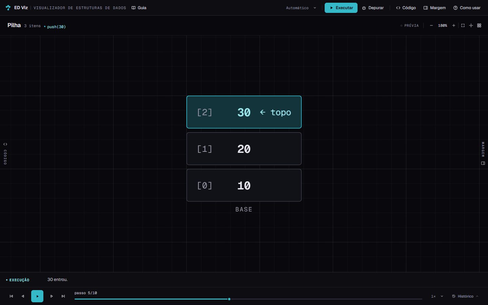
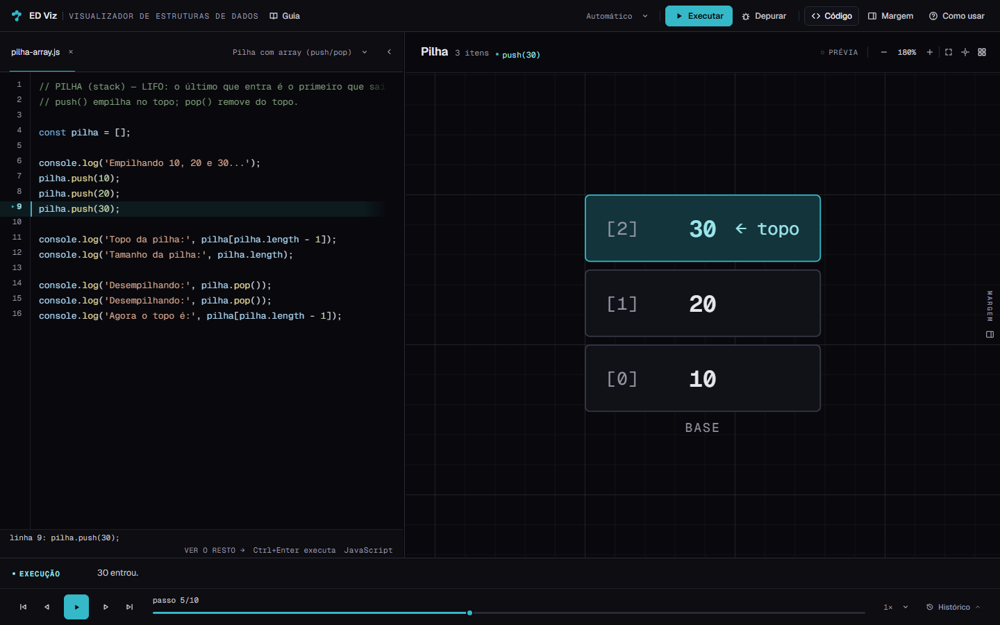
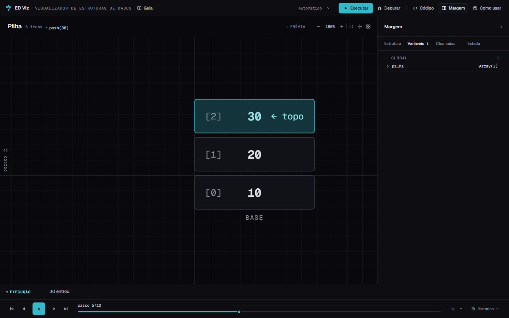
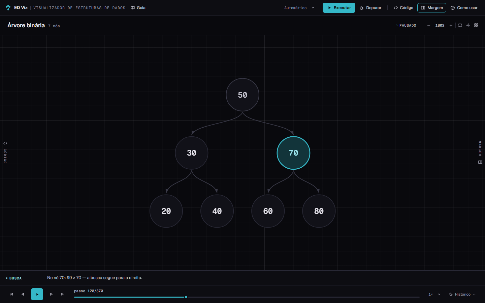
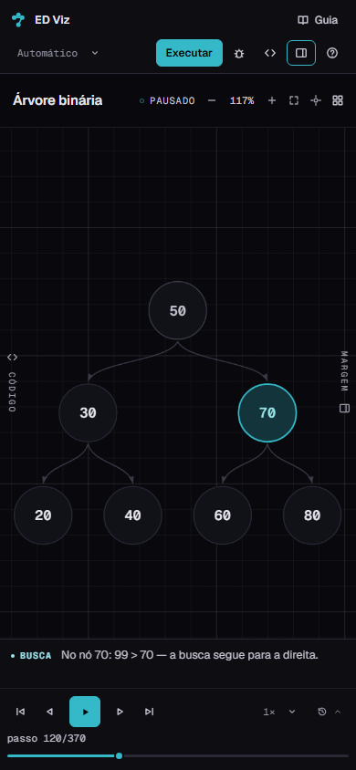
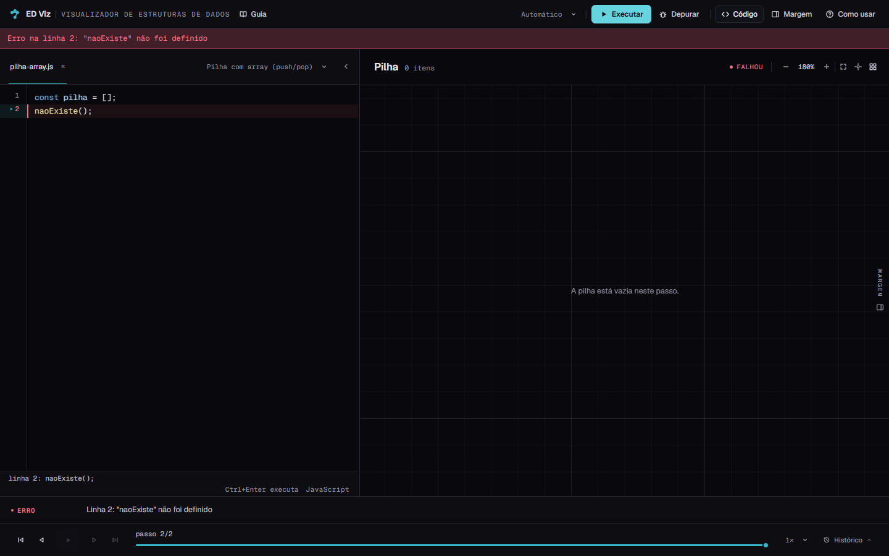

# ED Viz — Etapa 4B
## Contrato e Fundação do Novo Visualizador

**Data:** 10/11/2026  
**Branch:** `redesign/etapa-1-baseline`  
**HEAD:** `b97545f`  
**Escopo:** contrato de DOM, fundação de estilos, shell semântico e carregamento de fontes  
**Status:** implementação concluída; aguardando revisão antes da Etapa 4C

> Esta etapa **não** implementa a composição final em três zonas, as sheets mobile, o novo editor, a nova Margem ou a nova Régua. Ela estabelece a base segura para que essas etapas aconteçam sem regressão.

A arquitetura aprovada está em [`diagnostico-visualizador.md`](diagnostico-visualizador.md) (Etapa 4A). Este relatório cobre apenas o contrato e a fundação definidos para a Etapa 4B.

---

## 1. Resumo das alterações

A Etapa 4B entregou uma fundação estável para o Caderno de Execução:

- O Visualizador passou a carregar **Geist e Geist Mono** localmente, com preload e `font-display: swap`.
- O tema do Visualizador passou a usar a **ponte de tokens Ocean + Neutral** do Design System, sem alterar o restante do site.
- O CSS foi separado em duas novas folhas:
  - `css/visualizador.css` — shell, layout estrutural, editor, painéis, transporte, ajuda e responsivo.
  - `css/estruturas.css` — regras dos renderizadores de pilha, fila, lista, árvore e array.
- O `visualizador.html` ganhou um shell semântico com as regiões **Roteiro, Prancha, Margem e Régua**, marcadas por `data-zone` e rótulos acessíveis.
- O corpo do documento passou a `class="viz-app"`, com `color-scheme: dark`, e o `theme-color` foi atualizado para `#09090D`.
- A Margem passou a ser o rótulo visível do antigo Inspetor; os IDs e o comportamento de abas foram preservados.
- Foi adicionada uma **verificação de contrato de DOM** na inicialização: IDs ausentes são listados no console e em `window.__edvizMissingIds`.
- Foram corrigidos pontos necessários para a nova tipografia: remeasuremento após `document.fonts.ready`, reset de métrica no resize, hover coerente com o hold de scroll do Firefox e ajuste do limite de arrasto do editor.
- O motor, o interpretador, o parser, o tokenizer, os exemplos, os renderizadores e a geometria **não foram modificados**.

O layout atual — canvas-first com gavetas — foi preservado de propósito. A Etapa 4B prepara o contrato e a fundação; a reorganização para as três zonas e as folhas responsivas pertence às etapas 4C–4F.

---

## 2. Arquivos criados e modificados

### 2.1 Criados nesta etapa

| Arquivo | Papel |
|---|---|
| `css/visualizador.css` | Fundação do shell: tokens de escopo, topbar, layout, editor, painéis, transporte, ajuda e responsivo (2.712 linhas) |
| `css/estruturas.css` | Regras dos renderizadores, sem JS e sem geometria nova (924 linhas) |
| `docs/etapa-4/relatorio-4b.md` | Este relatório |
| `docs/etapa-4/4b-shell-1440.png` | Estado inicial, 1440×900 |
| `docs/etapa-4/4b-codigo-1440.png` | Código aberto, 1440×900 |
| `docs/etapa-4/4b-margem-1440.png` | Margem aberta, 1440×900 |
| `docs/etapa-4/4b-arvore-1440.png` | Árvore binária, passo 120/370 |
| `docs/etapa-4/4b-mobile-390.png` | Estado mobile, 390×844 |
| `docs/etapa-4/4b-erro-1440.png` | Estado de erro, 1440×900 |

### 2.2 Modificados nesta etapa

| Arquivo | Alteração |
|---|---|
| `visualizador.html` | `theme-color`, preload das fontes, `fonts.css`, novas folhas CSS, `body.viz-app`, `data-zone` nas regiões, rótulos “Margem” e cópia da Ajuda |
| `js/app.js` | Verificação de IDs ausentes, reordenação do layout antes de ocultar painel, reflow de segurança, rótulos dinâmicos “margem”, reset de métricas após fontes, hover com `codeScrollX`, `SPLIT_MAX_CODE_PX` para 620 |
| `css/fonts.css` | Comentário atualizado; o arquivo já existia como não rastreado desde a Etapa 2 e agora é carregado pelo Visualizador |
| `tests/e2e/edviz.spec.js` | Somente a asserção final do teste de persistência passou a usar `expect.poll` para aguardar o assentamento da grade; a tolerância de 12px foi mantida |

### 2.3 Não modificados nesta etapa

- `js/tokenizer.js`
- `js/parser.js`
- `js/interpreter.js`
- `js/examples.js`
- `js/anim.js`
- `js/views.js`
- `js/rough.js`
- `js/util.js`
- `css/styles.css` (permanece como legado no repositório, **não carregado**)
- `css/tokens.css` (consumido, não alterado)
- `css/conteudo.css`, `css/landing.css`, `css/uikit.css`
- `package.json` e dependências
- `vite.config.mjs`

O `dist/` foi regenerado pelo build; é saída ignorada pelo Git.

---

## 3. Contratos de DOM identificados e preservados

### 3.1 IDs

O shell contém **108 IDs** e a verificação encontrou **0 duplicados**. O mapa `els` do `app.js` não encontrou IDs ausentes:

```text
window.__edvizMissingIds === []
```

Principais grupos preservados:

| Grupo | IDs |
|---|---|
| Editor | `code`, `codeViewport`, `highlight`, `gutterInner`, `lineHilite`, `varTip`, `tabs`, `exampleSelect`, `statusLine`, `statusHint`, `statusOverflow` |
| Execução | `btnRun`, `btnDebug`, `debugBar`, `debugInfo`, `btnExitDebug`, `banner` |
| Prancha | `structure`, `structureSelect`, `canvasTitle`, `canvasSub`, `canvasBadge`, `vizRunState`, `vizRunStateText`, `btnZoomOut`, `btnZoomReset`, `btnZoomIn`, `btnZoomFit`, `btnCanvasCenter`, `btnGrid` |
| Régua | `dock`, `dockHistory`, `dockTabs`, `btnDockToggle`, `btnDockClose`, `stepExplainer`, `stepOp`, `stepText`, `stepCount`, `btnFirst`, `btnPrev`, `btnPlay`, `btnNext`, `btnLast`, `slider`, `stepLabel`, `speedSelect` |
| Margem | `sidePanel`, `btnToggleSide`, `btnCollapseSide`, `railInspector`, `inspector-title`, `inspTabStructure`, `inspTabVars`, `inspTabCalls`, `inspTabState`, `pageStructure`, `pageVars`, `pageCallstack`, `pageState`, `structureInfo`, `vars`, `callstack`, `stateInfo`, `varsCount`, `callsCount` |
| Histórico | `commands`, `events`, `console`, `tabCommands`, `tabEvents`, `tabConsole`, `pageCommands`, `pageEvents`, `pageConsole` |
| Layout | `layout`, `codePanel`, `vizPanel`, `splitLeft`, `btnToggleCode`, `btnCollapseCode`, `railCode` |
| Ajuda | `helpDialog`, `helpTitle`, `btnHelp`, `btnHelpClose`, `linkGuia` |

### 3.2 Atributos `data-*`

Preservados sem renomeação:

- `data-k`, `data-enter`, `data-exit` — FLIP dos renderizadores.
- `data-content` — caixa real do desenho para a câmera da árvore.
- `data-state` — estados do chip de execução.
- `data-step` — comandos, eventos e console clicáveis.
- `data-tab`, `data-close` — abas do editor.
- `data-insp`, `data-pane` — abas da Margem.
- `data-dock` — abas do Registro.
- `data-var-key`, `data-filled` — expansão de variáveis.
- `data-line` — gutter do editor.

Adicionados nesta etapa, sem substituir contratos:

- `data-zone="roteiro"`, `"prancha"`, `"margem"`, `"regua"` e `"cabecalho"`.
- `data-zone="caderno"` no `<main>`.

### 3.3 Classes dos renderizadores

O `js/views.js` não foi alterado. As classes que ele gera continuam existindo em `css/estruturas.css`:

- Container: `.structure`, `.canvas-viewport`, `.canvas-stage`, `.empty`, `.empty-inline`.
- Pilha: `.stack-wrap`, `.stack-col`, `.stack-cell`, `.stack-side`, `.cell-*`.
- Fila: `.queue-wrap`, `.queue-row`, `.queue-unit`, `.queue-ptrs`, `.queue-ptr`, `.queue-cell`, `.queue-idx`.
- Lista: `.list-wrap`, `.list-unit`, `.list-node`, `.list-value`, `.list-next`, `.list-prev`, `.list-ptrs`, `.list-head-tag`, `.list-tail-tag`, `.ptr-chip`, `.list-link`, `.list-arrow`, `.list-end`, `.list-null`.
- Array: `.array-wrap`, `.array-board`, `.array-idx`, `.array-cell`, `.array-val`, `.array-size-row`, `.array-size-tag`, `.array-internal`, `.array-shift-flag`.
- Árvore: `.tree-wrap`, `.tree-svg`, `.tree-node`, `.tree-edge`, `.tree-tip-*`, `.tree-arrow`, `.tree-val`, `.tree-preview-*`.
- Animação: `.anim-enter` e `@keyframes enter-flash`, movidos para `estruturas.css`.

Nenhuma classe foi renomeada.

### 3.4 Câmera e canvas

Contratos preservados:

- `.canvas-viewport` e `.canvas-stage` continuam sendo encontrados por `canvasParts()`.
- `data-content` no `.canvas-stage` continua alimentando o enquadramento da árvore.
- `--canvas-x`, `--canvas-y` e `--canvas-zoom` continuam sendo escritos por `applyCanvasView()`.
- `.list-unit`, `.list-node.pending/target/active/new` continuam sendo usados por `canvasFocusNodeEl()`.
- `#structure`, `#vizPanel`, `#layout` e `#splitLeft` permanecem com os mesmos IDs e posição na árvore de nós.

A única alteração de layout foi a ordem interna de `applyLayout()`: a grade é atualizada antes de o painel ser ocultado, com um reflow de segurança. Não houve mudança em zoom, pan, fit, auto-fit ou pisos de legibilidade.

### 3.5 Callbacks e integração

Preservados:

- `DSV.renderStructure(container, sel, step, ctx)`
- `ctx.onMeta({ title, sub, badge })`
- `canvasAfterRender(sel)`
- `DSV.flipRender(...)`
- `window.DSV` e a ordem de importação em `js/main.js`

### 3.6 Contrato de testes

- Os testes de núcleo continuam lendo o mesmo `views.js` e a mesma API `DSV`.
- Os testes E2E continuam usando os mesmos IDs (`#code`, `#btnRun`, `#codePanel`, `#sidePanel`, `#dockHistory`, `#inspTabVars`, etc.).
- A verificação “todos os ids usados no app existem no HTML” continua passando.
- Nenhum teste funcional foi removido ou enfraquecido.
- A única atualização de teste está descrita na seção 5.4.

### 3.7 Verificação de desenvolvimento

Foi adicionada ao `app.js`, imediatamente após o mapa `els`:

```js
function checkDomContract() {
  var optional = { tabVars: true, tabCallstack: true };
  var missing = [];
  Object.keys(els).forEach(function (key) {
    if (!optional[key] && !els[key]) missing.push(key);
  });
  if (missing.length) {
    window.__edvizMissingIds = missing;
    console.error('[ED Viz] IDs ausentes no shell: ' + missing.join(', '));
  } else {
    window.__edvizMissingIds = [];
  }
  return missing;
}
```

Em produção, o resultado atual é `[]`. O teste de UI que confere os IDs também continua ativo.

---

## 4. Decisões de implementação

### 4.1 Portar e separar, em vez de reescrever

O CSS atual foi lido e separado por responsabilidade:

- Regras de renderizadores → `css/estruturas.css`.
- Demais regras → `css/visualizador.css`.

O arquivo `css/styles.css` permanece intacto no repositório como referência e rollback. Ele **não é carregado** pelo `visualizador.html` nesta etapa.

Motivo: a Etapa 4B precisa preservar o funcionamento; reescrever 3.000 linhas de CSS em uma etapa de fundação aumentaria o risco sem benefício imediato. A reorganização visual virá nas etapas seguintes.

### 4.2 Ponte de tokens no escopo do app

`body.viz-app` define os tokens legados que o shell e os renderizadores já consomem, resolvendo-os para `--ds-*`:

```css
body.viz-app {
  color-scheme: dark;
  --bg-primary: var(--ds-bg-canvas);
  --bg-surface: var(--ds-bg-surface);
  --bg-editor: var(--ds-bg-canvas);
  --bg-elevated: var(--ds-bg-raised);
  --border: var(--ds-border);
  --text-primary: var(--ds-text-primary);
  --accent: var(--ds-accent);
  --accent-soft: var(--ds-accent-wash);
  --accent-text: var(--ds-accent-soft-text);
  --font-ui: var(--ds-font-sans);
  --font-mono: var(--ds-font-mono);
  --radius-sm: var(--ds-radius-sm);
  /* ... demais superfícies, estados e medidas */
}
```

A ponte cobre `--viz-*`, `--accent-*`, `--bg-*`, `--border-*`, `--text-*`, `--node-*`, `--edge-line`, `--grid-*`, `--selection`, `--danger/*`, `--warn/*`, `--font-*` e `--radius-*`. O restante do site não é remapeado.

### 4.3 Shell semântico sem reorganizar as zonas

O HTML manteve a composição canvas-first e os controles atuais. Foram adicionados:

- `body.viz-app`.
- `data-zone` no cabeçalho, no layout e nas quatro regiões.
- `aria-label="Caderno de Execução"` no `<main>`.
- Rótulos “Roteiro de código”, “Prancha da estrutura”, “Margem de leitura” e “Régua de reprodução”.
- “Margem” como rótulo visível no lugar de “Inspetor”, inclusive na Ajuda.

A grade de quatro colunas, as gavetas e o dock continuam iguais. A composição final de Roteiro + Prancha + Margem e as sheets serão implementadas em 4C–4F.

### 4.4 Fontes e carregamento

- `css/fonts.css` passou a ser carregado pelo Visualizador.
- Preload de `Geist-Variable.woff2` e `GeistMono-Variable.woff2`.
- `font-display: swap`.
- Nenhuma requisição externa: as fontes são servidas de `fonts/`.
- `document.fonts.ready` dispara remeasuremento de `codeCharW`/`codeFit` e `syncScroll()`.

### 4.5 Ajustes necessários de compatibilidade

| Ajuste | Motivo |
|---|---|
| `SPLIT_MAX_CODE_PX` de 600 para 620 | Com Geist Mono, o auto-fit do exemplo padrão chega a 580px; o arrasto de 60px batia no teto de 600 e o teste de redimensionamento deixava de observar crescimento. O auto-fit continua limitado a 600 (`SPLIT_FIT_MAX`). O valor 620 é transitório até 4C definir o Roteiro final. |
| `applyLayout()` atualiza a grade antes de ocultar o painel | Evita que o Chromium exponha, por um frame, a coluna antiga com o painel já recolhido. |
| `void layout.offsetWidth` | Força o recálculo da grade antes da mudança de visibilidade. |
| Reset de `codeCharW` em `document.fonts.ready` | Garante que o hover e o `codeFit` usem Geist Mono, não a fallback. |
| `codeWordAt` usa `codeScrollX` quando `codeScrollHold` está ativo | Corrige o deslocamento do hover no Firefox após a rolagem horizontal. |
| Rótulos dinâmicos de `btnToggleSide` para “margem” | Mantém o nome acessível coerente com a região. |

Nenhuma dessas mudanças altera o motor, a renderização, o playback, o debug, o zoom/pan ou a persistência de dados.

### 4.6 O que **não** foi implementado

- Composição final de três zonas.
- Redimensionamento funcional do Roteiro na nova arquitetura.
- Sheets mobile.
- Reconstrução da Margem e da Régua.
- Redesign do editor.
- Command palette, cross-highlight ou timeline anotada.
- Alterações em interpretador, parser, tokenizer, renderizadores ou geometria.

---

## 5. Testes executados e resultados

### 5.1 `npm test`

```text
214 testes de núcleo        → 0 falhas
 90 testes de UI            → 0 falhas
  9 testes de conteúdo      → 0 falhas
313 verificações             → 0 falhas
```

### 5.2 `npm run test:e2e`

```text
108 testes
107 passaram
  1 skipped (memória, exclusivo do Chromium)
  0 falharam
```

Cobre Chromium e Firefox, incluindo:

- axe sem violações críticas/sérias em 1440 e 390;
- foco e teclado;
- persistência, reload, abas e buffers;
- execução, passos, debug, erro e stale;
- canvas, zoom, pan, fit, grid, lista dupla e árvore;
- mobile e ausência de overflow;
- CSP e ausência de script inline.

### 5.3 `npm run build`

```text
✓ 29 modules transformed
✓ built in 493ms
```

Saídas relevantes:

```text
dist/visualizador.html                    22.82 kB
dist/assets/visualizador-*.css            57.45 kB (10.59 kB gzip)
dist/assets/visualizador-*.js            219.71 kB (64.36 kB gzip)
dist/assets/Geist-Variable-*.woff2        69.48 kB
dist/assets/GeistMono-Variable-*.woff2    71.21 kB
```

### 5.4 Atualização de teste justificada

O teste `workspace persiste gavetas e largura do editor entre recargas` media a largura logo após o `Escape`, de forma síncrona. Em Chromium, sob carga da suíte completa, a leitura podia ocorrer em um frame intermediário em que a Margem já estava oculta, mas a grade ainda mostrava a coluna antiga. A asserção foi trocada por:

```js
await expect.poll(async () => {
  const restaurado = await page.evaluate(
    () => document.getElementById('codePanel').getBoundingClientRect().width
  );
  return Math.abs(restaurado - depois);
}).toBeLessThan(12);
```

A condição final é a mesma: a largura restaurada deve ficar a menos de 12px da largura ajustada. O teste não foi enfraquecido; passou a aguardar o assentamento da grade, como as demais asserções de layout do projeto.

### 5.5 Validação manual

| Verificação | Resultado |
|---|---|
| Fontes Geist/Geist Mono | `document.fonts.status = "loaded"`; checks `true` |
| Folhas carregadas | `fonts.css`, `tokens.css`, `visualizador.css` (com `estruturas.css` no bundle) |
| `styles.css` antigo | **não carregado** |
| Requisições externas | 0 |
| IDs no DOM | 108; 0 duplicados; 0 ausentes |
| `window.__edvizMissingIds` | `[]` |
| Overflow horizontal | 0 em 1440, 1280, 1024, 768 e 390 |
| Console/página | 0 erros no smoke |
| 16 exemplos | Executam sem erro; as cinco famílias renderizam |
| Hover de variável | Tooltip “pilha · global · [10, 20, 30]” no passo de prévia |
| Erro | Banner, linha vermelha, estado “falhou”, play desabilitado |
| Código aberto | 580px no exemplo padrão; conteúdo com Geist Mono 13/22 |

> A captura `4b-codigo-1440.png` foi feita após **Ajustar à tela**, porque a abertura da gaveta com `prefers-reduced-motion` preserva o enquadramento anterior — comportamento preexistente registrado na Etapa 1 e no relatório 4A. Sem redução de movimento, a câmera reenquadra sozinha.

### 5.6 Screenshots

| Arquivo | Conteúdo |
|---|---|
| [`4b-shell-1440.png`](4b-shell-1440.png) | Estado inicial, prévia da pilha, 1440×900 |
| [`4b-codigo-1440.png`](4b-codigo-1440.png) | Código aberto após Ajustar à tela, 1440×900 |
| [`4b-margem-1440.png`](4b-margem-1440.png) | Margem aberta, 1440×900 |
| [`4b-arvore-1440.png`](4b-arvore-1440.png) | Árvore BST, passo 120/370 |
| [`4b-mobile-390.png`](4b-mobile-390.png) | Árvore em 390×844 |
| [`4b-erro-1440.png`](4b-erro-1440.png) | Erro de runtime e linha destacada |













---

## 6. Problemas encontrados e riscos restantes

### 6.1 Encontrados nesta etapa

1. **Geist Mono é mais larga que a fallback.** O auto-fit do exemplo padrão subiu para 580px e o arrasto de 60px encontrava o teto de 600px. Resolvido com `SPLIT_MAX_CODE_PX=620` apenas para o arrasto; o auto-fit continua em 600. O limite final será definido em 4C.
2. **Corrida de layout no Chromium.** O teste de persistência podia ler a largura em um frame intermediário entre o painel oculto e a grade atualizada. Resolvido com a ordem grade → painel, reflow de segurança e `expect.poll` no teste.
3. **Métrica do editor após fontes.** `codeCharW`/`codeFit` podiam usar a fallback se as fontes chegassem depois do primeiro cálculo. Agora há remeasuremento em `document.fonts.ready`.
4. **Hover com scroll horizontal no Firefox.** `codeWordAt` ignorava `codeScrollX`; corrigido para usar o hold de scroll.
5. **Rótulo antigo “Inspetor”.** O `app.js` sobrescrevia o rótulo estático; agora os rótulos dinâmicos falam “margem”.

### 6.2 Problemas preexistentes, não corrigidos nesta etapa

1. **Câmera ao abrir Código com `prefers-reduced-motion`.** O enquadramento anterior é preservado e parte do desenho pode ficar fora do palco até “Ajustar à tela”. Já registrado no baseline e no relatório 4A; pertence à 4D.
2. **Prévia do `meu-array`.** Ao selecionar o exemplo, a prévia pode abrir no passo 1 sem estrutura desenhada; ao navegar para passos com conteúdo, o array manual renderiza. A causa está em `candidateHasContent`, que para o wrapper de array manual checa o objeto como se fosse um array. Não foi alterado por estar fora do escopo de 4B.
3. **Edição durante playback.** O chip pode permanecer “executando” até o play parar, embora a status bar já diga “código editado”. Comportamento de playback preexistente; pertence à 4E.
4. **Foco de 1px em vários controles.** A identidade aprovada pede 2px; a fundação manteve os contornos legados para não misturar redesign de componentes. 4C/4E devem aplicar o anel de 2px.

### 6.3 Riscos restantes

| Risco | Impacto | Mitigação |
|---|---|---|
| A composição final ainda não existe | Alto para a experiência, esperado para 4B | 4C–4F constroem as zonas e sheets |
| `css/styles.css` legado permanece no repositório | Confusão de fonte da verdade | Não é carregado; remover só após paridade (4G) |
| `visualizador.css` contém regras do layout antigo | Retrabalho em 4C–4F | A fundação preserva comportamento; a limpeza é incremental |
| Limite 620px do Roteiro é transitório | Pode conflitar com a largura final | 4C define `clamp`/limites finais |
| Câmera com reduced motion | Desenho pode abrir deslocado | 4D reenquadra ao abrir/fechar zonas |
| Sem teste visual automatizado | Regressão de cor/layout passa despercebida | Adicionar screenshots de regressão em 4C/4G |
| IDs ainda são o contrato principal | Refatorações futuras podem quebrar caminhos | Manter `checkDomContract` e o teste de IDs |

---

## 7. Comparação entre o estado anterior e o novo shell

| Aspecto | Antes (4A) | Depois (4B) |
|---|---|---|
| Folhas do Visualizador | `tokens.css` + `styles.css` | `fonts.css` + `tokens.css` + `visualizador.css` + `estruturas.css` |
| Tipografia | Segoe UI / JetBrains/Consolas | Geist Sans / Geist Mono |
| Acento | Âmbar `#f0aa68` | Ocean `#35B8C8` |
| Superfícies | `--viz-*` grafite | `--ds-*` Ocean/Neutral via ponte |
| `color-scheme` | ausente | `dark` |
| `theme-color` | `#16181c` | `#09090D` |
| Corpo | sem classe de escopo | `body.viz-app` |
| Regiões | sem marcação | `data-zone` em Roteiro/Prancha/Margem/Régua |
| Inspetor | rótulo “Inspetor” | rótulo “Margem” |
| Contrato de IDs | funcional, sem verificação explícita | 108 IDs, verificação de ausência e duplicidade |
| CSS dos renderizadores | misturado em `styles.css` | isolado em `estruturas.css` |
| Layout | canvas-first com gavetas | **mantido** (a composição final é 4C–4F) |
| Motor/renderizadores | funcionais | **inalterados** |

### 7.1 Comparação visual

Antes: [`docs/baseline/04-visualizador-inicial-1440.png`](../baseline/04-visualizador-inicial-1440.png) — âmbar, Segoe/JetBrains.

Depois: [`4b-shell-1440.png`](4b-shell-1440.png) — Ocean, Geist, mesma composição funcional.

A comparação mostra a mudança de fundação (cor/tipografia) sem prometer a composição final. As gavetas, a topbar e a Régua ainda são as da etapa anterior; a reorganização é intencionalmente posterior.

---

## 8. Confirmação sobre motor e renderizadores

**O motor e os renderizadores não foram modificados nesta etapa.**

Não houve edição em:

- `js/tokenizer.js` — tokenização.
- `js/parser.js` — AST.
- `js/interpreter.js` — execução, passos, eventos, serialização.
- `js/examples.js` — exemplos e ordem.
- `js/anim.js` — FLIP e utilidades de animação.
- `js/views.js` — detecção, seleção, explicações, renderizadores, geometria, SVG.
- `js/rough.js` — traço determinístico.
- `js/util.js` — utilitários.

O `css/estruturas.css` é uma **porta de estilos** dos renderizadores, não uma alteração de renderização. Nenhuma classe, `data-*`, geometria, SVG, animação ou regra de posicionamento foi redesenhada. A única mudança de cor nos renderizadores é a resolução dos tokens legados para Ocean/Neutral; o estado de remoção (`target`) usa danger, como previsto no sistema funcional.

As alterações em `js/app.js` são de interface/controlador:

- verificação de IDs;
- rótulos “margem”;
- ordem de atualização da grade e reflow;
- limite de arrasto do editor;
- remeasuremento de fonte e hover com scroll.

Não há mudança em `goto`, no trace, no playback, no debug, no zoom/pan ou na persistência de dados.

---

## 9. Estado final do Git

```text
Branch: redesign/etapa-1-baseline
HEAD:   b97545f
Working tree: 43 entradas
```

As **41 entradas preexistentes** (29 modificadas + 12 não rastreadas, incluindo `docs/etapa-4/`) foram preservadas. As alterações desta etapa são:

```text
 M visualizador.html
 M js/app.js
 M tests/e2e/edviz.spec.js
?? css/visualizador.css
?? css/estruturas.css
?? css/fonts.css        (já era não rastreado desde a Etapa 2; comentário atualizado)
?? docs/etapa-4/        (relatório 4B + 6 screenshots; o diretório já existia)
```

`css/styles.css` continua modificado no working tree por etapas anteriores, mas **não foi editado nesta etapa** e **não é carregado** pelo Visualizador. O mesmo vale para `tokens.css`, `conteudo.css`, `landing.css`, `uikit.css` e os demais arquivos preexistentes.

Não houve:

- commit;
- troca de branch;
- reset, clean, checkout destrutivo ou stash;
- remoção de arquivos;
- instalação de dependências;
- alteração de algoritmos ou renderizadores.

---

## 10. Critério de conclusão

| Critério | Status |
|---|---|
| Aplicação inicializa sem erros no console | ✅ |
| Exemplo padrão continua executando | ✅ |
| Todas as estruturas continuam renderizando | ✅ (testes de núcleo/UI/E2E) |
| IDs e contratos preservados | ✅ 108 IDs, 0 duplicados, 0 ausentes |
| CSS antigo e novo sem conflito | ✅ apenas as folhas novas são carregadas |
| Fontes Geist carregadas | ✅ preload + `document.fonts` |
| `theme-color` e `color-scheme` | ✅ |
| Build | ✅ 29 módulos |
| Testes unitários/UI/conteúdo | ✅ 313 |
| Testes E2E | ✅ 107 passaram, 1 skip |
| Motor e renderizadores intactos | ✅ |
| Nenhuma dependência nova | ✅ |
| Commit/branch swap | ❌ nenhum |

---

## 11. Próximo passo

A fundação está pronta para a **Etapa 4C — Roteiro e Editor**. Antes de avançar, esta entrega deve ser revisada e aprovada, especialmente:

1. A decisão de manter a composição canvas-first nesta etapa, com a reorganização visual apenas em 4C–4F.
2. A separação `visualizador.css` / `estruturas.css`.
3. A ponte de tokens e o uso de Geist no Visualizador.
4. O limite transitório de 620px para o arrasto do editor.
5. A atualização pontual do teste de persistência para `expect.poll`.

**Não avancei para a Etapa 4C. Aguardando revisão e aprovação.**
