# ED Viz — Etapa 4C · Refinamento do Roteiro e do editor

**Data:** 11/11/2026  
**Branch:** `redesign/etapa-1-baseline`  
**HEAD:** `b97545f`  
**Escopo:** segunda iteração visual da 4C — topbar, cabeçalho do Roteiro, editor, status e relação Roteiro–Prancha  
**Status:** refinamento concluído; aguardando revisão antes da Etapa 4D

> Esta etapa é exclusivamente visual e organizacional. Não implementa a nova Prancha (4D), a nova Margem/Regua (4E) nem as sheets mobile (4F). O interpretador, os renderizadores, a geometria, a câmera, o playback e a persistência não foram alterados.

---

## 1. Diagnóstico visual inicial

A primeira versão da 4C resolveu a arquitetura — o Roteiro virou coluna permanente — mas manteve o padrão de **muitos controles permanentes com o mesmo peso**. A leitura da captura de 1440 mostrou cinco fontes principais de ruído:

1. **Topbar com oito controles interativos.** Marca, Guia, seletor de estrutura, Executar, Depurar, Código, Margem e Como usar competiam na mesma faixa de 46px, todos com ícone + rótulo e contraste parecido. O subtítulo em caixa alta ocupava o centro da marca sem ajudar a operar.
2. **Cabeçalho do Roteiro em duas faixas altas.** 40px para exemplo + ações e 34px para abas, total de 74px. O seletor ocupava a largura toda, Executar e Depurar tinham o mesmo formato de pílula e o cabeçalho usava `surface`, destacando-se como uma barra independente.
3. **Editor com sinais demais na linha atual.** Wash Ocean de 10%, barra de 2px, marcador `▶` e número em Ocean 200/600 — quatro sinais para uma informação secundária. O gutter ainda tinha uma divisória de 1px em toda a altura.
4. **Rodapé com quatro informações permanentes.** Linha atual, “VER O RESTO” em caixa alta, atalho e “JAVASCRIPT”. O atalho e a linguagem eram permanentes mesmo sem relação com a leitura do código.
5. **Fronteira Roteiro–Prancha desenhada como parede.** Além da calha de 4px, uma hairline `--border` percorria toda a altura; o Roteiro tinha superfície `surface` e a Prancha `canvas`, o que reforçava a sensação de duas aplicações lado a lado.

O que **não** era problema: a Prancha, o desenho, a paleta, a tipografia e a largura flexível aprovada na 4A. O refinamento deveria agir no chrome do Roteiro e da topbar, não no conteúdo.

### 1.1 Medidas antes → depois

| Indicador | Antes (4C) | Depois (4C refinada) |
|---|---:|---:|
| Ações visíveis na topbar em 1440, com Roteiro aberto | 8 | 5 |
| Faixas do cabeçalho do Roteiro | 2 (40 + 34px) | 2 (32 + 26px) |
| Altura total do cabeçalho | 74px | **58px** |
| Altura do status do editor | 28px | **26px** |
| Itens visíveis no status (captura com overflow) | 4 | 2 (+1 contextual ao editar) |
| Sinais de acento na linha atual | 4 | 2 |
| Divisórias permanentes no editor | gutter + base das abas | nenhuma no gutter; nenhuma na base das abas |
| Botões de execução no Roteiro | Executar + Depurar rotulados | Executar rotulado + Depurar em ícone |
| Ajuda e Guia | 2 botões visíveis | 1 menu discreto “Mais” |

---

## 2. Hierarquia adotada

A interface passou a ter quatro degraus claros:

| Degrau | Elemento | Tratamento |
|---|---|---|
| 1. Protagonista | Código | Superfície `canvas`, sem moldura, sem divisórias internas; ocupa todo o espaço restante |
| 2. Documento | Exemplo ativo, aba e linha atual | Texto 12px, seletor sem caixa, aba com régua de 1px, linha atual com wash de 4,5% |
| 3. Ação principal | Executar | Único preenchimento Ocean do Roteiro |
| 4. Apoio / sob demanda | Depurar, recolher, Código, Margem, Mais, atalhos, overflow | Ícones mudos, menu, status contextual e controles que só aparecem quando necessários |

**Regra aplicada:** se o elemento não responde “onde estou” nem “o que acontece se eu executar”, ele não pode competir com o código. Nesse caso, vira ícone, menu ou aparece apenas no estado relevante.

---

## 3. Decisões de design e o que mudou

### 3.1 Topbar: de barra de ferramentas para régua

- O subtítulo “VISUALIZADOR DE ESTRUTURAS DE DADOS” e o separador da marca saíram. A identificação agora é só o símbolo + **ED Viz**.
- `Guia` e `Como usar` foram movidos para um disclosure nativo `<details>` com o rótulo acessível **Mais opções**. O painel usa `surface-overlay`, borda, raio de 8px e sombra de popover — as mesmas regras de uma camada flutuante.
- `Código` e `Margem` são ícones de 28px, sem rótulo visível, com `title`, `aria-label`, `aria-pressed` e `aria-controls` preservados. O estado aberto usa apenas um degrau tonal (`surface-raised`), sem borda nem Ocean.
- O divisor vertical da topbar foi removido. A separação agora é feita por espaço e pela própria ordem dos grupos.
- A borda inferior da topbar passou de `--border` para `--border-soft`.
- **Abaixo de 420px**, os toggles `Código` e `Margem` saem da topbar. As abas laterais `CÓDIGO`/`MARGEM` da Prancha continuam abrindo as gavetas, e cada gaveta tem seu próprio botão de recolher. Os nós e listeners continuam no DOM; apenas a duplicação visual foi removida para devolver espaço ao seletor de estrutura.
- Em 620px a topbar deixou de empilhar em duas linhas: marca, seletor, Executar, Depurar e Mais cabem em uma linha de 46px. Em 360px o seletor mostra “Automático” inteiro; em 320px trunca de forma controlada.

**Contrato preservado:** `#btnRun` e `#btnDebug` continuam sendo os mesmos nós. Com o Roteiro aberto em desktop, vivem em `#roteiroRunSlot`; recolhido ou abaixo de 1024, voltam para `#topbarRunSlot`. Nenhum botão duplicado.

### 3.2 Cabeçalho do Roteiro: 74px → 58px

- Primeira faixa: **32px** com o seletor de exemplo à esquerda e o cluster `Executar · Depurar · recolher` à direita.
- Segunda faixa: **26px** com as abas.
- O total de 58px coincide com a altura do cabeçalho da Prancha; o código e o desenho começam na mesma linha horizontal.
- O seletor de exemplo perdeu a aparência de campo: fundo transparente, 12px, chevron discreto, largura máxima de 220px e `margin-right: auto`. Ele lê como o título do documento, não como um formulário.
- `Depurar` virou um botão de ícone de 26px. O rótulo continua no `title`/`aria-label` e o estado ativo mantém `accent-soft` + `accent-text`. A ação não depende do texto para ser descoberta.
- A base da faixa de abas perdeu a hairline. A aba ativa agora usa uma régua Ocean de **1px** com 75% de opacidade, recuada 7px nas pontas.
- O recolher do Roteiro permaneceu no cabeçalho como um chevron de 24px em `text-muted`.

### 3.3 Editor: o código como protagonista

- O gutter perdeu a divisória vertical. Os números agora flutuam sobre o mesmo `canvas` do código, com 10,5px e `text-muted`.
- A linha atual perdeu o marcador `▶`, o fundo Ocean no gutter e o número em negrito/Ocean. Restaram:
  - wash de **4,5%** de Ocean sobre a linha;
  - barra esquerda de **2px** a 48% de opacidade;
  - número em `text-secondary`, peso 500.
- O erro mantém uma wash de 8% + barra de 72% em danger e o número do gutter em danger. O banner e o estado “FALHOU” continuam sendo a leitura principal do erro.
- O degradê de overflow na borda direita do editor foi removido. Ele escurecia o fim de toda linha longa sem acrescentar informação; o botão contextual “ver o resto →” continua no status e faz a rolagem horizontal.
- O anel de foco do editor passou de 2px Ocean cheio para **1px `accent-muted`**. O caret Ocean, a linha atual e o atalho contextual continuam indicando o foco; o anel deixou de emoldurar o editor inteiro como uma caixa.
- O texto do código, a fonte, o `line-height` de 22px, os paddings usados pelo hover e a paleta de sintaxe não foram alterados.

### 3.4 Rodapé do editor

- O status caiu de 28px para 26px e usa o mesmo `canvas`.
- Sobraram, em repouso, a linha atual e o controle de overflow quando existe código fora da largura.
- `JAVASCRIPT` foi removido: a aplicação só executa JavaScript e o rótulo não mudava nenhuma decisão.
- O atalho deixou de ser permanente. `Ctrl+Enter executa`/`Tab insere espaços · Esc sai` aparece apenas quando o textarea recebe foco (classe `is-editing` no painel) e recolhe ao sair.
- O atalho só entra quando a coluna tem **470px ou mais**. Em colunas compactas — 1280, 1024 e a gaveta estreita — ele permanece no `title` de Executar e no diálogo de ajuda, em vez de empurrar o status para uma segunda linha. Em telas ≤620px também permanece oculto.
- O `#statusOverflow` continua com o mesmo comportamento e os mesmos textos (“ver o resto →” / “← início”), agora em minúsculas e sem `text-transform: uppercase`.
- A linha atual pode quebrar; o teste P5 continua garantindo que não há truncamento silencioso.

### 3.5 Roteiro e Prancha: uma área de trabalho

- O painel do Roteiro passou de `surface` para `canvas`, a mesma superfície da Prancha. Cabeçalho, abas, editor e status agora são um plano contínuo.
- O divisor de 4px continua existindo e arrastável, com os mesmos limites, persistência, teclado e `aria-valuenow`.
- A hairline do divisor em repouso passou de `--border` para `--border-soft`; no hover/foco ela vira `accent-muted` e no arraste vira uma linha Ocean de 2px. A divisória agora existe para o gesto, não para desenhar uma parede permanente.
- Na gaveta abaixo de 1024px, a borda direita também passou para `border-soft`.
- O cabeçalho da Prancha, o cluster de câmera e o desenho **não** foram redesenhados: continuam os da 4A/4B. A integração veio da superfície e da divisória, não de antecipar a 4D.

### 3.6 Controles contextuais

| Controle | Antes | Depois |
|---|---|---|
| Guia / Como usar | Dois botões permanentes | Um menu “Mais” com disclosure nativo |
| Depurar | Rótulo permanente no Roteiro | Ícone; rótulo volta na topbar quando é ação principal |
| Código / Margem | Rótulo em desktop | Ícone de 28px; abaixo de 420px, só as abas laterais da Prancha |
| Atalho do editor | Sempre visível | Só com o editor em foco |
| “ver o resto” | Sempre em caixa alta quando há overflow | Minúsculo, só quando há overflow |
| Linguagem | Sempre visível | Removida (JavaScript é a única linguagem suportada) |
| Barra de debug | Já era contextual | Mantida; aparece só no modo de depuração |
| Overflow horizontal | Degradê permanente na borda | Removido; o botão de status resolve |

---

## 4. O que foi preservado

- **IDs e contratos de DOM:** `btnRun`, `btnDebug`, `code`, `codeViewport`, `highlight`, `gutterInner`, `lineHilite`, `varTip`, `tabs`, `exampleSelect`, `statusLine`, `statusHint`, `statusOverflow`, `btnToggleCode`, `btnCollapseCode`, `btnToggleSide`, `btnCollapseSide`, `railCode`, `railInspector`, `splitLeft`, `topMenu` (novo) e `btnTopMenu` (novo).
- **Atributos `data-*`:** `data-tab`, `data-close`, `data-line`, `data-k`, `data-enter`, `data-exit`, `data-content`, `data-state`, `data-step`, `data-insp`, `data-pane`, `data-dock`, `data-var-key`, `data-filled`, `data-zone`.
- **Comportamento:** execução, debug por tecla, F10, Esc, Ctrl+Enter, reprodução, histórico, abas, buffers, deep links, persistência da largura, zoom, pan, câmera, FLIP, renderizadores.
- **Tokens visuais:** nenhuma cor nova. Foram usados apenas tokens existentes (`--ds-bg-canvas`, `--ds-bg-raised`, `--ds-border-soft`, `--ds-accent-border`, `--ds-accent-wash`, `--text-secondary`, `--text-muted`).
- **Geometria:** o motor, o parser, o tokenizer, o interpretador, `js/views.js`, `js/rough.js`, `js/anim.js` e `css/estruturas.css` não foram tocados.

---

## 5. Arquivos modificados nesta iteração

| Arquivo | Alteração |
|---|---|
| `visualizador.html` | Marca sem subtítulo; menu “Mais” com `#linkGuia` e `#btnHelp`; remoção de `status-lang`, `topbar-divider`, `brand-sep` e `brand-sub`; ícone `i-more`; estrutura do cabeçalho do Roteiro mantida |
| `css/visualizador.css` | Topbar de 5 ações; menu; cabeçalho de 58px; abas de 26px; gutter sem divisória; linha atual de baixo contraste; status de 26px; atalho sob demanda; superfície única Roteiro–Prancha; divisor suave; ajustes em 1024–1279, ≤820, ≤620 e ≤420 |
| `js/app.js` | Classe `is-editing` no painel ao focar/sair do editor; setup do disclosure `#topMenu` (clique fora, Esc com foco dentro, `focusout`, clique em item). Nenhuma mudança em execução, trace, debug, câmera ou persistência |
| `tests/e2e/edviz.spec.js` | Novo teste do menu “Mais”; ajuda agora abre o menu antes de `#btnHelp`; mobile de 390 abre a gaveta pela aba lateral `#railCode` |
| `docs/etapa-4/relatorio-4c-refinamento.md` | Este relatório |
| `docs/etapa-4/4c2-*.png` | Capturas da validação visual (13 imagens) |

### 5.1 Arquivos deliberadamente não alterados

- `js/tokenizer.js`, `js/parser.js`, `js/interpreter.js`, `js/examples.js`, `js/anim.js`, `js/views.js`, `js/rough.js`, `js/util.js`.
- `css/estruturas.css`, `css/tokens.css`, `css/fonts.css`.
- `package.json`, `vite.config.mjs`, dependências.
- `tests/run-tests.js`, `tests/run-content.js`, `tests/e2e/a11y.spec.js`, `tests/e2e/conteudo.spec.js`.

O `dist/` foi regenerado pelo build e é saída ignorada pelo Git.

---

## 6. Estrutura final do chrome

```text
topbar (46px)
├─ .topbar-left
│  └─ .brand > símbolo + "ED Viz"
└─ .topbar-actions
   ├─ #structureSelect
   ├─ #topbarRunSlot          (Executar/Depurar quando o Roteiro está recolhido ou <1024)
   ├─ #btnToggleCode          (ícone; oculto ≤420)
   ├─ #btnToggleSide          (ícone; oculto ≤420)
   └─ #topMenu (details)
      ├─ summary#btnTopMenu   ("Mais opções")
      └─ .top-menu-panel
         ├─ #linkGuia
         └─ #btnHelp

#codePanel (canvas)
├─ .code-head (58px)
│  ├─ .code-head-top (32px)
│  │  ├─ #exampleSelect
│  │  ├─ #roteiroRunSlot
│  │  │  ├─ #btnRun
│  │  │  └─ #btnDebug
│  │  └─ #btnCollapseCode
│  └─ .code-tabs-row (26px)
│     └─ #tabs
├─ #editor
│  ├─ .gutter > #gutterInner
│  └─ #codeViewport
│     ├─ #highlight
│     ├─ #lineHilite
│     ├─ #code
│     └─ #varTip
└─ .statusbar (26px)
   ├─ #statusLine
   └─ .status-meta
      ├─ #statusOverflow
      └─ #statusHint
```

---

## 7. Testes executados

### 7.1 `npm test`

```text
214 testes de núcleo        → 0 falhas
 90 testes de UI            → 0 falhas
  9 testes de conteúdo      → 0 falhas
313 verificações             → 0 falhas
```

### 7.2 `npm run test:e2e`

```text
110 testes
109 passaram
  1 skipped (memória, exclusivo do Chromium)
  0 falharam
```

Cobre Chromium e Firefox, incluindo o novo teste:

- menu “Mais” começa fechado, abre Guia e Como usar, fecha com Esc e devolve o foco ao summary;
- ajuda abre a partir do menu;
- mobile de 390 abre o Roteiro pela aba lateral e mantém a gaveta sem overflow;
- axe sem violações críticas/sérias em 1440, 1600 e 390;
- execução, debug, erro, stale, abas, persistência, canvas, zoom, pan, fit, grid, lista dupla e árvore;
- 1024 com Roteiro em coluna e Margem em sobreposição;
- CSP e ausência de script inline.

### 7.3 `npm run build`

```text
✓ 29 modules transformed
✓ built in 299ms

dist/visualizador.html                     23.37 kB (6.57 kB gzip)
dist/assets/visualizador-2peH2XO3.css      60.46 kB (11.10 kB gzip)
dist/assets/visualizador-BfgzZzSH.js      221.89 kB (65.08 kB gzip)
```

### 7.4 Contrato de DOM

```text
IDs: 113
Duplicados: 0
Ausentes: 0
window.__edvizMissingIds: []
#btnRun: 1
#btnDebug: 1
```

O total inclui os dois novos IDs do menu (`topMenu`, `btnTopMenu`) e o símbolo `i-more`.

### 7.5 Validação manual

| Verificação | Resultado |
|---|---|
| 1440×900: Roteiro + Prancha | 480px + 956px; header 58px; status 26px; overflow 0 |
| 1280×800: coluna compacta | 426px + 850px; overflow 0 |
| 1024×768: coluna + Prancha | 360px + 660px; Margem em sobreposição; overflow 0 |
| 390×844: Prancha + topbar | topbar de uma linha; `Automático` legível; overflow 0 |
| 390×844: gaveta de código | 359px (92vw); Executar na topbar; header 58px |
| 360×800 / 320×720 | topbar sem overflow; seletor com 128px / 88px |
| 1440 com Margem aberta | Roteiro 480 / Margem 372 / Prancha 584 |
| Roteiro recolhido em 1440 | Prancha 1440; Executar e Depurar em `#topbarRunSlot` |
| Execução pausada | estado “pausado”; linha atual visível; sem erros de console |
| Modo de depuração | `readOnly = true`; barra de debug visível; estado “depuração” |
| Erro de sintaxe | banner “Erro na linha 3”; gutter marca 3; estado “falhou” |
| Editor em foco | classe `is-editing`; atalho contextual visível; anel de 1px |
| Hover de variável | “pilha · global · [10, 20, 30]” |
| Menu “Mais” | abre, fecha fora, fecha com Esc e devolve foco ao summary |
| Fontes | `document.fonts.status = "loaded"` |
| Console | 0 erros nas interações validadas |

---

## 8. Problemas encontrados e correções

1. **O DOM simulado do smoke test guardava apenas um listener global de `keydown`.** O primeiro desenho do menu adicionava um `document.addEventListener('keydown')` para fechar com Esc; no teste simulado, esse listener sobrescrevia o handler de debug, e seis testes de debug falharam. A correção foi remover o listener global: o Esc agora é tratado no próprio `<details>` e o menu também fecha em `focusout`. O comportamento real ficou igual e o smoke test voltou a 90/90.
2. **A topbar de 390 ficou apertada na primeira tentativa.** Com Código, Margem, Executar, Depurar e Mais na mesma linha, o seletor de estrutura ficava com 55px. Abaixo de 420px, os toggles de layout saíram da topbar; as abas laterais da Prancha e os botões de recolher das gavetas mantêm o acesso. O seletor passou a 128px em 360 e 88px em 320.
3. **O anel de foco de 2px em volta do editor pesava mais que o código.** Reduzido para 1px `accent-muted`; o caret, a linha atual e o atalho contextual continuam indicando o foco. O axe e os testes de teclado seguem passando.
4. **Uso de um token inexistente (`--accent-border`) na primeira versão do foco.** O token da ponte é `--accent-muted` (ou `--ds-accent-border`); a correção foi aplicada antes da captura final.
5. **O menu cobre temporariamente o cluster de câmera da Prancha.** É uma camada flutuante transitória, com foco e Esc; não há deslocamento de layout. O trade-off foi aceito em troca de uma topbar de 5 ações.
6. **O seletor de estrutura trunca em 320px.** A estrutura ativa também aparece no título da Prancha; o nome completo continua no dropdown. Aceitável para o menor recorte suportado.
7. **O atalho do editor deixou de ser permanente.** A descoberta fica no `title` de Executar (“Ctrl+Enter”), no diálogo de ajuda e no próprio status quando o editor recebe foco. É a troca intencional para tirar a instrução do caminho do código.
8. **O atalho contextual empurrava o status para uma segunda linha em 1280 e 1024.** Ao focar o editor, a barra crescia de 26 para 39,5px porque a linha e o atalho não cabiam na mesma faixa. A correção usa uma container query: o atalho só aparece quando a coluna tem 470px ou mais. Em colunas compactas, o status permanece em 26px e a instrução continua no título/ajuda.

---

## 9. Riscos e trade-offs restantes

| Risco | Impacto | Mitigação |
|---|---|---|
| Guia e Como usar dentro de um menu | Baixo; perdem descoberta imediata | Item “Mais opções” com rótulo acessível; menu testado por teclado |
| Atalho oculto em repouso e em colunas compactas | Baixo; usuário pode não descobrir Tab/Esc | `title` de Executar, diálogo de ajuda e exibição ao focar o editor em colunas ≥470px |
| Código/Margem fora da topbar ≤420 | Baixo; acesso passa pelas abas laterais | `#railCode`/`#railInspector` e o recolher de cada gaveta continuam visíveis |
| Menu flutuante sobre a Prancha | Baixo; é transitório | Fecha ao clicar fora, ao escolher uma ação ou com Esc |
| Anel de foco de 1px | Baixo; pode ser discreto demais para alguns usuários | Caret Ocean + linha atual + atalho contextual; foco de 2px permanece nos botões/controles |
| Seletor truncado em 320 | Baixo; contexto repetido no título da Prancha | Dropdown com nomes completos; largura testada sem overflow |
| Sem teste visual automatizado | Regressão de cor/layout pode passar | Capturas de referência nesta etapa; 4G pode adicionar regressão visual |
| Prancha/Margem ainda não redesenhadas | Esperado; o chrome delas é das etapas 4D/4E | Esta iteração não antecipa a arquitetura dessas etapas |

---

## 10. Comparação visual antes/depois

### 10.1 Antes (4C, primeira implementação)

- Topbar com marca + subtítulo, Guia, seletor, Executar, Depurar, Código, Margem e Como usar.
- Cabeçalho do Roteiro de 74px, com seletor largo, dois botões rotulados e base de abas desenhada.
- Gutter com divisória; linha atual com wash forte, barra, `▶` e número Ocean.
- Status com quatro itens permanentes, incluindo “VER O RESTO” e “JAVASCRIPT” em caixa alta.
- Fronteira Roteiro–Prancha com hairline permanente e superfícies diferentes.

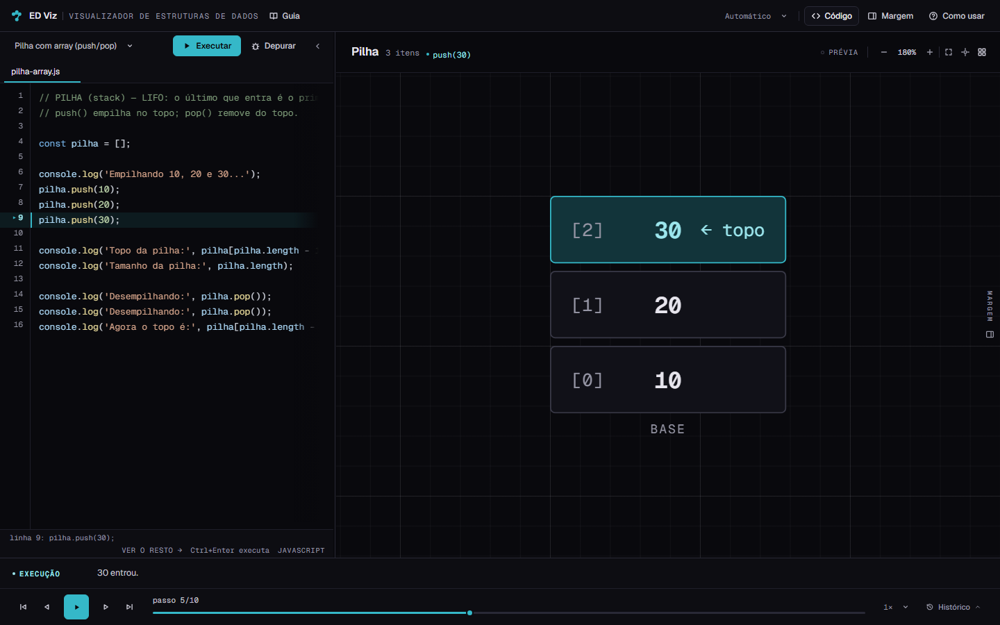

### 10.2 Depois (4C refinada)

- Topbar com cinco ações e menu “Mais”.
- Cabeçalho de 58px alinhado ao cabeçalho da Prancha.
- Depurar em ícone; Executar como único preenchimento Ocean.
- Editor sem divisória de gutter, com linha atual de baixo contraste e sem degradê de overflow.
- Status de 26px com atalho sob demanda.
- Roteiro e Prancha na mesma superfície; divisor só se revela no gesto.


### 10.3 Menu “Mais”

O menu concentra Guia e Como usar sem devolver uma barra de ferramentas à topbar.

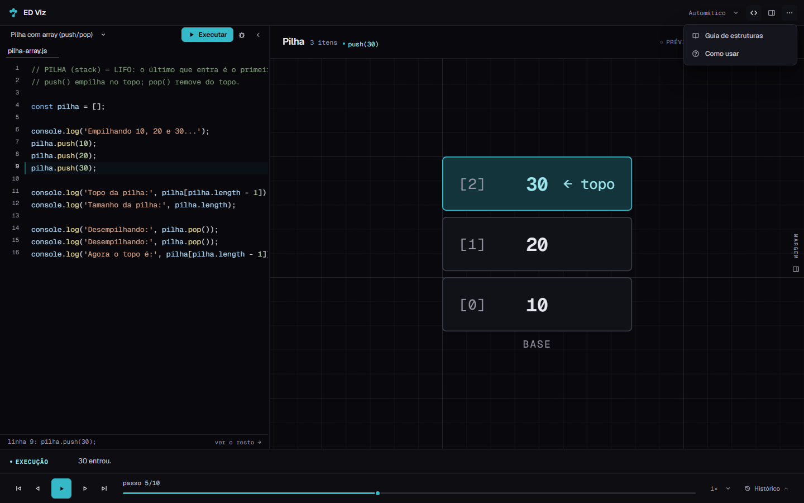

### 10.4 Larguras

Em 1280, o Roteiro mantém 426px e a Prancha 850px. Em 1024, a coluna compacta tem 360px e a Prancha 660px. Em 390, a topbar fica em uma linha e as abas laterais continuam abrindo as gavetas.

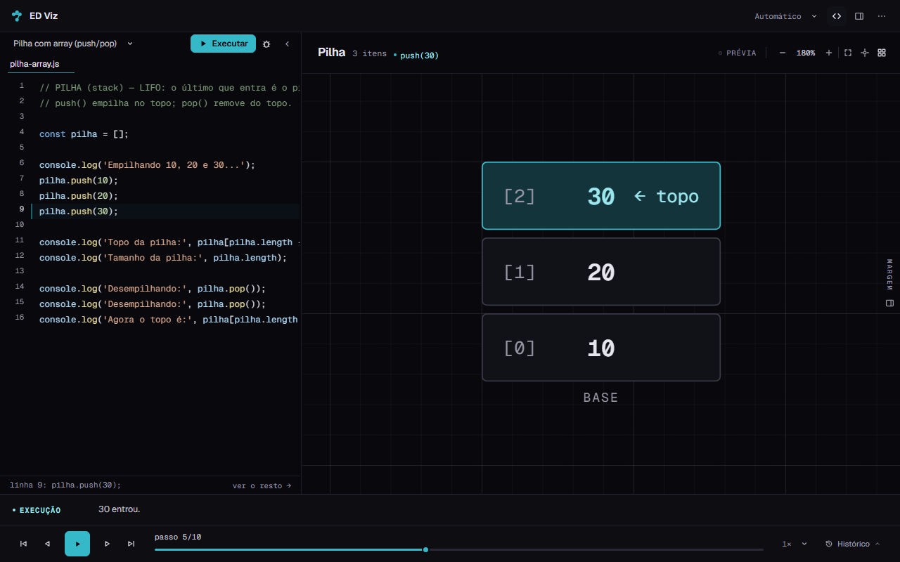

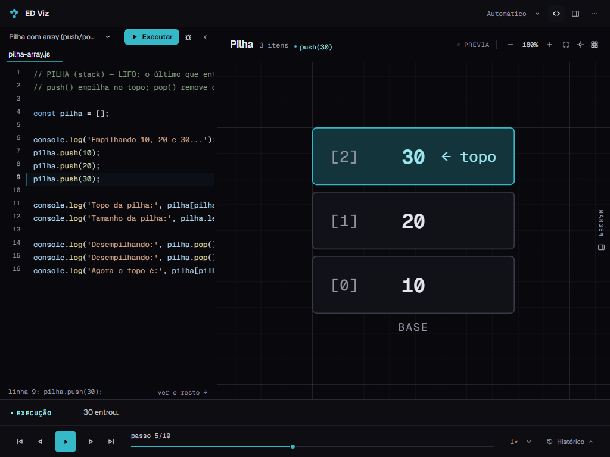

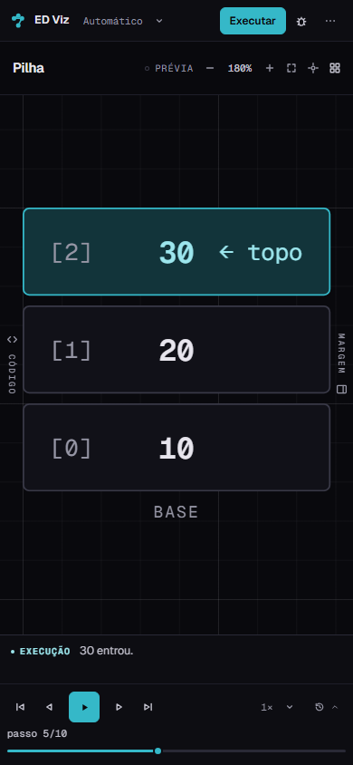

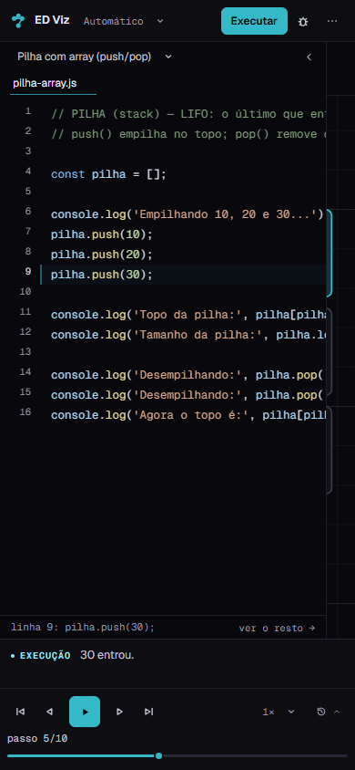

### 10.5 Roteiro recolhido

Com o Roteiro recolhido, a Prancha ocupa toda a largura e Executar/Depurar voltam à topbar — os mesmos nós, sem duplicação.

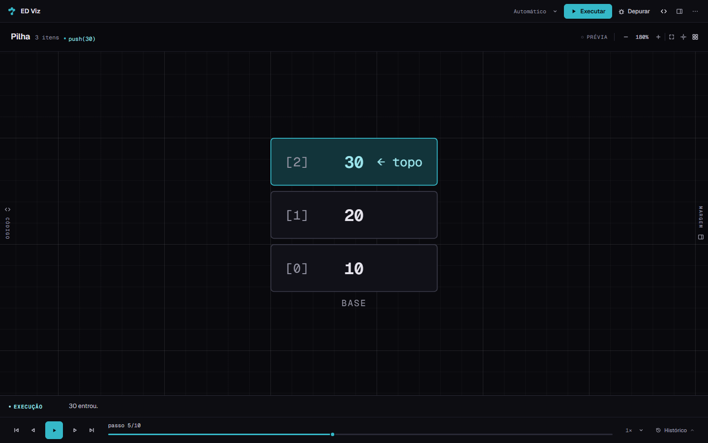

### 10.6 Execução, debug e erro

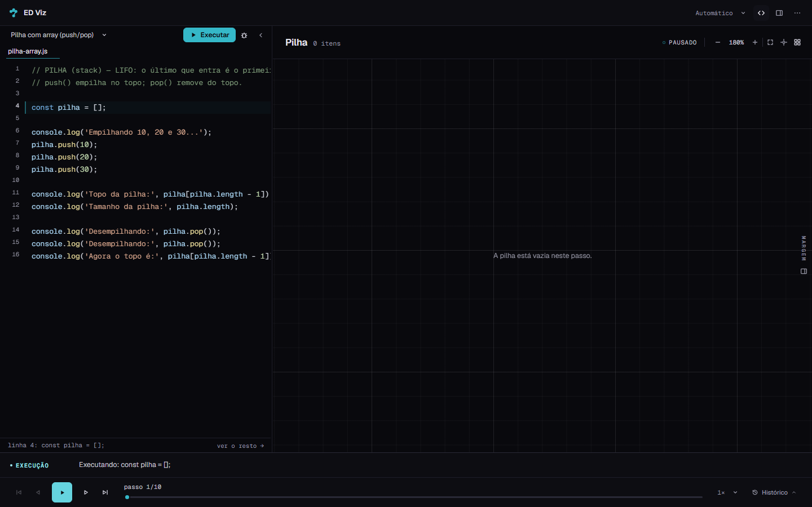

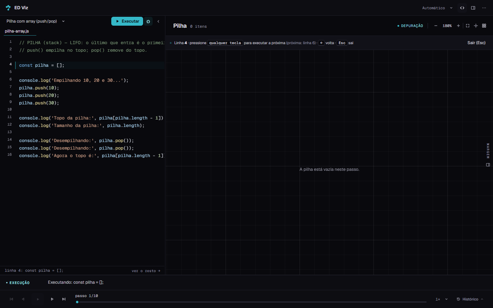

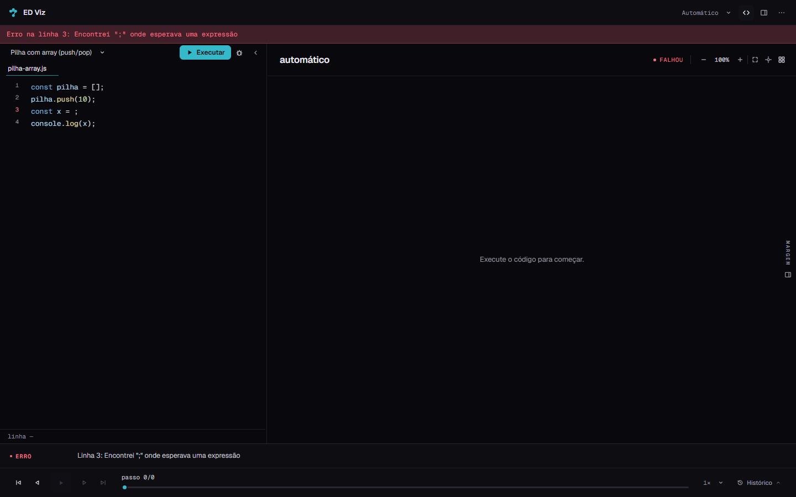

### 10.7 Editor em foco e hover

O atalho aparece apenas com o editor em foco; o anel de 1px confirma a área sem emoldurar o código.


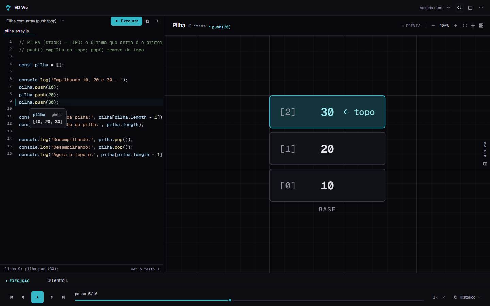

### 10.8 Compatibilidade com a Margem

Com a Margem aberta em 1440, o Roteiro mantém 480px, a Margem ocupa 372px e a Prancha preserva 584px.

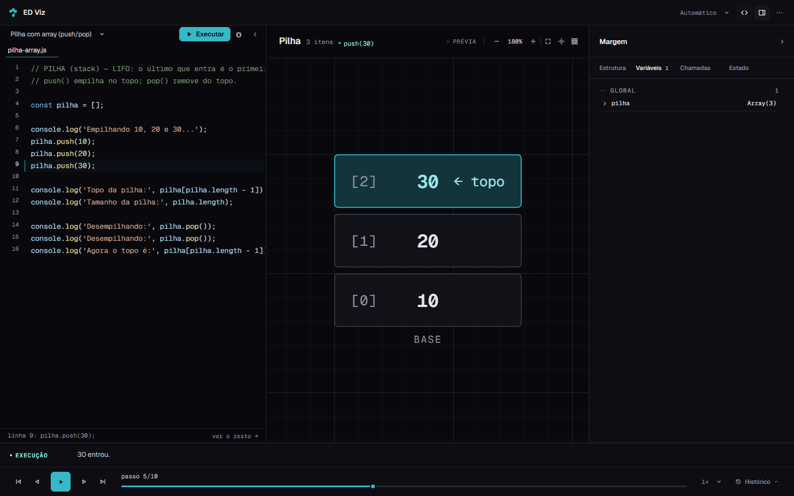

---

## 11. Confirmação sobre motor, renderizadores e câmera

**O motor e os renderizadores não foram modificados nesta iteração.**

Não houve edição em:

- `js/tokenizer.js` — tokenização;
- `js/parser.js` — AST;
- `js/interpreter.js` — execução, passos, eventos e serialização;
- `js/examples.js` — exemplos e ordem;
- `js/anim.js` — FLIP e utilidades de animação;
- `js/views.js` — detecção, seleção, explicações, renderizadores, geometria e SVG;
- `js/rough.js` — traço determinístico;
- `js/util.js` — utilidades;
- `css/estruturas.css` — estilos dos renderizadores.

As alterações em `js/app.js` são de controlador de interface:

- classe `is-editing` no painel do Roteiro para o atalho contextual;
- abertura/fechamento do disclosure `#topMenu`;
- nenhuma mudança em `goto`, no trace, no playback, no debug, no zoom/pan, na geometria, no FLIP ou na persistência de exemplos.

---

## 12. Estado final do Git

```text
Branch: redesign/etapa-1-baseline
HEAD:   b97545f
```

Arquivos desta iteração:

```text
 M visualizador.html
 M js/app.js
 M tests/e2e/edviz.spec.js
?? css/visualizador.css            (já não rastreado desde a 4B; editado)
?? docs/etapa-4/relatorio-4c-refinamento.md
?? docs/etapa-4/4c2-*.png
```

Não houve:

- commit;
- troca de branch;
- reset, clean, checkout destrutivo ou stash;
- remoção de funcionalidades;
- instalação de dependências;
- alteração de algoritmos, renderizadores ou geometria.

O `dist/` foi regenerado pelo build e é ignorado pelo Git.

---

## 13. Critério de conclusão

| Critério | Status |
|---|---|
| Redução perceptível de ruído visual | ✅ topbar de 5 ações; cabeçalho de 74→58px; status de 4→2 itens |
| Código como protagonista | ✅ superfície contínua, sem gutter desenhado, linha atual discreta |
| Funcionalidades secundárias menos intrusivas | ✅ Depurar em ícone; Guia/Como usar no menu; atalho sob demanda |
| Executar como única ação Ocean | ✅ |
| Roteiro integrado à Prancha | ✅ mesma superfície; divisor só no hover/foco/arraste |
| Largura flexível preservada | ✅ 480/426/360px; persistência e limites intactos |
| Todos os estados validados | ✅ normal, execução, debug, erro, recolhido, foco, hover e Margem |
| Contratos DOM válidos | ✅ 113 IDs, 0 duplicados, 0 ausentes |
| `npm test` | ✅ 313 verificações |
| `npm run test:e2e` | ✅ 109 passaram, 1 skip |
| `npm run build` | ✅ 29 módulos |
| Motor e renderizadores intactos | ✅ |
| Nenhuma dependência nova | ✅ |
| Nenhum commit ou troca de branch | ✅ |

---

## 14. Próximo passo

A segunda iteração da 4C está concluída e deve ser revisada antes de qualquer avanço.

**Não avancei para a Etapa 4D.** A Prancha, a Régua, a Margem e as sheets mobile continuam como estavam. A estrutura do cabeçalho do Roteiro, o slot de execução e o menu “Mais” ficam prontos para a revisão e para a arquitetura das próximas etapas.
