# ED Viz — Etapa 4C
## Roteiro e Editor

**Data:** 10/11/2026  
**Branch:** `redesign/etapa-1-baseline`  
**HEAD:** `b97545f`  
**Escopo:** coluna permanente do Roteiro, largura flexível, redesign do editor, abas/seletor de exemplos, controles de execução e status do editor  
**Status:** implementação concluída; aguardando revisão antes da Etapa 4D

> Esta etapa **não** implementa a nova Prancha (4D), a nova Margem (4E), a nova Régua (4E) nem as sheets mobile (4F). A Margem e a Régua mantêm o comportamento existente. O motor, os renderizadores e a geometria não foram alterados.

---

## 1. Resumo das alterações

A Etapa 4C transformou o Roteiro de uma gaveta lateral em uma **coluna estável do Caderno de Execução**:

- Em desktop (`>=1024px`), `#codePanel` abre como coluna permanente e divide a grade com a Prancha.
- A largura nasce de uma referência responsiva — `clamp(420px, 33.3vw, 520px)` no desktop largo e `~360px` no recorte de 1024–1279 — e pode ser ajustada por um divisor de 4px, com limites e persistência.
- O cabeçalho do Roteiro foi reorganizado em duas faixas: **exemplo + Executar/Depurar + recolher** e, abaixo, **abas de arquivo**.
- `Executar` e `Depurar` passaram a viver no Roteiro quando a coluna está aberta, usando os **mesmos nós DOM**; abaixo de 1024px, ou com o Roteiro recolhido, os mesmos botões voltam à topbar. Não há duplicação, segunda lógica de execução ou perda de listeners/atalhos.
- O editor recebeu uma camada visual própria: superfície do painel em `surface`, editor em `canvas`, gutter de 44px, linha atual com wash + barra Ocean, foco de 2px, abas com régua Ocean de 2px e scrollbars mais discretas.
- A barra inferior foi refinada para linha atual, contexto, “ver o resto”, dica de atalho e linguagem, sem se transformar em um painel de indicadores.
- Abaixo de 1024px, o comportamento anterior foi preservado: a Prancha ocupa a tela e o Roteiro continua sendo uma gaveta de 92vw em telas estreitas.
- A largura foi persistida no mesmo `workspace` já existente (`edviz.workspace`), com migração da preferência antiga. Não foi criado um segundo mecanismo concorrente.
- O motor, o parser, o tokenizer, o interpretador, os exemplos, as animações, os renderizadores e a geometria **não foram modificados**.

---

## 2. Arquivos criados e modificados

### 2.1 Criados nesta etapa

| Arquivo | Papel |
|---|---|
| `docs/etapa-4/relatorio-4c.md` | Este relatório |
| `docs/etapa-4/4c-roteiro-1440.png` | Roteiro permanente em 1440×900 |
| `docs/etapa-4/4c-roteiro-redimensionado-1440.png` | Roteiro em 520px após arrasto, 1440×900 |
| `docs/etapa-4/4c-roteiro-1280.png` | Roteiro compacto em 1280×800 |
| `docs/etapa-4/4c-roteiro-mobile-390.png` | Prancha em 390×844 com o Roteiro recolhido |
| `docs/etapa-4/4c-roteiro-1024.png` | Recorte intermediário de 1024×768 |
| `docs/etapa-4/4c-roteiro-768.png` | Preservação do layout em 768×1024 |
| `docs/etapa-4/4c-roteiro-mobile-390-codigo.png` | Gaveta de código em 390×844 |
| `docs/etapa-4/4c-execucao-1440.png` | Editor aberto durante execução pausada |
| `docs/etapa-4/4c-debug-1440.png` | Editor aberto durante o modo debug |
| `docs/etapa-4/4c-hover-1440.png` | Tooltip de variável no editor |

> As capturas opcionais (`1024`, `768`, `mobile-codigo`, `execucao`, `debug`, `hover`) documentam a validação; as quatro obrigatórias estão presentes.

### 2.2 Modificados nesta etapa

| Arquivo | Alteração |
|---|---|
| `visualizador.html` | Cabeçalho do Roteiro em duas faixas; `#roteiroRunSlot` e `#topbarRunSlot`; abas separadas do seletor; botões de execução no Roteiro; rótulos do divisor |
| `js/app.js` | Largura da coluna, limites, persistência e migração; posicionamento responsivo de `#btnRun`/`#btnDebug`; preservação de scroll ao sair do debug; `fitCodeColumn` restrito à gaveta |
| `css/visualizador.css` | Grade do Roteiro/Prancha, splitter, cabeçalho, abas, editor, gutter, foco, status, scrollbars, mídia 1024–1199 e ≤1023 |
| `tests/run-ui-smoke.js` | Expectativa do Roteiro aberto em desktop e uma gaveta por vez apenas abaixo de 1024 |
| `tests/e2e/edviz.spec.js` | Novas expectativas de coluna, largura, posição dos botões, persistência e recorte de 1024 |
| `tests/e2e/a11y.spec.js` | Abertura condicional da coluna antes do axe em 1600 |
| `tests/e2e/conteudo.spec.js` | Abertura condicional da coluna antes de editar o código |

### 2.3 Não modificados nesta etapa

- `js/tokenizer.js`
- `js/parser.js`
- `js/interpreter.js`
- `js/examples.js`
- `js/anim.js`
- `js/views.js`
- `js/rough.js`
- `js/util.js`
- `css/estruturas.css`
- `css/tokens.css` (consumido, não alterado)
- `package.json`, dependências e `vite.config.mjs`

O `dist/` foi regenerado pelo build; é saída ignorada pelo Git.

---

## 3. Arquitetura final do Roteiro

### 3.1 Estrutura DOM

```text
#codePanel [data-zone="roteiro"]
├─ .code-head
│  ├─ .code-head-top
│  │  ├─ #exampleSelect              (exemplo ativo; sem borda em repouso)
│  │  ├─ #roteiroRunSlot
│  │  │  ├─ #btnRun                  (Executar, primário Ocean)
│  │  │  └─ #btnDebug                (Depurar, ghost)
│  │  └─ #btnCollapseCode            (recolher o Roteiro)
│  └─ .code-tabs-row
│     └─ #tabs                       (arquivos abertos)
├─ #editor
│  ├─ .gutter > #gutterInner         (numeração e linha atual)
│  └─ #codeViewport
│     ├─ #highlight                  (syntax highlighting)
│     ├─ #lineHilite                 (linha em execução)
│     ├─ #code                       (textarea transparente)
│     └─ #varTip                     (tooltip de variável)
└─ .statusbar
   ├─ #statusLine                    (linha atual + contexto)
   └─ .status-meta
      ├─ #statusOverflow             (ver o resto / início)
      ├─ #statusHint                 (atalho contextual)
      └─ .status-lang                (JavaScript)
```

### 3.2 Grade

- `>=1200px`: `Roteiro | divisor 4px | Prancha | Margem` — Margem em coluna, como antes.
- `1024–1199px`: `Roteiro | divisor 4px | Prancha`; a Margem continua como sobreposição à direita, preservando o comportamento anterior dessa região até a 4E/4F.
- `<1024px`: Prancha em tela cheia; Roteiro e Margem continuam como gavetas, sem sheets novas.
- A Prancha é sempre a maior superfície individual. Com a Margem aberta em `>=1200`, o teto do Roteiro recua para manter a Prancha com pelo menos **480px**.

### 3.3 Alturas

| Faixa | Altura |
|---|---:|
| Exemplo + ações | 40px |
| Abas | 34px |
| Cabeçalho total | 74px |
| Editor | resto da coluna |
| Status | 28px mínimo |

O cabeçalho e o status ficam fora da área rolável; apenas o `textarea` rola. A página inteira não rola (`body` com `overflow: hidden`).

---

## 4. Estratégia de largura flexível

### 4.1 Referências iniciais

| Resolução | Padrão | Mínimo | Máximo |
|---|---:|---:|---:|
| `>=1280px` | `clamp(420px, 33.3vw, 520px)` | 420px | 520px |
| `1024–1279px` | 360px | 340px | 400px |
| `<1024px` | gaveta | comportamento anterior | comportamento anterior |

Medições reais após a implementação, sem Margem aberta:

| Viewport | Roteiro | Prancha | Overflow horizontal |
|---|---:|---:|---:|
| 1440×900 | 480px | 956px | 0 |
| 1280×800 | 426px | 850px | 0 |
| 1024×768 | 360px | 660px | 0 |
| 768×1024 | 0 (gaveta) | 768px | 0 |
| 390×844 | 0 (gaveta) | 390px | 0 |

Com a Margem aberta em `>=1200`, a Prancha mantém o piso de 480px:

| Viewport | Roteiro | Margem | Prancha |
|---|---:|---:|---:|
| 1440 | 480 | 372 | 584 |
| 1280 | 424 | 372 | 480 |
| 1200 | 344 | 372 | 480 |

### 4.2 Limites e piso da Prancha

- O máximo do Roteiro é reduzido quando a Margem está em coluna:
  `max = min(limite da faixa, largura total - margem - 4 - 480)`.
- A largura da Margem é lida da fórmula do CSS quando o painel ainda está oculto; sem isso, a abertura da Margem poderia medir 0px e permitir uma Prancha menor que o piso.
- O usuário não consegue arrastar a coluna além dos limites; a Prancha permanece utilizável.

### 4.3 Persistência

- Reaproveitado o `workspace` existente em `localStorage` (`edviz.workspace`), agora na **versão 3**.
- `workspace.codeRatio` continua guardando a proporção.
- `workspace.codeUserResized` registra se a largura foi escolhida pelo usuário; sem esse registro, o auto-ajuste antigo sobrescreveria a escolha após um reload.
- O workspace v2 é migrado: a proporção antiga é preservada como preferência explícita; gavetas e foco de leitura não são herdados.
- Duplo clique no divisor restaura o padrão responsivo.

### 4.4 Interação

- Divisória de **4px** com hairline de 1px.
- Hover: linha muda para `accent-muted`.
- Arraste: classe `.dragging`, linha de 2px em Ocean, classe `.is-resizing` no layout e bloqueio de seleção.
- A área de agarre cresce 6px para o lado da Prancha, sem cobrir a scrollbar vertical do editor.
- Teclado: `ArrowLeft`/`ArrowRight` ajustam 16px por vez; o divisor tem `role="separator"`, `tabindex="0"`, `aria-valuenow` e `aria-valuetext` em pixels.
- Durante o arraste, a câmera não salta: o reenquadramento acontece ao soltar, como antes. Zoom manual e pan são preservados.

> O `SPLIT_MAX_CODE_PX = 620` da 4B **não** foi adotado como limite da coluna. Ele permanece apenas para a gaveta abaixo de 1024px, onde o auto-ajuste antigo ainda faz sentido. A coluna usa 420–520px (wide) e 340–400px (compacto).

---

## 5. Decisões de design do editor

### 5.1 Superfícies e hierarquia

- Cabeçalho, abas e status: `--ds-bg-surface`.
- Editor e gutter: `--ds-bg-canvas`, criando o recesso do código.
- Separação por hairlines e superfícies, sem cartões, sombras ou bordas em todos os elementos.
- O cabeçalho tem duas faixas para separar o “capítulo” (exemplo) das “páginas” (abas).

### 5.2 Abas e seletor de exemplos

- Seletor de exemplo na primeira faixa, à esquerda, sem borda em repouso, 12px, flexível e truncável.
- Abas na segunda faixa, 34px; a ativa recebe uma régua Ocean de 2px na base.
- O fechar da aba aparece no hover/foco; em dispositivos sem hover, a aba ativa mantém o fechar visível para continuar descobrível no toque.
- A lógica de carregamento, buffers e persistência não foi alterada.

### 5.3 Editor

- Geist Mono preservada; 13px/22px no desktop largo e 12,5px ≤1366, sem mudar `LINE_HEIGHT`, `PAD_TOP` ou `CODE_PAD_LEFT`.
- Gutter de 44px, números tabulares, linha atual em `accent-text` com marcador `▶`.
- Linha atual: wash Ocean de 10% + barra de 2px; erro mantém danger.
- Seleção com o token `--selection`.
- Tooltip de variável preservado.
- Scroll vertical e horizontal independentes; gradiente de overflow e “ver o resto” no status.
- Scrollbars de 9px no editor, mais discretas que o chrome.
- Anel de foco de 2px no Roteiro (editor, botões, abas, seletor, splitter).
- Syntax highlighting mantém a paleta e as classes existentes; nenhuma regra de token foi renomeada.

### 5.4 Barra inferior

- Linha atual + texto da linha em Geist Mono.
- `#statusOverflow` para a cauda da linha.
- `#statusHint` contextual: “Ctrl+Enter executa” em repouso; “Tab insere espaços — Esc sai” no foco.
- `JavaScript` discreto à direita.
- A linha pode quebrar; o teste P5 garante que não há truncamento silencioso.

---

## 6. Alterações nos controles de execução

- `#btnRun` e `#btnDebug` foram movidos para `#roteiroRunSlot`, no cabeçalho do Roteiro, quando:
  - a viewport tem `>=1024px`; e
  - a coluna do Roteiro está aberta.
- Caso contrário (viewport `<1024px` ou Roteiro recolhido), **os mesmos nós** são movidos para `#topbarRunSlot`. Não há botões duplicados: a contagem é 1 para cada ID.
- IDs, listeners, `aria-label`, títulos, atalhos (`Ctrl+Enter`, `F10`), classes de estado e o comportamento de debug/execução foram preservados.
- `Executar` continua sendo a única ação preenchida Ocean do Roteiro; `Depurar` é ghost com ícone + rótulo em telas largas e apenas ícone no recorte compacto (o nome acessível permanece).
- O chip de estado da execução continua na Prancha, como definido na arquitetura; a 4C não duplica esse indicador no Roteiro.
- O feedback de edição permanece no `#statusLine` (“código editado — execute novamente”).
- Abaixo de 1024px, o comportamento atual é mantido: Executar/Depurar na topbar, gaveta de código e Prancha em tela cheia.

### 6.1 Preparação para as sheets

- O `#roteiroRunSlot` já existe dentro do cabeçalho que, na 4F, pode se tornar o cabeçalho da sheet.
- A função de posicionamento é pequena e isolada (`syncRunPlacement`), fácil de remover ou ampliar quando a sheet passar a manter Executar no próprio cabeçalho.
- Nenhuma sheet foi implementada nesta etapa.

---

## 7. Contratos DOM preservados

### 7.1 IDs

O shell contém **110 IDs** (108 da 4B + 2 slots adicionais), **0 duplicados** e **0 ausentes**:

```text
window.__edvizMissingIds === []
```

IDs principais preservados:

| Grupo | IDs |
|---|---|
| Editor | `code`, `codeViewport`, `highlight`, `gutterInner`, `lineHilite`, `varTip`, `tabs`, `exampleSelect`, `statusLine`, `statusHint`, `statusOverflow` |
| Execução | `btnRun`, `btnDebug`, `debugBar`, `debugInfo`, `btnExitDebug`, `banner` |
| Prancha | `structure`, `structureSelect`, `canvasTitle`, `canvasSub`, `canvasBadge`, `vizRunState`, `vizRunStateText`, `btnZoomOut`, `btnZoomReset`, `btnZoomIn`, `btnZoomFit`, `btnCanvasCenter`, `btnGrid` |
| Régua | `dock`, `dockHistory`, `dockTabs`, `btnDockToggle`, `btnDockClose`, `stepExplainer`, `stepOp`, `stepText`, `stepCount`, `btnFirst`, `btnPrev`, `btnPlay`, `btnNext`, `btnLast`, `slider`, `stepLabel`, `speedSelect` |
| Margem | `sidePanel`, `btnToggleSide`, `btnCollapseSide`, `railInspector`, `inspector-title`, `inspTabStructure`, `inspTabVars`, `inspTabCalls`, `inspTabState`, `pageStructure`, `pageVars`, `pageCallstack`, `pageState`, `structureInfo`, `vars`, `callstack`, `stateInfo`, `varsCount`, `callsCount` |
| Histórico | `commands`, `events`, `console`, `tabCommands`, `tabEvents`, `tabConsole`, `pageCommands`, `pageEvents`, `pageConsole` |
| Layout | `layout`, `codePanel`, `vizPanel`, `splitLeft`, `btnToggleCode`, `btnCollapseCode`, `railCode` |
| Ajuda | `helpDialog`, `helpTitle`, `btnHelp`, `btnHelpClose`, `linkGuia` |
| Novos (aditivos) | `roteiroRunSlot`, `topbarRunSlot` |

### 7.2 Atributos `data-*`

Preservados sem renomeação:

- `data-k`, `data-enter`, `data-exit` — FLIP.
- `data-content` — caixa real do desenho para a câmera.
- `data-state` — estados do chip.
- `data-step` — comandos, eventos e console.
- `data-tab`, `data-close` — abas do editor.
- `data-insp`, `data-pane` — abas da Margem.
- `data-dock` — abas do Registro.
- `data-var-key`, `data-filled` — expansão de variáveis.
- `data-line` — gutter.
- `data-zone="roteiro"`, `"prancha"`, `"margem"`, `"regua"`, `"cabecalho"` e `"caderno"`.

### 7.3 Classes dos renderizadores

Nenhuma classe de `js/views.js` foi alterada. `css/estruturas.css` permaneceu intacto.

### 7.4 Canvas e câmera

- `.canvas-viewport`, `.canvas-stage`, `data-content`, `--canvas-x/y/zoom` preservados.
- `canvasAfterRender`, `ctx.onMeta`, `DSV.renderStructure` e `DSV.flipRender` preservados.
- O redimensionamento do Roteiro altera a largura da Prancha; a câmera reenquadra ao soltar o divisor, sem sobrescrever zoom/pan manuais. O teste de redimensionamento com zoom 225% confirmou a preservação.

### 7.5 Ajustes de teste

Nenhum teste funcional foi removido. As atualizações refletem a nova arquitetura:

- O teste de UI que assumia “editor recolhido no desktop” agora verifica o Roteiro aberto e a regra de uma gaveta por vez apenas em tela estreita.
- O teste E2E de workspace passou a medir a coluna (420–520px) e a posição dos botões de execução.
- O teste de persistência passou a arrastar a coluna aberta e a validar o reload com `expect.poll`.
- O teste de largura da gaveta em 1440 passou a validar a coluna (420–520px) e o recorte de 1024 (340–400px).
- O teste de array puro só clica em “Último passo” se o controle estiver habilitado; em um trace curto a reprodução pode chegar ao fim antes da pausa, e o estado final é o mesmo.
- Os testes de acessibilidade e de link direto abrem a coluna apenas quando necessário.
- O teste “layout empilha em janela estreita” usa 720px para a gaveta e 1440px para a coluna permanente.

---

## 8. Testes executados e resultados

### 8.1 `npm test`

```text
214 testes de núcleo        → 0 falhas
 90 testes de UI            → 0 falhas
  9 testes de conteúdo      → 0 falhas
313 verificações             → 0 falhas
```

### 8.2 `npm run test:e2e`

```text
108 testes
107 passaram
  1 skipped (memória, exclusivo do Chromium)
  0 falharam
```

Cobre Chromium e Firefox, incluindo:

- axe sem violações críticas/sérias em 1440, 1600 e 390;
- foco, teclado, abas, persistência e reload;
- execução, debug, erro e stale;
- canvas, zoom, pan, fit, grid, lista dupla e árvore;
- 1024 com Roteiro em coluna e Margem em sobreposição;
- mobile sem overflow e sem empilhamento de gavetas;
- CSP e ausência de script inline.

### 8.3 `npm run build`

```text
✓ 29 modules transformed
✓ built in 340ms
```

Saídas relevantes:

```text
dist/visualizador.html                     23.05 kB (6.47 kB gzip)
dist/assets/visualizador-*.css             59.45 kB (10.92 kB gzip)
dist/assets/visualizador-*.js             221.05 kB (64.86 kB gzip)
dist/assets/Geist-Variable-*.woff2         69.48 kB
dist/assets/GeistMono-Variable-*.woff2     71.21 kB
```

### 8.4 Contrato de DOM

```text
IDs: 110
Duplicados: 0
Ausentes: 0
window.__edvizMissingIds: []
#btnRun: 1
#btnDebug: 1
```

### 8.5 Validação manual

| Verificação | Resultado |
|---|---|
| 1440×900: Roteiro + Prancha | 480px + 956px; sem overflow |
| 1280×800: coluna compacta | 426px + 850px; sem overflow |
| 1024×768: coluna + Prancha | 360px + 660px; Margem em sobreposição |
| 768×1024: drawer | Prancha 768px; Roteiro recolhido |
| 390×844: mobile | Prancha 390px; Roteiro recolhido |
| 390×844: gaveta de código | 359px (92vw); Executar na topbar |
| Arrasto máximo | 520px (wide) |
| Arrasto mínimo | 420px (wide) |
| Recorte compacto | 400px máximo / 340px mínimo |
| Teclado no divisor | 420 → 436px com `ArrowRight` |
| Reload após arrasto | 436px preservados |
| Margem aberta em 1200 | Roteiro 344, Margem 372, Prancha 480 |
| Margem aberta em 1280 | Roteiro 424, Margem 372, Prancha 480 |
| Margem aberta em 1440 | Roteiro 480, Margem 372, Prancha 584 |
| Fechar/abrir Margem | coluna ou sobreposição conforme a faixa; comportamento anterior preservado |
| Alternar exemplos/abas | seleção e buffers corretos |
| Editar/executar | estados e linha atual corretos |
| Debug | editor readOnly; Esc libera; scroll não salta mais |
| Hover de variável | “pilha · global · [10, 20, 30]” |
| Scroll horizontal | “ver o resto” rola e retorna ao início |
| Câmera após arrasto | zoom 225% preservado; árvore visível |
| Overflow horizontal | 0 em 1440, 1280, 1024, 768 e 390 |
| Console | 0 erros nas interações validadas |
| Fontes | `document.fonts.status = "loaded"` |

---

## 9. Problemas encontrados

1. **Auto-ajuste da 4B alargava a coluna até 600px.** O `codeFit` existia para a gaveta. Na coluna permanente, ele passaria a competir com a Prancha e com o limite de 520px. A correção foi restringir `fitCodeColumn()` ao recorte `<1024` e criar limites próprios para a coluna. O `620px` ficou somente para a gaveta.
2. **Saída do debug saltava para o fim do buffer.** `exitDebug()` focava o `textarea`, cujo cursor estava no fim do valor definido por script. Em uma coluna com rolagem horizontal, o editor saltava para a última coluna. A correção preserva `scrollLeft`/`scrollTop` e usa `focus({ preventScroll: true })`.
3. **Medição da Margem no instante da abertura.** Como `targetCodeWidth()` roda antes da classe da Margem ser aplicada, o painel ainda podia medir 0px; a Prancha ficava abaixo do piso em 1200/1280. A correção usa a fórmula do CSS (`clamp(300px, 34vw, 372px)`) quando a medição não é confiável.
4. **Leitura de layout em frame intermediário no Chromium.** O teste da nova coluna podia ler a grade antiga logo após o clique em Código. O teste passou a aguardar a visibilidade e a usar `expect.poll` para a largura final. O comportamento do app foi confirmado com medição manual; não era um defeito de produto.
5. **Flake de teardown no Firefox.** Em uma execução intermediária, um teste falhou no `beforeEach` com erro de contexto/Juggler do Firefox. O mesmo teste passou isolado e na execução final completa. Foi tratado como flake de infraestrutura.
6. **Trace curto podia terminar antes do clique em “Último passo”.** No teste de array puro, a reprodução de um trace de três linhas podia chegar ao fim antes da pausa; com isso `#btnLast` já estava desabilitado. O teste passou a clicar no controle apenas se ele estivesse habilitado — o estado final validado é o mesmo, e a lógica de playback não foi alterada.
7. **Fechar aba em telas de toque.** A aba ativa não deve mostrar “×” permanentemente no desktop, mas no toque não existe hover. Foi adicionada a regra `@media (hover: none)` para manter o fechar descobrível.
8. **Migração da largura antiga.** O workspace v2 guardava apenas `codeRatio`; sem um marcador de “redimensionado”, o novo padrão ignoraria a escolha. A migração passou a tratar a proporção salva como preferência explícita.

---

## 10. Riscos restantes

| Risco | Impacto | Mitigação |
|---|---|---|
| Linhas longas ainda exigem rolagem horizontal | Médio para leitura de linhas de 100+ caracteres | “ver o resto” e scroll horizontal preservados; a folha “expandir código” não faz parte do escopo desta etapa e pode ser adicionada depois |
| Margem em sobreposição entre 1024 e 1199 | Médio; é o comportamento anterior | 4E/4F substituirão pela sheet inferior aprovada |
| Seletor de estrutura ainda na topbar | Baixo; é escopo da 4D | Não foi movido para não antecipar a Prancha |
| Foco de 2px só no Roteiro | Baixo; Margem/Régua continuam com 1px | 4E aplica o anel de 2px nas demais regiões |
| Largura escolhida pode deixar a Prancha em 480px com a Margem aberta em 1200 | Médio; limites da referência compacta | Piso de 480px; a Prancha continua a maior superfície |
| Reposicionamento de Executar/Depurar depende de JS | Baixo; o app já depende de JS | Mesmos nós, sem duplicação; `syncRunPlacement` isolado |
| Sem teste visual automatizado | Regressão de cor/layout pode passar | Capturas de referência nesta etapa; 4G pode adicionar regressão visual |
| Workspace v3 pode redefinir o estado de recolhimento na migração | Baixo; a largura é preservada | Migração documentada; o usuário pode recolher/abrir de novo |
| Sheets mobile ainda não existem | Esperado para 4F | Estrutura do cabeçalho e do slot de ações já preparada |

---

## 11. Comparação visual antes/depois

### 11.1 Antes (4B)

- Editor como gaveta de 580px, aberta por Código.
- Topbar com Executar/Depurar.
- Abas, seletor de exemplo e recolher na mesma faixa.
- Status em duas linhas forçadas.
- Prancha dominante, mas o código não fazia parte permanente da composição.

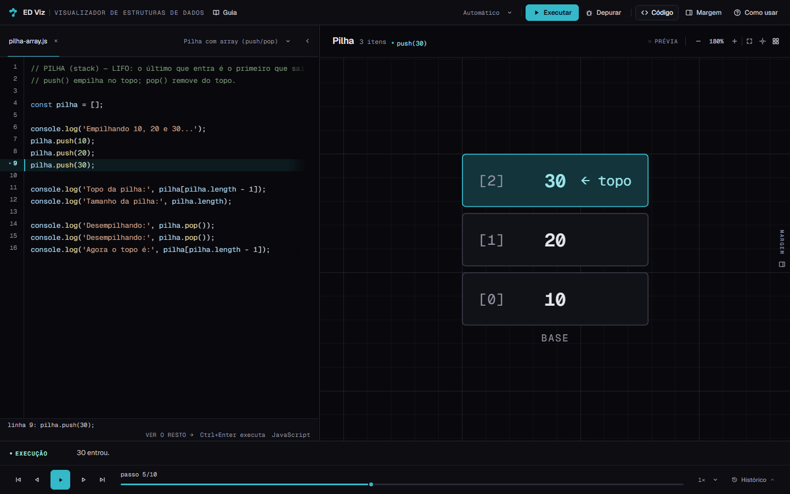

### 11.2 Depois (4C)

- Roteiro como coluna permanente de 480px em 1440.
- Exemplo e ações na primeira faixa; abas na segunda.
- Executar/Depurar dentro do Roteiro.
- Editor com gutter, linha atual e status refinados.
- Prancha com 956px; nenhuma rolagem de página.

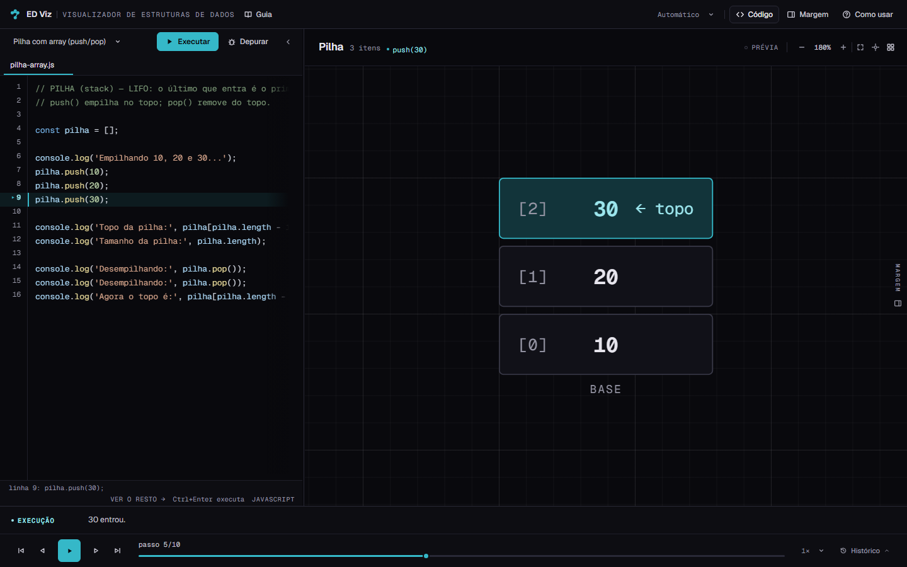

### 11.3 Largura ajustada

Arrasto até 520px; a Prancha recua para 916px, sem saltos de câmera.

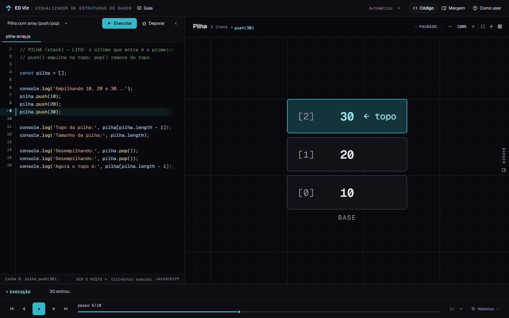

### 11.4 1280 e 1024

Em 1280, o Roteiro compacto tem 426px e a Prancha 850px. Em 1024, o Roteiro tem 360px e a Prancha 660px; a Margem continua em sobreposição.

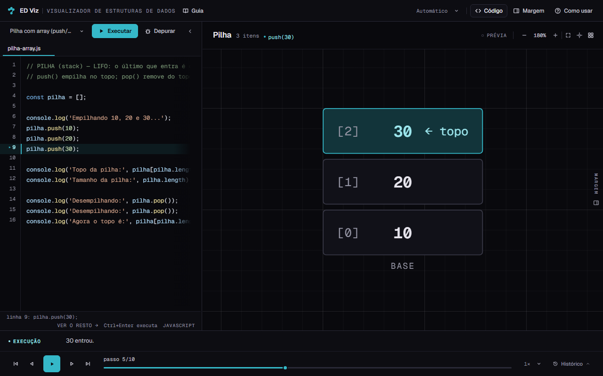

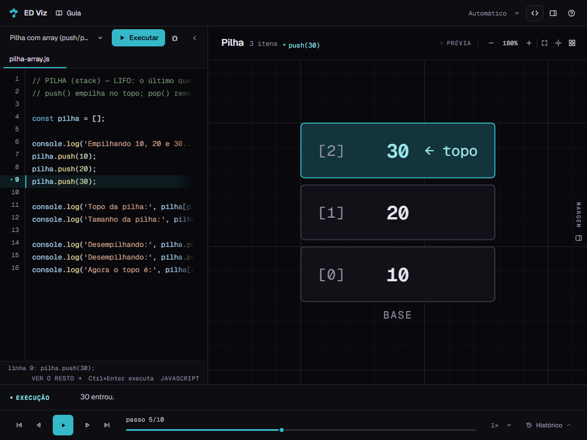

### 11.5 Menores

Em 768 e 390, a Prancha permanece em tela cheia e o Roteiro continua sendo a gaveta atual. A gaveta de 390 tem 359px e mantém Executar/Depurar na topbar.

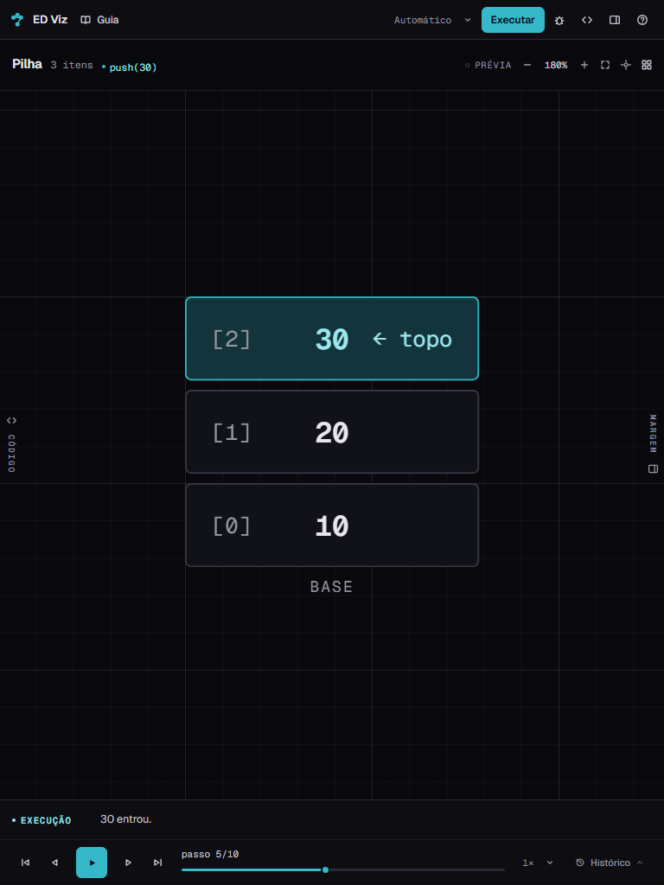

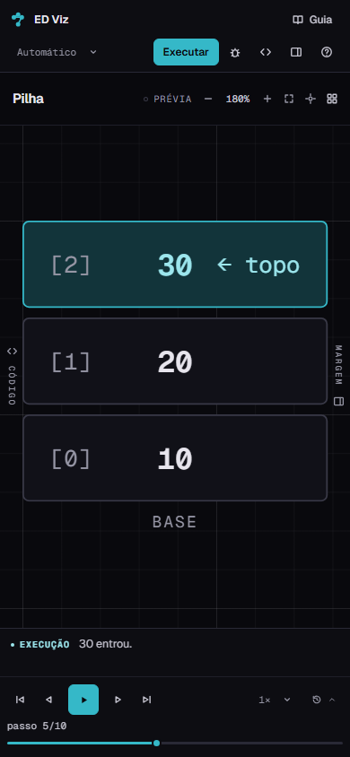

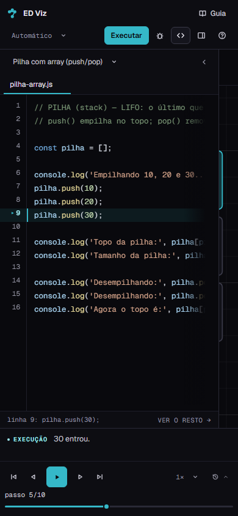

### 11.6 Execução e debug

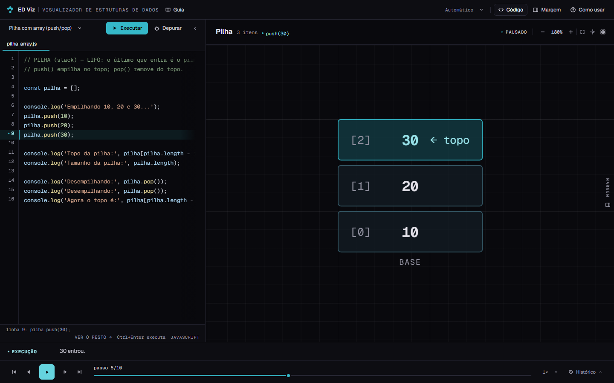

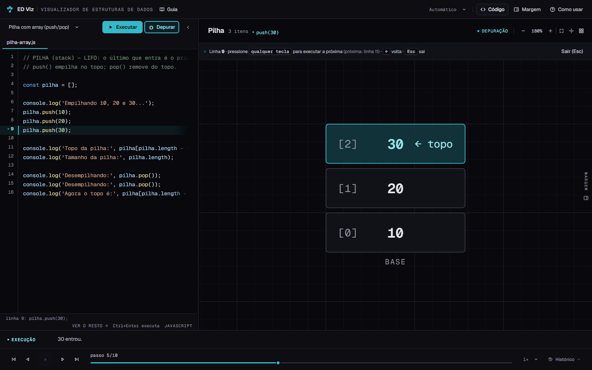

### 11.7 Hover de variável

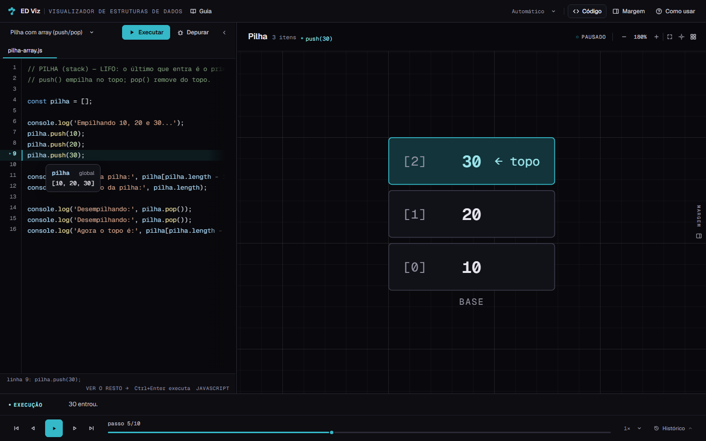

A comparação mostra a mudança de arquitetura sem antecipar a Prancha, a Margem ou a Régua: o código deixa de ser uma gaveta e passa a ser evidência permanente ao lado do desenho.

---

## 12. Confirmação sobre motor e renderizadores

**O motor e os renderizadores não foram modificados nesta etapa.**

Não houve edição em:

- `js/tokenizer.js` — tokenização.
- `js/parser.js` — AST.
- `js/interpreter.js` — execução, passos, eventos e serialização.
- `js/examples.js` — exemplos e ordem.
- `js/anim.js` — FLIP e utilidades de animação.
- `js/views.js` — detecção, seleção, explicações, renderizadores, geometria e SVG.
- `js/rough.js` — traço determinístico.
- `js/util.js` — utilidades.
- `css/estruturas.css` — estilos dos renderizadores.

As alterações em `js/app.js` são de controlador de interface:

- cálculo e persistência da largura do Roteiro;
- posicionamento responsivo de `#btnRun`/`#btnDebug`;
- preservação de scroll ao sair do debug;
- migração do workspace.

Não houve mudança em `goto`, no trace, no playback, no debug (além do foco/scroll), no zoom/pan, na geometria, no FLIP ou na persistência de exemplos.

---

## 13. Estado final do Git

```text
Branch: redesign/etapa-1-baseline
HEAD:   b97545f
```

As alterações preexistentes do working tree foram preservadas. As entradas desta etapa são:

```text
 M visualizador.html
 M js/app.js
 M tests/run-ui-smoke.js
 M tests/e2e/edviz.spec.js
 M tests/e2e/a11y.spec.js
 M tests/e2e/conteudo.spec.js
 ?? docs/etapa-4/relatorio-4c.md
 ?? docs/etapa-4/4c-*.png
```

`css/visualizador.css` e `docs/etapa-4/` já eram não rastreados desde a 4B; por isso aparecem como `??` no status. O arquivo foi editado nesta etapa.

Não houve:

- commit;
- troca de branch;
- reset, clean, checkout destrutivo ou stash;
- remoção de arquivos;
- instalação de dependências;
- alteração de algoritmos ou renderizadores.

O `dist/` foi regenerado pelo build e é ignorado pelo Git.

---

## 14. Critério de conclusão

| Critério | Status |
|---|---|
| Roteiro integrado à arquitetura como coluna principal | ✅ |
| Largura flexível e redimensionável em desktop | ✅ |
| Editor com hierarquia visual refinada | ✅ |
| Abas e seletor de exemplos organizados | ✅ |
| Controles de execução integrados sem duplicação | ✅ |
| Prancha funcional e responsiva à largura | ✅ |
| Comportamento em 768 e 390 preservado | ✅ |
| Contratos DOM válidos | ✅ 110 IDs, 0 duplicados, 0 ausentes |
| `npm test` | ✅ 313 verificações |
| `npm run test:e2e` | ✅ 107 passaram, 1 skip |
| `npm run build` | ✅ 29 módulos |
| Motor e renderizadores intactos | ✅ |
| Nenhuma dependência nova | ✅ |
| Nenhum commit ou troca de branch | ✅ |

---

## 15. Próximo passo

A Etapa 4C está concluída e deve ser revisada antes de qualquer avanço.

**Não avancei para a Etapa 4D.** A Prancha, a Régua, a Margem e as sheets mobile continuam como estavam; as próximas etapas podem partir da coluna do Roteiro agora estabelecida.
