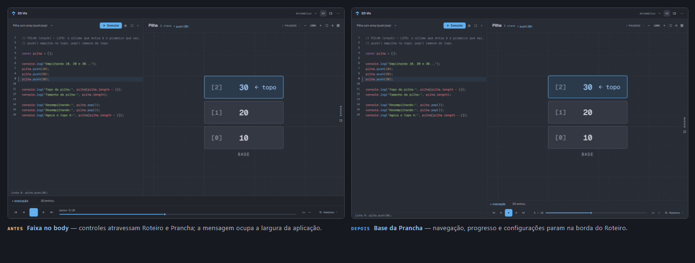

# ED Viz — Refinamento da Régua de execução

**Data:** 12/11/2026  
**Branch:** `redesign/etapa-1-baseline`  
**HEAD:** `b97545f`  
**Escopo:** localização, organização e experiência da Régua e da mensagem contextual  
**Status:** implementação concluída; aguardando revisão antes da Etapa 4F

> Esta etapa mexe apenas na arquitetura espacial da Régua e na legenda do passo. O interpretador, o parser, o tokenizer, os renderizadores, a geometria das estruturas, a câmera, o zoom/pan, o playback, o histórico e o depurador não foram alterados. Não há uma segunda lógica de execução.

---

## 1. Diagnóstico inicial

A Régua era um `footer` do `body`, irmão do `main`. A grade do Caderno de Execução já separava Roteiro, Prancha e Margem, mas a Régua ficava abaixo de todos: a faixa começava em `x=0` e terminava em `x=1440`, independentemente das colunas abertas.

Isso produzia cinco problemas:

1. **Controles atravessando zonas.** Play, timeline e velocidade passavam por baixo do Roteiro e da Prancha, sem pertencer visualmente a nenhuma das duas.
2. **Leitura de aplicação inteira.** O agrupamento à esquerda fazia a Régua parecer um controle global do ED Viz, não o transporte da visualização atual.
3. **Separação excessiva.** A explicação do passo e os controles ficavam longe da estrutura que descreviam.
4. **Altura fixa desnecessária.** Eram 44px de explicação + 52px de transporte em todas as larguras, mesmo quando a mensagem era curta.
5. **Mensagem atravessando a interface.** O texto do passo ocupava a largura do app, competindo com o Roteiro.

### 1.1 Medidas antes → depois

| Indicador | Antes | Depois |
|---|---:|---:|
| Largura da Régua em 1440 | 1440px (viewport inteira) | **860px** (Prancha com Roteiro aberto) |
| Altura da Régua no desktop | 96px (44 + 52) | **78px** (29 + 48 + hairline) |
| Altura da Régua em 390 | ~96–150px | **93px** (28 + 64 + hairline) |
| Play | 36px | **32px** |
| Contagem | “passo 5/10” acima do trilho | **“5 / 10”** ao lado do trilho |
| Progresso em 1440 | largura restante da viewport | **503px (58% da Régua)** |
| Progresso em 1024 | largura restante da viewport | **355px (54% da Régua)** |
| Histórico aberto | 1440px de largura | **860px**, dentro da Prancha |
| Mensagem do passo | faixa permanente de 44px | legenda de **29px** (até duas linhas) |

---

## 2. Nova organização espacial

A Régua passou a ser o último filho da Prancha. O Roteiro termina na própria status bar; não existe mais nenhuma barra de execução na base dele.

```
┌──────────────── Roteiro ────────────────┐   ┌──────────────── Prancha ─────────────────┐
│ seletor · Executar · Depurar · recolher │   │ título · estado · câmera                 │
├─────────────────────────────────────────┤   ├──────────────────────────────────────────┤
│                                         │   │                                          │
│ código                                  │   │ desenho                                  │
│                                         │   │                                          │
├─────────────────────────────────────────┤   ├──────────────────────────────────────────┤
│ status: linha 9 · ver o resto           │   │ legenda do passo (só quando há texto)    │
└─────────────────────────────────────────┘   │ ⏮  ◀  ▶  ▶  ⏭    5 / 10 ────────  1×  ⌄  │
                                              └──────────────────────────────────────────┘
```

Decisões estruturais:

- `#dock` mantém o ID, a classe `.dock` e `data-zone="regua"`, mas agora vive dentro de `#vizPanel`, depois de `#structure`.
- `#dock` ganhou a classe `.regua` para nomear a zona no CSS e no relatório.
- O histórico continua absoluto, com `bottom: 100%`, agora relativo à Régua. Ele sobe sobre o desenho, mas não sai da largura da Prancha.
- `.viz-panel` recebeu `z-index: 0` para criar um stacking context. Sem isso, o `z-index: 30` da Régua a colocaria acima das gavetas de Código e Margem no recorte estreito.
- Em **1024–1199px**, a Margem em folha termina no topo da Régua (`bottom: var(--regua-h)`), preservando o acesso aos controles. Em **≤1023px**, as gavetas continuam cobrindo a Prancha inteira; a sheet definitiva é 4F.
- A altura real da Régua é medida por `ResizeObserver` e publicada em `--regua-h` no `#layout`, porque a legenda pode ocupar uma ou duas linhas.

---

## 3. Elementos reorganizados

### 3.1 Grupo esquerdo — navegação

| Controle | ID | Tratamento |
|---|---|---|
| Primeiro passo | `#btnFirst` | 28px, ícone, transparente |
| Passo anterior | `#btnPrev` | 28px, ícone, transparente |
| Reproduzir/Pausar | `#btnPlay` | **32px**, preenchimento Ocean, raio 6px |
| Próximo passo | `#btnNext` | 28px, ícone, transparente |
| Último passo | `#btnLast` | 28px, ícone, transparente |

Os cinco botões ficam soltos, com gap de 2px e sem molduras individuais. O play é o único preenchimento do grupo; os demais usam `text-muted` e ganham `text-primary + bg-hover` no hover. Todos os listeners e estados `disabled` continuam os mesmos.

### 3.2 Grupo central — progresso

- `#stepLabel` passou de `passo 5/10` para **`5 / 10`**, em mono de 11px com `font-variant-numeric: tabular-nums`.
- `#slider` continua sendo o mesmo `<input type="range">`; nenhuma navegação paralela foi criada.
- A contagem fica ao lado do trilho, não acima dele. O `timeline` virou uma linha flexível: `58px` fixos para a contagem e todo o restante para o trilho.
- `aria-valuetext` passou a anunciar “Passo 5 de 10” sem alterar o valor numérico nem o `max`.
- O trilho tem 3px, preenchimento Ocean e thumb de 11px com borda da cor do canvas.

### 3.3 Grupo direito — configurações

- `#speedSelect` mantém o mesmo select e os mesmos valores (`0,5×`, `1×`, `2×`, `4×`), agora com 26px de altura e cor `text-muted`.
- `#btnDockToggle` continua com `aria-expanded`, `aria-controls` e o mesmo listener. O rótulo “Histórico” some em **≤1100px**, deixando ícone + chevron; o `title`/`aria-label` permanecem.
- O grupo tem 99–151px conforme a largura, sem competir com a navegação.

### 3.4 Mensagem contextual

- A legenda fica acima do transporte, dentro da Régua, na mesma superfície da Prancha.
- Estrutura preservada: `#stepExplainer` > `#stepOp` + `#stepText` + `#stepCount`.
- O rótulo de operação é mono de 10px/600 com ponto; o texto é sans de 12px, limitado a **duas linhas** com `-webkit-line-clamp` e `overflow-wrap: anywhere`.
- O texto completo vai para o `title` de `#stepText`, para mensagens de erro ou frases longas.
- Quando o controlador esconde `#stepExplainer`, a região não reserva altura. Não há painel permanente vazio.
- `#stepCount` continua oculto: a contagem visível é a do transporte, sem duplicação.

### 3.5 Histórico

- Continua com as mesmas abas, páginas e listeners (`data-dock`, `role=tab`, `aria-selected`, foco por setas).
- A gaveta agora tem a largura da Prancha e sobe até 260px / 42vh.
- A câmera continua usando `canvasInsetBottom`, calculado pela altura real do histórico; o desenho é reenquadrado acima dele.

---

## 4. Alterações de CSS e HTML

### 4.1 `visualizador.html`

- O bloco `<footer id="dock">…</footer>` saiu do fim do `body` e foi movido para dentro de `#vizPanel`, depois de `#structure`.
- A classe passou de `dock` para `dock regua`; `data-zone="regua"` e `aria-label="Régua de reprodução"` foram mantidos.
- `#dockHistory`, `#stepExplainer` e `.transport` mantiveram IDs, classes internas, `data-*`, roles, `aria-*` e ordem relativa.
- O rótulo inicial passou de `passo 0/0` para `0 / 0`.

### 4.2 `css/visualizador.css`

- `.viz-panel { z-index: 0; }` — stacking context da Prancha.
- `.dock` — fundo `--bg-canvas`, `border-top: 1px solid var(--border-soft)`, `flex: none`, `z-index: 30`.
- `.step-explainer` — transparente, sem borda própria, `padding: 7px 14px 5px`, 12px.
- `.step-op` — 10px/600, `min-width: 84px`, sem chip.
- `.step-text` — clamp de duas linhas, `overflow-wrap: anywhere`.
- `.transport` — 48px, padding `0 12px 0 14px`, gap 12px, fundo transparente.
- `.tbtn` — 28px; `.tbtn-play` — 32px, raio 6px; glifo de 12px.
- `.timeline` — linha; `.timeline-meta` — 58px à direita; `.step-label` — mono 11px.
- `.dock-toggle` — 28px; rótulo oculto em ≤1100px.
- `input[type="range"]` — 16px de altura; thumb com borda `--bg-canvas`.
- `@media (max-width: 820px)` — paddings e op label compactos.
- `@media (max-width: 620px)` — Régua em duas linhas: navegação/configurações em cima, progresso embaixo.
- `@media (max-width: 420px)` — play de 30px, contagem de 52px, controles de toque preservados.
- `@media (min-width: 1024px) and (max-width: 1199px)` — `side-panel { bottom: var(--regua-h, 0px); }`.
- `--od-text-muted` passou de `#98a1b0` para `#9aa3b2` (ver §7.1).

### 4.3 `js/app.js`

Alterações mínimas, todas de integração visual:

1. Em `renderStructurePanel`, `updateStepExplainer(sel, step)` passou a rodar **antes** de `canvasAfterRender(sel)`. A legenda ocupa altura dentro da Prancha; o fit precisa enxergar essa altura no primeiro render.
2. `goto()` passou a escrever `(índice + 1) + ' / ' + total` em `#stepLabel` e `aria-valuetext` no slider.
3. `updateStepExplainer()` ganhou `escrever(op, text)`, que centraliza op/texto/title/contagem e evita quatro repetições.
4. `syncReguaHeight()` mede `#dock` e grava `--regua-h` no `#layout`; `setupReguaHeight()` observa a Régua com `ResizeObserver` (com guarda para ambientes sem a API).
5. Nenhuma lógica de playback, histórico, câmera, parser ou renderização foi alterada. `play()`, `scheduleNext()`, `canvasFit*()`, `setDockOpen()` e `setDockTab()` permanecem iguais. `goto()` só ganhou a escrita visual do rótulo e do `aria-valuetext`; `renderStructurePanel` só teve a ordem de duas chamadas trocada.

### 4.4 Testes ajustados

A mudança de formato de `#stepLabel` exigiu atualizar apenas expectativas de texto:

- `tests/e2e/edviz.spec.js` — `passo N/M` → `N / M`; nova asserção em “abas e divisória”.
- `tests/e2e/conteudo.spec.js` — links diretos e passo fora do intervalo.
- `tests/e2e/stress.spec.js` — padrão do rótulo.
- `tests/run-ui-smoke.js` — seis asserções de `#stepLabel`.

Nenhuma asserção de comportamento foi removida.

### 4.5 `DESIGN.md`

As seções de Layout, Responsive, Step Explainer, Transport e Side Panel foram atualizadas para refletir a Régua na base da Prancha, as novas alturas e a contagem ao lado do trilho.

---

## 5. Contratos DOM preservados

| Contrato | Situação |
|---|---|
| `#dock` | preservado (novo pai: `#vizPanel`) |
| `#dockHistory` e `#btnDockToggle` | preservados |
| `#btnDockClose`, abas `#tabCommands/#tabEvents/#tabConsole` | preservados |
| `#stepExplainer`, `#stepOp`, `#stepText`, `#stepCount` | preservados |
| `#btnFirst/#btnPrev/#btnPlay/#btnNext/#btnLast` | preservados |
| `#slider`, `min`, `max`, `value`, listener `input` | preservados |
| `#stepLabel` | preservado; só o texto mudou |
| `#speedSelect` e listener `change` | preservados |
| `data-zone`, `data-dock`, `role`, `aria-selected`, `aria-expanded`, `aria-controls` | preservados |
| `play()`, `updateButtons()`, `updatePlayButton()` | intactos |
| `goto()` | preservado; só a escrita visual do rótulo e do `aria-valuetext` mudou |
| `renderStructurePanel()` | preservado; a ordem legenda → fit mudou |
| `setDockOpen()`, `setDockTab()`, `dockHistoryHeight()` | intactos |
| Persistência `edviz.workspace` (`dockOpen`, `dockTab`) | intacta |
| Câmera, zoom, pan e `canvasInsetBottom` | intactos; apenas a ordem do primeiro fit mudou |

Não foi criada nenhuma segunda navegação, nem um segundo estado de reprodução. A Régua continua sendo uma view do mesmo controlador.

---

## 6. Testes e resultados

### 6.1 Comandos

| Comando | Resultado |
|---|---|
| `npm test` | **313 passando** — 214 unidade + 90 UI + 9 conteúdo |
| `npm run test:e2e` | **113 passando, 1 pulado, 0 falhando** (Chromium + Firefox) |
| `npm run build` | **sucesso** — 29 módulos; CSS do visualizador 63,49 kB / 11,80 kB gzip |
| axe (3 estados × 2 navegadores) | **6 passando**, sem violações critical/serious |

O teste pulado é o de memória, que é exclusivo do Chromium.

### 6.2 Validação manual no navegador

| Verificação | Resultado |
|---|---|
| Primeiro passo | `1 / 10` |
| Passo anterior | volta de `2 / 10` para `1 / 10` |
| Reproduzir | `btnPlay.playing = true` |
| Pausar | `btnPlay.playing = false` |
| Próximo passo | `1 / 10` → `2 / 10` |
| Último passo | `10 / 10` |
| Navegação direta pela barra | slider em 4 → `5 / 10` |
| Alteração de velocidade | `2×` aplicado no select |
| Histórico | abre dentro da Prancha (860px), fecha pelo botão |
| Mensagem contextual | operação + texto; duas linhas em 390; `title` completo |
| Erro de execução | `Erro` + “Linha 1: …”, classe `is-error` |
| Redimensionamento da janela | 1440 → 1280 → 1024 → 390 sem overflow |
| Roteiro redimensionado | Prancha 740px, Régua 740px, alinhada à Prancha |
| Zoom e pan | Régua idêntica antes/depois; passo preservado |
| Margem em 1024 | termina em 689px; Régua começa em 690px |
| Histórico + câmera | base do desenho acima do topo do histórico |

### 6.3 Capturas

| Arquivo | Estado |
|---|---|
| [`regua-1440.png`](regua-1440.png) | 1440×900, Roteiro aberto, passo 5/10 |
| [`regua-1280.png`](regua-1280.png) | 1280×900, Roteiro aberto |
| [`regua-1024.png`](regua-1024.png) | 1024×768, Roteiro aberto, histórico sem rótulo |
| [`regua-390.png`](regua-390.png) | 390×844, Prancha inteira |
| [`regua-1440-historico.png`](regua-1440-historico.png) | histórico aberto dentro da Prancha |
| [`regua-1024-margem.png`](regua-1024-margem.png) | Margem terminando no topo da Régua |
| [`regua-390-mensagem-longa.png`](regua-390-mensagem-longa.png) | mensagem de duas linhas |
| [`regua-390-erro.png`](regua-390-erro.png) | erro de execução |
| [`regua-antes-depois.png`](regua-antes-depois.png) | comparação espacial |

As capturas foram feitas com movimento habilitado para evitar o problema descrito em §7.6. A comparação “antes” foi reconstituída no navegador com a geometria anterior (faixa no `body`) e a mesma paleta atual, para isolar a mudança espacial.

---

## 7. Problemas encontrados

### 7.1 Contraste do índice na célula ativa

O axe passou a acusar `4,45:1` em `.top > .cell-idx` (texto `#98a1b0` sobre a célula ativa `#2b3a4b`). O limite para texto normal é `4,5:1`. O token `--od-text-muted` foi ajustado de `#98a1b0` para `#9aa3b2`, o que leva o par a **4,56:1** sem mudar a hierarquia visual. A mudança é global ao Visualizador, mas imperceptível e resolve o único caso sério.

### 7.2 Ordem do fit da câmera

Com a legenda dentro da Prancha, `canvasAfterRender` precisava rodar depois de a legenda ocupar altura. A ordem foi invertida em `renderStructurePanel`. Sem isso, o primeiro render enquadrava o desenho com a altura errada.

### 7.3 Stacking context da Prancha

`#dock` tem `z-index: 30`. Dentro de `.viz-panel`, sem stacking context, ele passaria por cima das gavetas de Código/Margem. `.viz-panel { z-index: 0; }` contém a Régua e mantém as sheets acima dela.

### 7.4 Rótulo do passo nos testes

O formato `passo 5/10` estava espalhado por testes de e2e e de UI. A troca para `5 / 10` foi intencional para acompanhar o wireframe e liberar a linha do trilho; as expectativas foram atualizadas sem afrouxar nenhuma verificação de navegação.

### 7.5 Margem cobrindo a Régua em 1024–1199

A Margem em folha ia até `bottom: 0` e esconderia velocidade/histórico. Ela agora termina em `var(--regua-h)`. O valor vem da altura real da Régua, não de uma constante.

### 7.6 Câmera com `prefers-reduced-motion` (pré-existente)

Com movimento reduzido, o fit inicial em 1440 com o Roteiro aberto usa a largura de 1440 em vez dos 860px da Prancha (`--canvas-x` fica em `550px` em vez de `260px`). O problema já aparece na captura de baseline `08-visualizador-codigo-1440.png`, anterior a esta tarefa. Não foi corrigido porque a câmera está fora do escopo e o pedido é explícito para não alterá-la. As capturas desta entrega usam movimento habilitado.

---

## 8. Riscos restantes

1. **Sheets em ≤1023px.** A folha de Código continua com 92vw e cobre a Régua; a sheet definitiva é 4F. Em 390px sobra uma faixa de 31px à direita, onde o botão de histórico continua alcançável. Isso é geometria herdada da etapa anterior, não uma decisão desta.
2. **Altura da legenda.** Uma mensagem de duas linhas aumenta a Régua em ~17px. O fit é recalculado no passo seguinte e nos eventos de layout; não foi observada sobreposição, mas a câmera pode ficar alguns pixels fora de centro se o texto mudar de altura sem um novo fit.
3. **`--regua-h` sem `ResizeObserver`.** Em um ambiente sem a API, o fallback é `0` e a Margem em 1024–1199 pode cobrir a Régua. O app já depende de JavaScript; o guarda evita erro, não a degradação visual.
4. **Token de contraste.** `--od-text-muted` mudou em todo o Visualizador. A diferença é de dois pontos por canal, mas afeta textos muted fora da Régua.
5. **Sem teste visual automatizado.** As capturas são evidência manual; não há screenshot diff no pipeline.

---

## 9. Comparação visual antes/depois



**Antes:** a faixa de 96px começava no Roteiro e terminava na Margem; a mensagem e o transporte atravessavam toda a aplicação.

**Depois:** a Régua começa e termina na Prancha. O Roteiro termina na status bar; a legenda e o transporte ficam na base do desenho, com o histórico subindo dentro da mesma largura.

Medidas da captura de 1440 com Roteiro aberto:

| Elemento | x | largura | altura |
|---|---:|---:|---:|
| Prancha | 580 | 860 | 854 |
| Canvas | 580 | 860 | 717 |
| Régua | 580 | 860 | 78 |
| Navegação | 594 | 156 | 32 |
| Progresso | 762 | 503 | 16 |
| Configurações | 1277 | 151 | 28 |

O canvas termina exatamente no topo da Régua (822px), portanto os controles não cobrem a área de desenho. O progresso ocupa 58% da Régua em 1440 e 54% em 1024; em 390 ele ocupa a segunda linha inteira.

---

## 10. Arquivos alterados

| Arquivo | Mudança |
|---|---|
| `visualizador.html` | move a Régua para dentro de `#vizPanel`; classe `regua`; rótulo inicial `0 / 0` |
| `css/visualizador.css` | nova composição da Régua, legenda compacta, grupos, responsivo, `--regua-h`, token de contraste |
| `js/app.js` | ordem do fit, formato do passo, `aria-valuetext`, `title` da legenda, altura observada da Régua |
| `tests/e2e/edviz.spec.js` | expectativas do rótulo e asserção de largura/abas |
| `tests/e2e/conteudo.spec.js` | expectativas do rótulo em links diretos |
| `tests/e2e/stress.spec.js` | padrão do rótulo |
| `tests/run-ui-smoke.js` | expectativas do rótulo no DOM simulado |
| `DESIGN.md` | layout, responsivo e assinaturas da Régua |
| `docs/etapa-4/regua-*.png` | capturas e comparação antes/depois |
| `docs/etapa-4/relatorio-refinamento-regua.md` | este relatório |

---

**Fim da etapa.** A Régua está integrada à Prancha e a mensagem contextual passou a pertencer à visualização. Aguardando revisão antes de qualquer avanço para as sheets da Etapa 4F.
